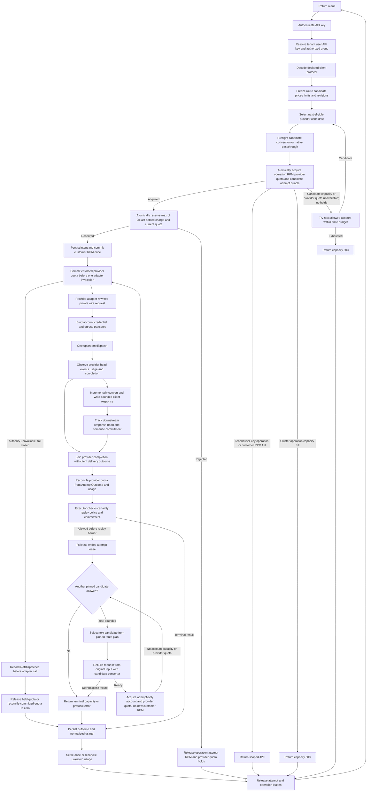

# Multi-user Identity and Request Admission Design

Status: implemented independent-customer identity and global/customer/user/key
admission, with additional target policies below. The backend supplies native
provider/protocol execution, model-key authority, provider account leases and
provider-cost budgets. USD wallets and internal financial transactions exist;
automatic execution precharge/settlement and subscriptions are not activated.
See [HTTP API contracts](API.md) and
[ADR 0022](adr/0022-aggregate-execution-admission.md) for the actual surface.
The customer workflow described here is an adaptation of that base, not a claim
that the removed implementation still exists. See [Product Domain and API Design](PRODUCT_DOMAIN_DESIGN.md)
for the customer/management API resources, object ownership, and product state machines.
The exact price resolution, `max(2 * latest settled charge, current request quote)`
precharge rule, wallet/entitlement transaction, and settlement recovery contract
are defined in [Billing and Pricing Design](BILLING_AND_PRICING_DESIGN.md).
The baseline adoption decision is [ADR 0015](adr/0015-imported-backend-baseline.md).

This document defines how multiple users and API keys share bounded gateway and
provider capacity without confusing request concurrency, request rate, provider
quota, and customer spend.

The target `user_group_policies` record is keyed by the exact tenant, user, and
authorized group. It requires a new appended migration; no imported migration
is changed or claimed to implement it. Authentication must load the optional
multiplier and RPM ceiling from that record. A user multiplier replaces the group multiplier;
it never compounds with it. The per-user group RPM cap is enforced in addition to
the aggregate group, user, and API-key caps. Missing overrides inherit the group
multiplier and add no per-user group RPM cap. Invalid stored override values reject
admission. The record and its management endpoint remain target capabilities;
API availability is tracked separately in the HTTP contract.

## 1. Identity and isolation

These identities have separate jobs and are never inferred from request headers,
workspace URLs, prompts, IP addresses, or provider model names.

| Identity | Meaning | Trust source |
| --- | --- | --- |
| `TenantId` | Hard data, authorization, continuation, usage, and billing isolation boundary. | Resolved from a verified credential or management session. |
| `UserId` | Independent customer principal within its internal partition; customer membership roles do not exist. | Verified API-key ownership record or authenticated customer session. |
| `ApiKeyId` | Revocable model-client credential owned by one user and tenant, with one authorized group and billing policy. | API-key verifier lookup. |
| `ProviderPrincipalId` | Real upstream quota/credential owner. Several gateway accounts or keys may share it. | Provider account configuration. |
| `AccountId` | One upstream credential binding and its egress/profile generation. | Scheduler and published configuration. |

For the current individual-user product, each customer user owns one tenant; this
does not imply organization membership or team sharing. Organizations and member
invitations are outside the product scope. A platform admin
session is separate from a customer's model API key and cannot be used as one.
Every query and mutation carries a verified tenant scope, and every API key is
checked for ownership, status, expiry, group entitlement, and billing source
before a model operation is admitted.

The immutable operation identity is:

```text
RequestPrincipal = {
  tenant_id,
  user_id,
  api_key_id,
  authorized_group_id
}
```

Management commands use a separate `ManagementPrincipal` resolved from an
administrator session. Do not put management actors on a model `RequestPrincipal`
or accept a model API key as a management session.

A management principal is not an implicit cross-tenant query scope. Customer
commands derive their tenant from the authenticated customer session. A platform
administrator may list or manage other tenants only through an explicitly
authorized platform operation whose target tenant is part of the command. Every
cross-tenant read or mutation records the actor, target tenant, action, and
reason in the audit trail. Tenant repositories require an explicit tenant scope;
platform-wide queries use separately named, permission-checked operations.

The authenticated execution context and existing `RoutingPlan` must pin these
identifiers and the authorization/config revision, but no additional copies of
key bytes. The `AttemptContext` inherits the operation identity
and binds one selected provider account and quota owner. All continuation state,
diagnostics, reservations, usage, and settlement are scoped by operation and
tenant. Verifier-only customer model-key storage is the target contract; the
imported `PlaintextClientApiKey` persistence must not be described as already
satisfying it. Provider credential storage and native recovery behavior remain
within the existing provider/host/store boundaries.

## 2. What the frontend currently exposes

The pages contain useful product requirements, but their forms and records are
preview data. The controls do not configure the backend or enforce limits.

| Frontend area | Visible controls/data | Design interpretation |
| --- | --- | --- |
| Users | Role/status, balance, user concurrency and RPM limits, user editing and recharge | Customer identity and user-wide hard limits. |
| User workspace | Dashboard, balance/usage summaries, request history and billing detail, channel status, subscriptions, orders, recharge, redemption, referrals and lottery previews | Customer-scoped read models and self-service commands. They require authenticated user identity; current records and actions remain local previews. |
| User API keys | Group, balance/subscription billing source, total quota, RPM, expiry, enable state, usage; local client snippets and CCS link | Per-key authorization, rate/spend ceiling and lifecycle. The fixture includes `concurrency`, but the editor does not let it be changed. |
| Groups | Account pool, group RPM, active/disabled and public/private, model mappings, multiplier, and per-user multiplier/RPM overrides; existing group price fields are replaced with complete model rate-card overrides | Entitlement and routing policy plus group aggregate rate cap and per-user group overrides. |
| Accounts | Provider/credential labels, group membership, status, weight, capacity/current-use count and quota windows | Scheduler candidate, per-account in-flight cap, health and provider-reported quota view. Capacity and current-use values are fixtures. |
| Channels | Provider/group bindings, model mapping and model allowlist; channel price rows and requested-versus-mapped billing basis are removed | Published routing only; provider procurement cost remains separate from customer retail pricing. |
| Gateway and model settings | Body/frame size, connection/first-response/idle/overall timeouts, retention, overload/rate cooldown, failure thresholds, stream action and Codex/client rules; model prices move to the global price book | Process/route safety policy, client eligibility and platform default retail tariffs. Local drafts do not change runtime behavior. |
| Subscriptions and usage | Plans and assignments, daily/weekly/monthly monetary quotas, expiry/reset schedule/timezone, usage and billing breakdowns | Customer entitlement, immutable purchased terms and scoped usage read models; values and history are synthetic. |
| Commerce | Recharge offers, CNY payment methods, orders, payment history, redemption codes, referral invitations/rebates/withdrawals | Order/payment/reward state machines and idempotent USD wallet mutations, with CNY quotes frozen per order. No customer commerce mutation is implemented on the imported base. |
| Platform configuration and content | Website identity; login/registration, terms, gifts and OAuth toggles; deployment SMTP/OAuth client configuration; payment/referral/audit settings, feature/page switches, announcements and lottery previews | Versioned website and identity policy, immutable consent and gifts, bounded deployment-configured notification delivery; other business workflows remain future scope. Browser drafts do not configure deployment secrets. |
| Operations and security | Active requests, throughput, logs/alerts, channel health, request diagnostics, security audit/authentication, proxies and backup settings/records | Operational/security read models and protected actions. Existing page fixtures must be connected to the corresponding imported APIs only after authorization and response contracts are verified. |

The imported execution service and provider registry are the working foundation.
Its existing model routes, management endpoints, continuation, retry and transport
behavior must be assessed against [API.md](API.md), rather than replaced by the
removed unary slice. URL-selected customer workspace state and `ovload-demo-`
values remain presentation only; they are not tenant authentication or proof of
a customer billing API.

Request deadlines, bounded waiting, provider/account leases and cancellation
retain their imported ownership. Customer financial reservations and their
supervised reconciliation worker must be added explicitly. A future financial
deadline schedules reconciliation; it never proves nonexecution or refunds on
expiry. Document and test actual configured bounds when that workflow is built.

## 3. Limit dimensions and scopes

Concurrency, rate, monetary quota, and resource bounds are separate controls.
One cannot stand in for another.

| Dimension | Measures | Applicable scopes | Acquire/release rule |
| --- | --- | --- | --- |
| Operation concurrency | Logical client operations currently able to produce work | Cluster, tenant, user, API key | Acquire once per admitted operation; retain through stream/session completion or terminal cancellation. Release once the operation can no longer produce upstream/downstream work. |
| Attempt concurrency | One active upstream dispatch | Provider quota owner and account; a group's available pool is the union of its member-account capacities | Acquire for each dispatch attempt; release only when that attempt has ended or its bounded cancellation grace has elapsed. The frontend has no separate group-wide concurrency field. |
| Session concurrency | Long-lived WebSocket/live connections | Tenant, user, API key, provider account | Separate from exchange concurrency. A session holds a session lease; each in-flight exchange follows the operation/attempt rules. |
| Request rate (RPM) | Admitted logical requests per time window | User, API key, group aggregate, optional user-within-group override | Consume once per admitted operation, not once per retry. Independent scopes are enforced together. |
| Provider rate/quota | Actual upstream requests/tokens or provider-defined units | Shared provider principal, account, model/endpoint quota | Reserve locally enforced request units before each attempt; reconcile provider headers and usage after dispatch. Shared credentials use the same quota owner. |
| Spend/entitlement | Fixed-point retail charge or allowed spend | Wallet, selected subscription daily/weekly/monthly windows, API-key spend cap | Reserve before dispatch; settle once by operation ID from authoritative usage; release unused reservation or reconcile unknown usage. |
| Resource bounds | Bytes, frames/events, buffers, connections, CPU/blocking work and deadlines | Process, connection, operation, provider pool | Enforce independently of commercial limits; reject before unbounded allocation or work. |

For any one concurrency dimension, the effective cap is the minimum of all
applicable configured hard caps. The target customer API represents an unlimited
scope explicitly rather than overloading zero. The imported `RateLimits` uses
zero for unlimited; translation at the customer boundary must preserve that
existing execution meaning. Limits belonging to distinct
scopes are all enforced, not added together. In particular, user and API-key
limits cannot bypass global or tenant operation limits, RPM buckets, or the
provider-principal/account capacity available through the authorized group. The
current frontend exposes no separate tenant or group-wide attempt-concurrency
setting. In the current individual-user product, one user owns one tenant, so
tenant isolation and user limits do not imply organization/team sharing.

RPM is not computed by taking a minimum across unrelated buckets. The operation
must reserve one token from every applicable bucket. Recommended semantics are
fixed token buckets with a documented burst capacity and server-clock refill.
The group RPM is an aggregate cap; a user-specific group RPM is an additional
ceiling for that user in that group and cannot raise the aggregate group cap.
User, key, and per-user group caps are each ceilings. Provider quotas use
provider-defined windows and units, not the customer RPM bucket by assumption.
A locally enforced provider RPM limit reserves one unit per attempt before
dispatch. A TPM limit reserves a defensible upper bound when the contract
supports it, then reconciles to authoritative usage; without such a bound it is
advisory and provider throttling is handled as an upstream failure. The UI's
zero value for some key limits must
be translated to an explicit `None`/unlimited choice before a management API is
published; zero must not be overloaded as both disabled and unlimited.

Concurrency is counted over the full work lifetime, not just until the first
response byte. SSE holds operation capacity through stream termination. A
WebSocket session has its own connection lease and bounded message queue; the
protocol contract specifies whether exchanges are serial or multiplexed. Keepalive
frames do not consume request RPM or create billable operations. Connection-pool
slots are a transport resource and are not a proxy for API operation limits.

## 4. Atomic admission and execution lifecycle

Admission and billing coordination are engine workflows. Integrate their target
semantics into `DefaultExecutionService`, `AttemptCoordinator` and
`DefaultExecutionSession` through narrow contracts. Preserve the provider
registry, native account selection/preparation, profiles, credential leases and
transport recovery. On retry, retain the logical operation's customer RPM and
financial reservation; only the next attempt's capacity/provider quota is new.
Concrete store adapters implement atomic Redis/SQL operations; customer money
must not be calculated or reserved inside provider adapters.

Keep abstractions at these boundaries:

| Role | Owns | Implementation boundary |
| --- | --- | --- |
| `RequestPrincipal` | Verified tenant, user, API-key and authorized-group identifiers | Core value object; contains no credentials or storage state. |
| `EffectiveLimitPolicy` | Frozen applicable concurrency, rate and spend limits with source revisions | Core value object produced from published configuration; explicit optional limits, no zero sentinels. |
| `AdmissionCoordinator` | Policy resolution, admission ordering, compensation and typed rejection outcomes | Application orchestration; does not implement Redis scripts or SQL. |
| `AdmissionLeaseStore` | Atomic first-attempt bundle across operation capacity, customer RPM holds, locally enforced provider quota holds, and selected provider/account capacity; attempt-only acquisition for retries; renewal and fenced release | Infrastructure capability backed by a shared distributed authority. |
| `BillingReservationRepository` | Idempotent wallet/subscription reserve, settle, release and reconciliation | PostgreSQL infrastructure transaction; see the fixed-point and idempotency contract in [Billing and Pricing Design](BILLING_AND_PRICING_DESIGN.md). |
| Existing execution service/coordinator and provider preparation | Operation retry/replay lifecycle, constrained candidate selection and attempt leases | Extend the existing core/provider contracts without replacing native provider handling or introducing provider-owned customer billing. |

These are target roles, not claims that the named modules or multi-scope atomic
bundle already exist. The imported cold `ProviderStream` contract supplies a
pre-send boundary: validate the frozen usage bounds and persist required financial
dispatch intent before its first poll. Observation-only attempt/send-state writes
are best effort and cannot replace that barrier. Runtime supplies local bounded
execution permits and cancellation; it does not own tenant or account policy.



Admission steps:

1. Authenticate the model API key; derive tenant, user, key, authorized group and
   billing source from trusted records. Reject disabled, expired, revoked, or
   unauthorized identities before routing.
2. Validate bounded input and protocol capability. Resolve and pin route,
   selected group, conversion, pricing, limits and configuration revisions. Do
   not hold a customer concurrency lease while parsing or waiting for upstream
   capacity; bound those preliminary steps with process-local runtime permits.
3. Build a bounded ordered account-candidate list. The scheduler considers
   current entitlement, account health, credential revocation, shared provider
   quota owner, region/egress, and account capacity. It never dispatches.
4. For each candidate within the finite scheduling budget, atomically try one
   initial-admission bundle keyed by the operation ID and candidate. It includes
   all applicable cluster/tenant/user/key operation limits, the user/key/group
   RPM reservations, any locally enforced provider request quota, and this
   candidate's provider-principal/account attempt capacity. If an operation or
   customer RPM limit is full, stop with its scoped rejection. If candidate
   capacity or provider quota is unavailable, the transaction leaves no holds
   or rate tokens behind and the scheduler tries the next candidate. Do not queue while
   probing candidates or create an unbounded per-request or per-tenant queue.
5. Resolve the exact policy in [Billing and Pricing Design](BILLING_AND_PRICING_DESIGN.md)
   and reserve `max(2 * latest settled charge, current request quote)` from the
   selected wallet or subscription allowance in one PostgreSQL transaction,
   using fixed-point units and the operation ID. A balance key never
   silently falls back to a subscription, nor the reverse. If reservation fails,
   release the operation and attempt leases and release held customer RPM and
   provider-quota reservations.
6. Persist operation and attempt dispatch intent before network send. At this
   admission commit point, commit the customer RPM reservation. If intent
   persistence fails, release held leases and rate/quota reservations. Once
   committed, the logical request counts once even if dispatch is later
    uncertain. Commit each locally enforced provider-quota reservation
    idempotently immediately before invoking the one-attempt provider adapter;
    do not invoke it unless both commits are confirmed. A timeout is resolved by
   retrying the same operation/attempt keys. If a failure is proven before
   dispatch authorization, release the held provider quota. Once authorized,
   reconcile it against the attempt outcome: `NotDispatched` consumes zero,
   known dispatch uses the provider's request/usage evidence, and uncertain
   execution conservatively retains the reserved amount until evidence arrives.
7. Build an immutable `AttemptContext` with the exact provider account, principal,
   egress/profile generations and lease fence. The adapter performs at most one
   dispatch. On retry, retain operation capacity, the committed customer RPM
   count, and the billing reservation, but release the completed attempt lease.
   Select the next pinned candidate and rebuild its provider-bound request from
   the original bounded inbound request with that candidate's frozen converter;
   never convert the previous provider-bound payload. Then acquire only the new
   account/principal attempt lease and any provider quota reservation. Each
   upstream retry gets a distinct attempt ID and provider quota reservation, but
   does not consume customer RPM again.
8. Keep operation capacity through the response/session lifecycle. Renew active
   leases with owner fencing. On disconnect or lease-renewal failure, cancel
   transport work and await its bounded termination. A lost lease or uncertain
   dispatch is not proof of non-execution and cannot bypass the replay barrier.
9. Persist normalized provider usage and attempt procurement evidence. Settle
   the customer once by operation ID from the pinned retail price and authoritative
   usage, release only the unused reservation, then release each lease
   idempotently. Unknown dispatch or incomplete usage keeps its hold for
   reconciliation; a timeout is never proof that no charge is due. A crash
   reconciler resolves abandoned operation, reservation and lease states;
   dashboards/outbox work does not hold request concurrency.

Redis capacity and PostgreSQL billing cannot share one transaction. Treat
admission as an idempotent saga. Customer RPM holds are keyed by operation ID
and customer bucket, and move through `Held`, `Committed`, and `Released` states:
only held customer RPM can be refunded, and a committed logical request counts
once. Provider quota holds are per attempt and keyed by operation ID, attempt
ID, provider-principal/quota dimension, and window. They use idempotent
`Held`, `Committed`, and `Reconciled` transitions, with `Held -> Released` for
a pre-dispatch failure. A `NotDispatched` outcome reconciles a committed hold to
zero; a known dispatch reconciles to provider request/token usage, returning
only unused upper-bound reservation. Unknown execution retains the reserved
amount until evidence arrives. A reservation deadline only schedules
reconciliation; it never releases a financial hold without durable proof that
the operation was not dispatched or that no charge is due. Durable
operation/attempt state drives reconciliation after a crash. Reject new
constrained requests when the lease authority is unavailable.
Never fall back to per-process counters for a cluster-wide limit. Lease lifetime
must account for the absolute request deadline plus a bounded cancellation grace;
expiry based only on a short heartbeat can prematurely free an account slot while
the provider may still be executing.

An atomic first-attempt Redis bundle across cluster, tenant, user, key,
provider-principal and account scopes requires those keys to share a Redis
Cluster hash slot (or an equivalent transactional admission authority). Keeping
one admission hash slot preserves exact all-or-none limits but creates a
potential hot shard. The initial deployment must measure that contention under
representative multi-tenant load; it must not split the global limit across
independent slots and still claim an exact cluster-wide cap. A different
partitioning design needs an explicit, reviewed consistency trade-off.

## 5. Backpressure, errors, and fairness

Customer forwarding must use bounded admission. It must not silently queue
requests in an unbounded Tokio task pool. A local runtime permit
protects CPU, buffers and connections; a distributed lease enforces shared
commercial and provider capacity. These are separate limits. Existing
`ConcurrencyWaitQueue` bounds and FIFO order apply within one replica; they do
not establish a cluster-wide queue size or fairness guarantee. Preserve shared
Redis grants, and document local queue limits explicitly or implement a shared
authority before promising global queue semantics.

Use stable client errors: invalid/revoked key is 401/403; operation-concurrency
and RPM exhaustion are 429 with a stable reason and `Retry-After` when known.
Wallet, subscription allowance/window, and API-key spend-cap exhaustion are 402
with the resource-specific billing reason defined in
[Billing and Pricing Design](BILLING_AND_PRICING_DESIGN.md). Cluster capacity,
provider quota/account attempt capacity, and unavailable shared admission are
503 with a bounded retry hint; shared-admission failure is fail-closed. Do not
expose another tenant, account ID, provider secret, or raw upstream quota
response. Any 429/402/503 admission rejection is recorded as not dispatched.

Configured per-tenant and per-user concurrency ceilings bound one identity's
maximum share; an omitted ceiling provides no isolation guarantee, and ceilings
alone do not guarantee progress when the cluster is saturated. A multi-user
deployment must publish a finite tenant default/hard maximum or use a bounded
fair scheduler with tenant-aware
round-robin/weights, per-tenant queue caps, cancellation removal and deadline
expiry. Queue entries must hold no operation/account leases or financial
reservations. Do not infer priority from the frontend's `fast` setting until its
entitlement, capacity share and pricing semantics are specified.

## 6. Frontend-to-domain contract decisions

Before wiring existing controls to APIs, publish these semantics in one
configuration revision:

- User concurrency and RPM are hard ceilings for all of that user's model keys.
- API-key concurrency and RPM are optional additional ceilings. Add concurrency
  to the key editor if it remains part of the product; the current fixture value
  is not an editable control.
- Group RPM is an aggregate logical-request ceiling. A per-user group RPM
  override is a further user-specific ceiling; the group aggregate remains in
  force. A per-user rate override replaces the group's retail multiplier only
  for that user/group pair.
- Account capacity is an attempt ceiling. Account weight affects selection only
  among eligible accounts with capacity; it never increases capacity.
- The selected API-key billing mode is authoritative. Wallet/subscription
  allowance, key spend quota and subscription daily/weekly/monthly windows must
  all pass before dispatch. All monetary amounts use the backend's fixed-point
  USD `Decimal` contract at scale 10 (`numeric(20,10)` in PostgreSQL); CNY is
  only the payment currency, with its conversion quote frozen on the order.
- Time-window price schedules use their configured IANA timezone. Quota reset
  windows use the purchased plan's frozen timezone/reset rule and are stored as
  UTC boundaries. Publish validation rejects overlap or ambiguous model/rate
  rules.
- Fast/live switches, account reset actions, and channel monitoring switches
  remain inert until their runtime meaning and authorization are defined; they
  cannot bypass identity, concurrency, pricing, or provider capability checks.

Configuration edits use compare-and-swap revisions and audit records. In-flight
operations pin their policy and price revision; disable/revoke checks remain live
before account credential attachment and dispatch.

## 7. Validation gates

Before model forwarding is exposed, test at minimum:

- Two users and two API keys concurrently cannot read, spend, cancel, continue,
  or export one another's data; an API key cannot escape its tenant/group.
- Concurrent acquisition at every scope never exceeds its configured cap across
  multiple gateway replicas; a shared provider principal is counted once even
  when represented by several account records.
- Rate windows use server time, enforce aggregate group and per-user overrides,
  consume once per logical operation, and do not turn retries into customer RPM.
- API-key, wallet, subscription daily/weekly/monthly, and price reservations are
  idempotent under races, cancellation, duplicate completion and crash recovery.
- SSE/WebSocket cancellation, buffer backpressure, deadline expiry and lease
  renewal loss do not leak permits or prematurely free an active account slot.
- Redis/PG failure, expired leases, stale fencing tokens, account switching,
  uncertain dispatch and settlement reconciliation fail closed without duplicate
  customer charges or unsafe replay.
- Load tests measure admission latency, lease-store contention, per-scope hot
  keys, memory per stream, saturation responses and recovery across replicas.

## References

- [Architecture](ARCHITECTURE.md)
- [Gateway Framework](GATEWAY_FRAMEWORK.md)
- [Protocol Conversion and Provider Adapter Design](PROTOCOL_PROVIDER_ADAPTERS.md)
- [Multi-provider Support](MULTI_PROVIDER_SUPPORT.md)
- [API Contracts](API.md)
