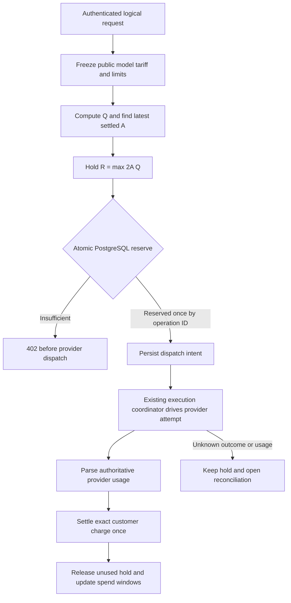
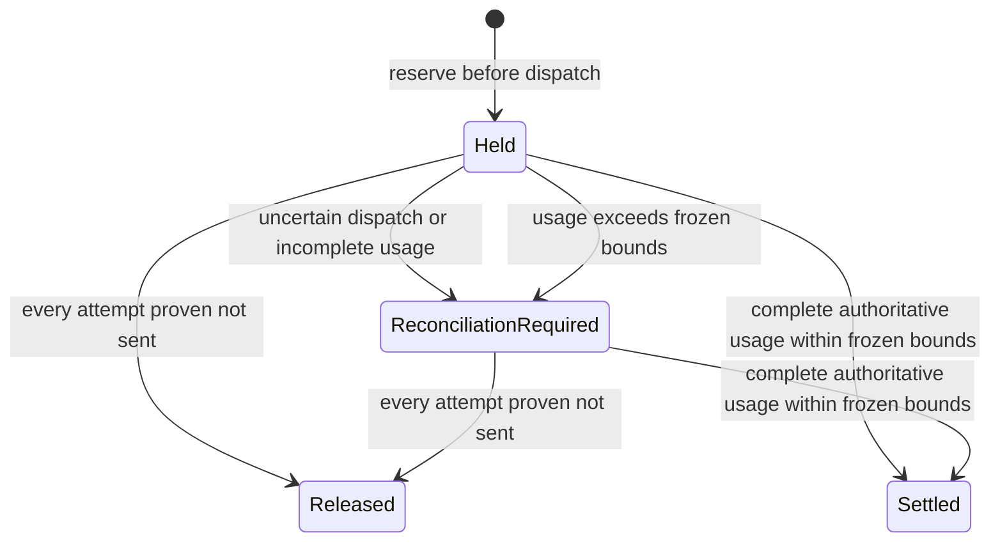

# Billing and Pricing Design

Status: historical design for the explicit retail reservation API. The current
model execution, subscription, redemption and wallet behavior is documented in
[Commerce](COMMERCE.md). Execution now charges the frozen gateway model price
with group pricing, through `ClientBudgetPort`; it does not call the separate
published-retail-catalog reservation API described below. The latest product
requirement is subscription-first funding with wallet fallback. The remaining
sections describe the reservation subsystem's contract, not a claim that model
execution has a provider-proven precharge ceiling.

The first customer-billing slice must support a complete context band covering
`[0, unbounded)` for the selected model, group, service tier, and explicit
time-band ID. Context-tiered cards remain unavailable until their actual-usage
settlement contract is implemented and verified. A pinned published or retired
revision is usable only after its effective timestamp. A time-band name does not
imply a schedule; admission must resolve an explicit supported band and tier.

Text quote construction requires a positive provider-verified input-token ceiling
and an enforced output-token cap. Raw UTF-8 byte counts are not token proofs. The
caller checks the transformed request against the provider contract before
dispatch. Each disjoint input/cache category receives that ceiling for a
conservative quote; authoritative provider counters determine settlement.
Uncertain or invalid usage must retain the hold and open reconciliation. A
pre-dispatch release must lock the durable operation and attempts and succeed
only when every attempt is proven not sent (or there are no attempts). It must
atomically close the operation so later attempt insertion is rejected. Client
disconnect is never release proof.

## 1. Goals and boundaries

Billing must give the customer one explainable price regardless of which
eligible provider account serves a request. It must reserve funds before any
provider dispatch, remain correct across concurrent gateway replicas, charge
from authoritative usage once, and retain enough immutable evidence to
reconcile crashes or disputed usage.

The customer charge and provider procurement cost are separate facts:

| Fact | Meaning | Visibility |
| --- | --- | --- |
| Retail charge | Amount charged to the selected wallet or subscription, calculated from the published customer tariff and billable usage. | Customer and authorized billing operators |
| Procurement cost | Amount billed by the provider, in the provider's native currency and from its own price revision. | Authorized finance and platform operators only |
| Reservation | Temporary hold that reduces available funds before dispatch. It is not a posted charge or revenue. | Customer and authorized billing operators |

No protocol converter, provider adapter, account selector, or runtime worker
calculates a retail charge. Provider adapters report normalized provider-native
usage; the application billing workflow supplies the frozen retail price and
performs settlement.

## 2. Money and price units

- **USD** is the customer billing currency for retail tariffs, wallet balances,
  subscription allowances, reservations, charges, and rewards. There is no
  internal credit currency or USD-to-credit conversion layer. Recharge payments
  may use CNY; the order freezes its CNY-per-USD quote, fee, bonus, and expiry.
  A recharge does not change a usage tariff.
- **Provider procurement cost and retail price remain separate USD facts.**
  Sharing a currency never makes the provider's cost the customer's charge.
  Preserve native provider currency when it differs; any procurement reporting
  conversion records its own FX source, rate, and timestamp and cannot reprice
  customer usage.
- **USD amounts and tariff rates** reuse the imported `metering::Decimal`
  representation: nonnegative checked `u128` scaled by `10^10`, matching
  PostgreSQL `numeric(20,10)`. `1 USD = 10,000,000,000` scaled units; the maximum
  is `9999999999.9999999999 USD`. Accept decimal strings with at most ten
  fractional digits and reject overflow or excess precision. Token rates name
  USD per one million tokens, for example `1.2500000000 USD / 1M input tokens`;
  per-request and image/search/audio rates name their explicit denominator.
- **Ledger direction** is an explicit credit/debit enum plus a nonnegative USD
  `Decimal` amount, not a signed integer or a negative `Decimal`. Balances,
  holds, receipts, grants and ledger amounts share the same ten-place scale.
  Database direction/amount constraints and checked arithmetic must prohibit
  negative availability or a debit beyond available funds. The existing
  saturating subtraction helper is not an affordability or settlement check.
- **Rounding** occurs once after summing exact component and multiplier
  calculations: customer settlement uses round-half-to-even at
  `0.0000000001 USD`; the quote and reservation round upward to that unit. Multipliers use
  integer basis points (`10,000 = 1.0000x`). Use checked integer/rational
  intermediates, reduce denominators where necessary, and validate the final
  `Decimal` range. Truncating division is not a substitute for these rounding
  rules. Negative prices, missing units and any arithmetic overflow reject the
  operation; they never clamp to zero or a maximum.
- **CNY payment amounts** use integer fen. A frozen positive CNY-per-USD rate
  is a decimal string with an explicit direction, revision and expiry. Recharge
  grants round down to `0.0000000001 USD`; CNY fees round up to a whole fen.
  Refunds use the original order's payment amount and frozen conversion terms,
  never a current exchange rate. No binary floating-point value crosses a
  billing boundary.

API USD money fields are canonical decimal strings with `currency: "USD"` and
`scale: 10`; insignificant trailing zeroes may be omitted without changing that
scale. CNY-fen fields are integer strings naming `unit: "fen"`, with
`currency: "CNY"` and `scale: 2`.
Clients never submit an authoritative computed charge. Rates include a named denominator
(`per_1m_tokens`, `per_image`, `per_search_call`, `per_audio_second`, or another
published unit). A bare number such as `1.25` is not a money contract.

## 3. Authoritative tariff and resolution

### Retail price ownership

The published `RetailPriceBookRevision` owns the platform default tariff keyed
by the **requested public model ID**. A `GroupPriceOverride` may replace that
model's complete rate card for one group. Partial field inheritance is
prohibited: publish either a complete supported rate card or no override. If
there is no group override, use the complete platform rate card. A missing
required tariff rejects admission with `price_unavailable`; it never becomes a
free request.

The billable model is always the caller's requested public model. A provider's
mapped model, endpoint, account, or failover candidate never changes the retail
tariff. The channel owns route eligibility and model mapping only. There is one
customer-price path: no requested-versus-mapped billing switch, channel retail
price table, account-price switch, hidden fallback tariff, or legacy alias.

For each request, resolve the complete rate card in this order:

1. Resolve the requested public model and the API key's authorized group.
2. Select that group's complete model override, otherwise the platform default
   for the requested model.
3. Select exactly one published service-tier rate card, context-length band,
   and time-window band when applicable. These selectors choose a rate card;
   they do not stack unbounded multipliers. Time windows use their configured
   IANA timezone and the admission timestamp in UTC.
4. Resolve `effective_multiplier_bps` as the user's override for this
   user/group pair when present, otherwise the group's multiplier. The user
   override replaces the group multiplier; the two are never multiplied
   together. API keys have no independent multiplier.
5. Freeze the public model, selected tariff revision and rows, group and user
   multiplier facts, service tier, time band, context band, billing source,
   route revision, and admission timestamp in the operation's billing snapshot.

An in-flight operation keeps this snapshot through retries and settlement.
Publishing a new price affects only newly admitted operations. A failover to a
different provider account inside the operation uses the same retail tariff.

### Billable dimensions

Rates are component-based and usage quantities must be disjoint:

| Component | Unit and rule |
| --- | --- |
| Uncached input | Input tokens not included in any cache-read or cache-write counter, per 1M tokens. |
| Cache read | Cache-hit/read tokens, per 1M tokens. |
| Cache write | Cache creation tokens, per 1M tokens; separate TTL rows such as 5-minute and 1-hour writes when provider billing distinguishes them. |
| Output | Billable output tokens per 1M. Reasoning tokens are not added a second time when already included in output. |
| Image input/output | Explicit count or published size/quality class; never infer an image price from text-token rates. |
| Audio input/output | Explicit provider-normalized token or second unit with a matching tariff. |
| Search/tool/service fee | Explicit billable call count and unit price. Tool arguments or returned text are not a second fee unless the provider usage contract reports them as billable. |
| Context/time/service tier | Selects a complete applicable rate card. No implicit surcharge stacking. |

Every accepted provider capability must identify its billable dimensions and a
complete tariff before it can be published for customer traffic. A response
with an unknown billable dimension or incomplete authoritative usage cannot be
silently priced as zero; the reservation stays held and the operation enters
reconciliation.

### Formula and price preview

For dimension `d`, `q[d]` is the disjoint billable quantity and `p[d]` is the
selected tariff in USD per its declared unit. The customer charge is:

```text
base_usd = sum(q[d] * p[d] / unit_scale[d]) + sum(fixed_fees)
exact_charge_usd = base_usd * effective_multiplier_bps / 10,000
charge_scaled = round_half_even(exact_charge_usd * 10,000,000,000)
charge_usd = Decimal::from_scaled(charge_scaled)
```

The calculator retains exact integer/rational intermediates and rounds only the
final total. A price preview must show each quantity, unit rate, component
subtotal, selected band, multiplier source/value, final USD estimate, and
tariff revision. Preview is informative; the server's frozen quote is
authoritative.

Example (illustrative, not a live model quotation):

```text
Requested public model: example-model
Uncached input:     800 * 1.2500000000 USD / 1M = 0.0010000000 USD
Cache read:         200 * 0.1250000000 USD / 1M = 0.0000250000 USD
Output:            100 * 10.0000000000 USD / 1M = 0.0010000000 USD
Base:                                                0.0020250000 USD
Group multiplier: 1.5000x
User override: 2.0000x, replacing group multiplier
Settled customer charge:                             0.0040500000 USD
```

The normalized usage receipt, wallet debit, subscription usage, API-key spend,
and customer usage view all use the same final `charge_usd`. Procurement
cost is a separate record and can never be substituted into one of these
customer-facing totals.

## 4. Precharge policy

Precharge is a balance reservation, not an immediate posted debit. It reduces
the source's available amount before dispatch. After authoritative usage is
known, settlement posts one actual charge and releases the unused hold. This
avoids a debit-then-refund ledger trail for every successful request.

### Amount

For an operation, let:

- `A` be the latest positive, fully settled **customer charge** for the same
  tenant, API key, billing source, authorized group, requested public model,
  and service tier. It may have used an older tariff revision; it is a sizing
  signal only, never the current price.
- `Q` be the current request's conservative maximum-charge quote calculated
  from the frozen tariff and enforced per-request bounds for input, output,
  image/audio/search units, context, and tools.
- `R` be the requested hold.

```text
R = max(2 * A, Q)
```

If there is no prior settled charge, `A = 0`, so the first request reserves
`Q`. A pending, failed, released, estimated, or unreconciled charge is never a
history input. If `R` exceeds the selected billing source or any applicable
API-key/subscription spend window, reject with `402 insufficient_funds` before
dispatch. Never clip a hold to the remaining amount and send a partially funded
request.

Admission returns a typed, stable reason scoped to the limiting resource:
`insufficient_funds` for a wallet, `subscription_allowance_exceeded` for an
entitlement/window, and `api_key_spend_limit_exceeded` for a key cap. These are
all HTTP 402 because no part of the request is admitted or dispatched. RPM and
concurrency exhaustion remain separate 429/503 admission errors. Balance and
allowance details are returned only to the owning principal or an authorized
operator.

`Q` is only valid when admission can bound every billable dimension. The
accepted request limits and token/media bounds are pinned in the operation.
Token bounds use the exact tokenizer revision for the requested public model or
a provider-verified conservative upper bound for every eligible mapped model;
the transformed request is checked against the bound before dispatch. Image,
audio, search, and tool counts have explicit request limits. If the gateway
cannot calculate and enforce a bound for a requested capability, it rejects
before dispatch; it does not reserve zero. This makes `2 * A` the adaptive
minimum while protecting a large first/new request from a small prior charge.

Example: if the latest settled charge is `0.0040500000 USD` and the current
quote is `0.0064000000 USD`, the hold is `max(0.0081000000, 0.0064000000)` =
`0.0081000000 USD`. With no prior charge, the hold is `0.0064000000 USD`.

### Atomicity and concurrent users

The internal wallet-only transaction boundary is implemented as specified in
[ADR 0020](adr/0020-retail-funds-transactions.md), without activating execution.
It freezes the group's persisted integer basis-point multiplier, enforces current sealed price selection and
thirty-minute database expiry, and admits another dispatch intent only after
every prior attempt is proven not sent. Public callers cannot assert bounds or
usage through HTTP. Subscription windows and customer-specific multiplier
configuration remain targets. A strict bound violation retains funds for
reconciliation rather than widening the saved proof or adding a speculative
extension path; with valid frozen bounds, actual charge is at most `Q <= R`.

PostgreSQL is authoritative for wallets, subscriptions, reservations, and
settlement. Redis is not a financial source of truth. Wallet mode holds the
amount against wallet availability. Subscription mode holds it against the
entitlement's remaining included USD quota and every applicable daily, weekly,
and monthly window. Each configured API-key spend cap is another ceiling and
receives the same hold. The hold must fit every applicable ceiling; available
spend is the minimum remaining allowance among them. The API key's selected
source is immutable, with no wallet/subscription fallback.

One transaction locks the selected source and all applicable spend-window rows
in stable ID order, reads the latest eligible settled `A`, computes checked `R`
from the frozen `Q`, calculates remaining allowance after existing holds, and
inserts one reservation with a unique `operation_id`. A conditional update or
row lock prevents two replicas from reserving the same funds. Tenant scope is
part of every query and foreign key.



Admission acquires bounded Redis capacity/RPM leases before the PostgreSQL
reservation and records dispatch intent before sending bytes. If reservation or
intent persistence fails, it compensates the leases and does not dispatch.
Retries within one logical operation reuse its billing reservation; provider
attempts never reserve customer money independently. Duplicate completion is
idempotent by `operation_id`.

## 5. Settlement and recovery

The implemented internal wallet lifecycle follows the strict frozen-bound
contract in [ADR 0020](adr/0020-retail-funds-transactions.md). Automatic execution
charging and subscription/spend-window effects remain separate integration work.



- Before dispatch failure with durable proof no provider bytes were sent releases
  the complete hold. A provider rejection with a known billable fee settles that
  fee; it does not automatically become free because the HTTP status is an
  error.
- Complete authoritative usage requires exactly one sent attempt and no
  unresolved attempts. Within the frozen bounds, one PostgreSQL transaction
  writes the immutable usage receipt and canonical billing event, posts one
  positive USD wallet debit, releases the unused hold, and marks the reservation
  `Settled`. A zero charge still creates a receipt and settled operation without
  a ledger debit. Future subscription mode must write a quota consumption event
  instead of a wallet debit and apply the final amount to applicable spend caps.
- Usage exceeding any frozen bound is a contract violation. Retain the original
  hold and mark `ReconciliationRequired`, even if its calculated charge would
  fit the held amount. With valid bounds and the frozen tariff, the charge is at
  most `Q <= R`; the current lifecycle neither widens those bounds nor extends
  the hold. Later completion requires resolved dispatch evidence and complete
  authoritative usage within the original bounds, or proof of nonexecution.
- Timeout, disconnect, process crash, or missing final usage is not evidence of
  nonexecution. Keep the hold and reconcile against provider evidence. A
  reservation deadline schedules reconciliation but never releases funds by
  itself. Only proof of nonexecution or a resolved authoritative charge permits
  release/settlement.
- Corrections are linked ledger entries; the original receipt, settlement, and
  provider evidence remain immutable. Replaying the same operation ID returns
  its durable outcome and cannot add a second debit.

## 6. Domain model and Rust ownership

Use explicit types and behavior at the actual billing boundary; do not add
generic `MoneyManager`, pass-through traits, or a second price path. The billing
types below distinguish the implemented pure/admin boundary from remaining
execution additions. Existing execution and provider behavior is the integration
base, not code to replace with the removed implementation.

| Type / owner | Contract |
| --- | --- |
| Core `metering::{Decimal, Money, CurrencyCode}` and proposed billing values | Reuse the existing ten-place USD amount representation. Add explicit retail rate units, credit/debit direction, CNY-fen payment values, and multiplier rules where used; no alternate credit amount type. Pure calculations contain no SQL, HTTP, async runtime, or provider implementation. |
| Implemented `UsageDimension`, `RateDenominator`, `BillableUsage`, `BillableUsageBounds` | Portable dimension/unit vocabulary and disjoint quantities. Bound construction requires verified input evidence; execution has not supplied that evidence yet. |
| Implemented `RetailPriceBook`, `RetailPriceCard`, `RetailRateCard`, `RetailPricePreview` | Bounded complete documents, exact group/model/tier selection, canonical digest and rational quote/charge calculations for the complete unbanded card. Sample preview rounds only the total and is not an execution bound. |
| Implemented admin `RetailPricingService` and `RetailPricingStore` | Reasoned/idempotent commands and bounded read/validate/preview; PostgreSQL owns live platform authorization, catalog/revision locking and immutable publication. |
| `PrechargePolicy` | Pure checked `max(2 * latest_settled_charge, request_quote)` calculation; the quote and resulting hold round upward to `0.0000000001 USD`. |
| `BillingReservation`, `UsageReceipt`, `LedgerEntry` | Domain states and invariants; settlement is unique by operation ID and immutable evidence is append-only. |
| `DefaultExecutionService::prepare_execution_start` | Integrate one durable reservation per logical operation after bounded admission. Its queue affordability precheck must remain read-only; it must not reserve on each wait/retry. Carry the frozen billing context through the start guard and execution session. |
| `ResponseExecutionSession::{prepare_attempt,pull}` | Preserve provider selection, request profiles, retries and cold streams. Validate enforced quote bounds and persist required dispatch intent before first polling the prepared provider stream. Best-effort observation writes cannot serve as this financial barrier. |
| `DefaultExecutionSession::settle_if_finalized` | Complete the durable billing workflow with authoritative usage, dispatch certainty and the frozen tariff. Existing `budget_charge()` sums provider USD costs and treats missing costs as zero; it is not a customer charge. |
| `ClientAdmissionPort` and Redis adapter | Retain existing shared per-key capacity/RPM and extend the required customer scopes with explicit acquisition, commit, renewal and release semantics. Admission does not post customer charges. |
| Store crate PostgreSQL billing adapter | Implement source locking, reserve/settle transactions, immutable price reads, append-only records and durable reconciliation. PostgreSQL is the financial authority. |
| API/admin crates and application composition | Implemented wallet/price/history management translates requests without formulas or account selection; supervised expiry reconciliation is registered. Execution financial outcomes remain to be connected after provider verification. |
| Implemented `RetailBillingPort` and `PgRetailBillingStore` | Internal durable reserve/dispatch/evidence/completion, one potentially executed attempt, strict frozen bounds and idempotent financial outcomes. Not yet called by model execution. A separate supervised expiry worker opens cases without refunding funds. The existing `ClientBudgetPort` remains a separate provider-cost budget contract. |

Portable rules extend the existing core crate under `src/crates/core/src`;
PostgreSQL persistence belongs under `src/crates/store/src/postgres`. Provider
USD metering, native usage parsing, protocol conversion, credential ownership,
and transport handling remain in their existing boundaries. Add concrete modules
only with implemented callers. This follows
[backend structure](BACKEND_STRUCTURE.md) and
[naming and abstraction rules](adr/0008-naming-and-abstractions.md).

## 7. Durable records and constraints

The following logical records are product contracts, not all imported tables.
Migrations 0037..0039 implement the wallet/price/reservation/evidence storage;
subscription windows and the execution callers remain absent. Names follow
local SQL naming, but their ownership and uniqueness
rules are fixed. Every USD amount/rate uses `numeric(20,10)` and the same checked
`Decimal` range; quantities, rate denominators, and credit/debit direction are
stored separately:

| Record | Required facts and constraints |
| --- | --- |
| `retail_price_book_revisions` | Monotonic revision, draft/published/retired state, author, publish time, effective time, checksum. Published rows are immutable. |
| `retail_price_catalog`, `retail_price_commands` | Implemented singleton current pointer/generation and append-only principal/action/key command receipts. Creation advances the catalog; publication/retirement check catalog plus row version and commit audit atomically. |
| `retail_rate_cards` | Revision, public model, optional group override, service tier, context band, time-window selector, dimension, denominator, decimal `rate_usd_per_unit`, and explicit billable/free applicability. A unique constraint prevents two active rows resolving the same selector. Group override is complete. |
| `provider_cost_price_revisions` | Provider service/model, native currency and explicit scale, dimension/unit, native rate, effective revision, and source. USD rates use the existing provider metering precision and `Decimal` representation; native non-USD evidence retains its currency. Internal-only read policy. |
| `wallet_accounts` | Tenant/user owner, settled USD balance projection, row version, and timestamps. Projection rebuilds from the ledger. |
| `subscription_quota_windows` | Tenant and entitlement, frozen plan revision, total/included allowance, period boundaries, settled usage, active holds, reset timezone/rule snapshot, and row version. Every window is independently enforced. |
| `api_key_spend_windows` | Tenant and API key, configured cap, period boundary, settled spend, active holds, and row version. Each cap is enforced in addition to the wallet or subscription allowance. |
| `billing_reservations` | Unique operation ID, tenant/user/API-key/source/group, requested public model, price revision, prior actual amount, `Q`, `R`, held/settled/released amounts, multiplier snapshot, enforced bounds, state, and reconciliation deadline. |
| `billing_reservation_events` | Append-only reserve/settle/release/reconcile facts, actor/cause, amount, timestamp, and idempotency key. |
| `usage_receipts` | Unique operation ID, dispatch certainty, normalized complete/unknown usage, canonical retail amount, procurement amount and native currency, all price/config revisions, and timestamps. Customer reads omit provider credentials/account identity and procurement facts. |
| `usage_components` | Immutable dimension, quantity/unit, retail unit rate and charge, provider cost rate/amount/currency, source evidence reference, and pricing revision. Retail and provider-cost sides are distinct. |
| `ledger_entries` | Append-only credit/debit direction, nonnegative USD amount, grant/usage/adjustment kind, source, operation/order reference, and timestamp. One usage debit per operation; corrections are linked new entries. |
| `subscription_usage_entries` | Append-only USD allowance consumption/reversal keyed uniquely by operation and entitlement. Subscription usage never masquerades as a wallet debit. |
| `billing_reconciliation_cases` | Unique operation, reason, held/known/pending amount, evidence references, state, owner, resolution and audited decision. |

Composite tenant foreign keys and repository predicates enforce tenant
ownership. `UNIQUE(operation_id)` on reservation and receipt, plus a unique
usage-debit key on the ledger, prevents duplicate holds or charges. The reserve
transaction checks the selected wallet/entitlement allowance less active holds,
and every applicable subscription/API-key window under the same row locks. The
settlement transaction records exactly one wallet debit or one subscription
usage entry, never both. No network call occurs inside a transaction. Every
migration is appended and follows
[database recovery rules](DATABASE.md); applied migrations are never edited.
In particular, preserve imported migration checksums, including removal of the
old provider-cost reconciliation mechanism; customer billing uses a new migration
with its own financial meaning. Financial records survive API-key deletion and
retain immutable owner references under the applicable retention policy.

The imported `BufferedClientBudgetStore` acknowledges costs in a process-local
queue before PostgreSQL persistence. It and runtime configuration snapshots are
not authoritative for customer funds or latest settled history. A replica must
reserve and persist settlement/evidence through PostgreSQL before acknowledging
those financial transitions. Background retries claim durable work with fencing;
a process crash or expired lease cannot erase a hold or authorize a refund.

## 8. API and frontend contract

Wallet and retail management endpoints below are implemented; subscription and
customer usage reads remain targets. [API](API.md) owns exact wire fields and
version headers. Generate frontend types from OpenAPI when available; the
existing browser preview stores are not connected to these endpoints.

| Resource / action | Contract |
| --- | --- |
| `GET /api/v1/billing/balance` | Implemented: tenant wallet `settled_usd`, `held_usd`, `available_usd` as decimal strings, `currency: "USD"`, and `scale: 10`. `available_usd = settled_usd - held_usd`. |
| `GET /api/v1/subscriptions/allowances` | Returns each tenant-owned entitlement/window's included amount, settled usage, held amount and available amount as USD decimal strings at scale 10, plus period boundaries and state. It is a separate resource from the wallet balance. |
| `GET /api/v1/usage` and `GET /api/v1/usage/{operation_id}` | Tenant-scoped cursor reads. Show requested public model, state, usage dimensions, price revision, reserved amount, settled customer charge, released amount, and timestamps. Show procurement cost only to separately authorized finance/admin principals. |
| `GET /api/v1/billing/operations[/{id}]` | Implemented: tenant-scoped financial operation projections with quote/hold/settled/released USD amounts and state. Management equivalents require explicit tenant and scoped `billing.read`. These are financial records, not the provider observation usage API. |
| `GET /api/admin/v1/pricing/revisions[/{id}]` | Implemented: bounded cursor summaries or complete canonical document, catalog generation and revision row version. Platform `billing.read` only. |
| `POST /api/admin/v1/pricing/revisions` | Implemented: complete sealed draft from a catalog `If-Match` generation. Reasoned, idempotent and platform-scoped; editing creates a new draft. |
| `POST /api/admin/v1/pricing/revisions/{id}/validate` | Implemented: bounded hydration, complete cards/selectors/units, supported UTC/context band and digest validation. Uses identity errors; does not validate provider capabilities or unknown product model catalogs. |
| `POST /api/admin/v1/pricing/revisions/{id}/preview` | Implemented: exact model/group/tier selection, explicit sample multiplier and usage. Returns rational USD component subtotals and one rounded total. No dispatch, verified bounds, money mutation or customer multiplier lookup. |
| `POST /api/admin/v1/pricing/revisions/{id}/publish` | Implemented: immediately retires the old revision and publishes the sealed new revision with catalog generation, audit and idempotent command in one transaction. No runtime configuration cache is authoritative. Execution pinning remains to be integrated. |
| `POST /api/admin/v1/pricing/revisions/{id}/retire` | Implemented: terminal retirement of the current published revision and pointer removal with catalog/row preconditions. New price lookup then has no published source. |

The existing frontend supports these domain controls, but its fixtures/local
drafts are not a billing implementation:

| Existing frontend surface | Normative billing behavior |
| --- | --- |
| Gateway/model pricing settings | Own the platform default rate book, published as immutable revisions. Edit USD per 1M tokens and explicit media/search units; include the service/context/time bands that have a verified billing contract. Replace browser-only pricing persistence with draft/validate/preview/publish API commands. |
| Group editor | Own complete per-model rate-card overrides and group multiplier. The override replaces the complete platform card; missing components are validation errors, not inherited/zero rates. |
| Per-user group overrides | User multiplier replaces the group multiplier for that user/group pair. The price preview displays which source won. |
| Channel editor | Own provider groups, mappings, capabilities, and route order only. Remove its requested/mapped billing selector, channel retail price rows, and account-pricing toggle. |
| User balance and usage | Show wallet settled/held/available separately; show subscription allowance/window consumption separately. Usage shows the same canonical customer charge regardless of source. |
| Admin usage and dashboard | Show customer retail charge and provider procurement cost as separate columns/series with distinct permissions. Never sum them under an ambiguous `cost` label. |

The admin rate-book experience edits rates per million billable tokens, explicit
image/audio/search units, service/context/time bands, and the group multiplier;
the preview shows the effective user override when present. Do not keep removed
fields as runtime fallbacks or aliases. Existing workspace routes remain in
place; implementation updates their feature composition rather than adding new
routes. Pricing and errors remain synchronized in English and Chinese.

Customer balance surfaces label settled, held, and available amounts
separately. Usage history distinguishes `Held`, `Settled`, `Released`, and
`Reconciliation required`; it shows actual customer charge and released hold
without presenting the hold as spend. A persistent reconciliation status is
content, not a transient toast. Failed admission shows the limiting resource's
available amount and stable reason without leaking another tenant's balance or
another resource's limit.

Frontend contract changes are English/Chinese synchronized. Pricing inputs use
decimal strings and show rate denominators. No browser calculator, local draft,
or demo row is authoritative; no page claims an API-backed save before a
durable command exists.

## 9. Validation and release gates

Automatic execution charging is not activated until the following contracts pass:

- Pure arithmetic tests cover all dimensions, disjoint cache/reasoning usage,
  explicit zero/free pricing, multipliers, time/context/service selection,
  integer overflow, ten-place precision rejection, half-even settlement and
  upward reservation rounding at `0.0000000001 USD`.
- Precharge tests cover first request (`R = Q`), prior charge (`R = 2A`),
  `Q > 2A`, `2A > Q`, changed price revision, no settled history, and
  insufficient balance before dispatch.
- Real PostgreSQL concurrency tests issue simultaneous reservations from
  multiple connections/replicas against one wallet, one subscription window,
  and one API-key cap; total holds must never exceed available funds.
- Idempotency tests repeat admission, provider retry, completion, settlement,
  and release for the same operation ID; there is one reservation and one
  customer debit.
- Failure tests cover pre-dispatch failure, provider rejection with a fee,
  client disconnect, uncertain dispatch, missing/partial usage, usage exceeding
  frozen bounds while the wallet has additional funds, process crash, and
  reconciliation without extending or releasing the hold.
- Tenant isolation tests prove one user cannot read another wallet, usage,
  subscription, price override, or reconciliation case. Provider cost remains
  finance-only.
- Published price changes affect new work only. Reconciliation and retries use
  the exact saved price/bounds snapshot after restart.

## References

- LiteLLM documents pre-request maximum-cost reservation, rejection before
  provider dispatch when a budget cannot cover it, and replacement with actual
  cost after pricing: [budget reservation](https://docs.litellm.ai/docs/proxy/users#budget-reservation).
- Sub2API is a relevant product reference for multi-provider token/image usage
  dimensions and request-idempotent billing commands:
  [usage billing](https://github.com/Wei-Shaw/sub2api/blob/main/backend/internal/service/usage_billing.go)
  and [usage records](https://github.com/Wei-Shaw/sub2api/blob/main/backend/internal/service/usage_log.go).
- Sub2API issue [#1131](https://github.com/Wei-Shaw/sub2api/issues/1131)
  documents different raw-cost and customer-charge readings across subscription,
  API-key, and wallet surfaces. This design deliberately uses one canonical
  customer charge everywhere and stores supplier cost separately.
- Sub2API issue [#5229](https://github.com/Wei-Shaw/sub2api/issues/5229)
  illustrates how floating-point and independent database rounding can make
  balances, quotas, and usage rows drift. This design uses one integer amount
  and one final rounding rule.
