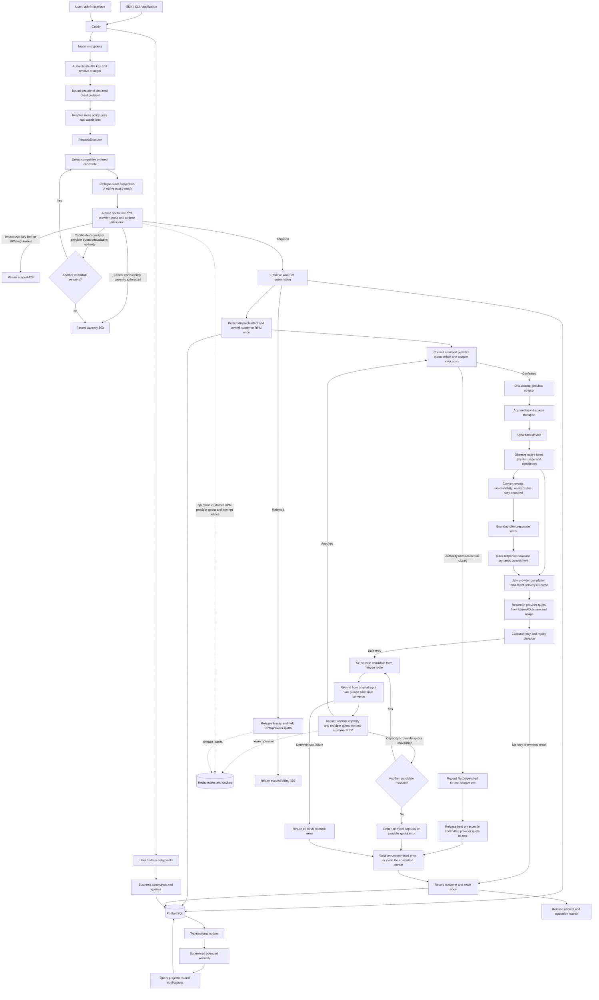

# Gateway Framework Design

Status: normative product target adapted to the imported backend.
[ADR 0015](adr/0015-imported-backend-baseline.md) supersedes the removed unary
implementation and single-package layout. Existing Codex/Grok Build execution,
provider preparation, protocol/transport handling, shared leases, plugins and
restart-based updates are the baseline. Customer tenants, wallets/subscriptions,
retail USD pricing, precharge and settlement remain target capabilities. The
current HTTP surface is listed in [API Contracts](API.md).

This design connects the existing product previews to the backend boundaries in
[Architecture](ARCHITECTURE.md), [Backend Structure](BACKEND_STRUCTURE.md),
[Runtime](BACKEND_RUNTIME.md), [Naming and Abstractions](adr/0008-naming-and-abstractions.md),
and [Protocol Capability Planes](adr/0009-protocol-capability-planes.md).
Apply those boundaries subject to the imported-workspace decision in ADR 0015.
The product and billing rules below are normative targets, not an inventory of
implemented customer workflows.

## Request execution boundary

The existing core `DefaultExecutionService`, `AttemptCoordinator` and execution
sessions own request orchestration. API translates inbound exchanges; provider
crates retain native preparation/selection and private endpoint handling; Host
and Store implement injected network and persistence ports. Preserve actual
retry, continuation, cancellation and stream behavior while adapting customer
ownership and finances. HTTP objects and SQL do not enter portable money rules.

The financial integration must reserve once in execution start, carry a frozen
retail quote and reservation through the session, and persist required dispatch
intent before the first poll of a cold `ProviderStream`. Existing best-effort
observation writes and per-key provider-cost budget queues do not provide that
financial authority. Retries reuse one logical operation reservation; native
provider preparation and account leases remain intact.

Each billable capability needs a verified conservative input/output/media/tool
bound, including provider overhead and transformed input, before computing its
USD quote. UTF-8 length is not a token proof. The first retail slice supports a
complete unbanded card; unsupported bands or unbounded dimensions reject before
dispatch. The precise quote and rounding contract belongs to the billing design.

Customer admission must add the required scopes and provisional RPM semantics
around existing shared leases, compensate failure before dispatch, and persist
unknown outcomes for reconciliation. Process-owned tasks and bounded cleanup
cannot replace durable recovery after a crash. Retain the imported configured
deadlines, waiting/lease mechanisms and supervision during baseline integration;
the removed executor's timeout values and financial scan worker are not current
capabilities. Expiry alone never refunds a financial reservation.

Detailed companion designs:

- [Multi-provider Support](MULTI_PROVIDER_SUPPORT.md): OpenAI/Codex, Claude,
  Gemini, Grok, and Chinese model services as required product coverage, with
  native protocols, explicit conversions, and provider-specific usage contracts.
- [OpenAI/Codex Protocol and Identity](CODEX_PROTOCOL_AND_IDENTITY.md): pinned
  official Rust source, endpoint contracts, transport behavior, and state ownership.
- [Administrator Request Diagnostics](REQUEST_DIAGNOSTICS.md): complete exchange
  capture, execution profiles, protected payload storage, and capture failures.
- [Billing and Pricing Design](BILLING_AND_PRICING_DESIGN.md): customer tariffs,
  price resolution, precharge, settlement, and balance/usage surfaces.

Customer tariffs, balances, allowances, holds and charges use checked fixed-point
USD at ten decimal places, reusing the imported `Decimal` and PostgreSQL
`numeric(20,10)`. There is no internal credit currency or USD-to-credit conversion.
Provider procurement cost remains a separate fact even when also USD; payment in
CNY has its own frozen order quote. See the canonical
[Billing and Pricing Design](BILLING_AND_PRICING_DESIGN.md).

The current backend's runtime snapshots, administrator/API-key policies and
per-key daily/weekly provider-USD budgets are not customer tenant or financial
records. New customer records require appended migrations after imported 0033;
do not restore the removed migration-7 contract. Dashboard sample data does not
configure runtime records or establish a backend capability.

## 1. Architecture choice

Use one Rust modular monolith, with PostgreSQL as the durable authority, Redis for
transient coordination, and React/shadcn-admin for both user and administrator
interfaces. Caddy terminates public TLS. PostgreSQL, Redis, and Caddy retain their
independent deployments and persistent storage.

Separate three workloads inside the application:

- **Request execution:** authenticate, decode bounded input, resolve and validate
  a route, admit a compatible first attempt, select an account, forward an
  incremental exchange, and record authoritative usage and settlement.
- **Business administration:** identities, credentials, routing configuration,
  plans, orders, payments, redemptions, referrals, and audit records.
- **Queries and background work:** usage summaries, dashboards, exports,
  notification delivery, reconciliation, and operational monitoring.

These are responsibility boundaries, not three services or new crates. Start
with one gateway replica. Add replicas only after shared admission, account
ownership, continuation fencing, and settlement have passed concurrency and
recovery tests. Preserve the imported plugin runtime. Do not add a message broker,
another plugin mechanism or a separate analytics database without a measured
requirement.



## 2. Lessons from the reference projects

The other project references are design evidence. codex-proxy-rs is now the
imported implementation base; the architecture revision linked below does not
verify the exact revision of the user-supplied copy. ADR 0015 defines its adoption.

| Reference | Useful concepts | Application here |
| --- | --- | --- |
| [Official Codex Rust 0.154.0](https://github.com/openai/codex/tree/6b9826e3aa83b1a5947db50f4332cb9c65f1b340/codex-rs) | Native Responses types, per-turn client session, HTTP/SSE and WS clients, request compression, transport dependencies | Baseline the Codex provider against this source revision and the local identity archive. Keep public OpenAI API and Codex OAuth contracts separate. Match endpoint semantics and supported transport behavior; do not import agent tooling, client retry loops, or unbounded queues. |
| [codex-proxy-rs architecture](https://github.com/zyycn/codex-proxy-rs/blob/1db8b0e319431717611e3e30ae1a2d3b371de86a/docs/architecture.md) | Core-owned execution, frozen runtime configuration, provider-independent request identity, explicit replay boundaries | Adapt the actual imported workspace and preserve its provider/plugin behavior. Replace process-local financial authority with PostgreSQL customer reservations and settlement in a later complete billing slice. |
| [sub2api scheduler](https://github.com/Wei-Shaw/sub2api/blob/ba81c7fd758e425d67f856d601147ef0c5263d3f/backend/internal/service/openai_account_scheduler.go) and [billing repository](https://github.com/Wei-Shaw/sub2api/blob/ba81c7fd758e425d67f856d601147ef0c5263d3f/backend/internal/repository/usage_billing_repo.go) | Eligibility before selection, bounded concurrency, sticky sessions, deduplicated transactional billing and outbox updates | Build the commercial lifecycle around the forwarding engine. Use fixed-point amounts and a single settlement path; do not reproduce floating-point billing or compatibility fallbacks. |
| [CPA Manager Plus runtime model](https://github.com/seakee/CPA-Manager-Plus/blob/794ef828023960ccad0a2e9848293aee0880d688/apps/docs/en/guide/runtime-model.md) and [collector](https://github.com/seakee/CPA-Manager-Plus/blob/794ef828023960ccad0a2e9848293aee0880d688/apps/manager-server/internal/collector/collector.go) | Collection health, durable usage history, management and diagnostic views | Keep statistics and collection status separate from forwarding health. CPA Manager Plus manages CPA; it is not itself the forwarding engine. Keep PostgreSQL for our authoritative records. |

### Review corrections

| Gap in earlier notes | Design correction |
| --- | --- |
| Codex examples narrowed the apparent product scope and treated Gemini as Antigravity-only. | Make OpenAI/Codex, Claude, Gemini, Grok, and Chinese model services peer integration targets. Direct Gemini API and Vertex AI have independent contracts. Codex identity rules apply only to the endpoints that require them. |
| OpenAI support did not identify the official Codex source baseline. | Pin Codex 0.154.0 to commit `6b9826e3aa83b1a5947db50f4332cb9c65f1b340`; version endpoint fixtures and transport manifests together. An upgrade requires a new conformance run. |
| A single Responses label could imply identical public API and OAuth features. | Declare endpoint/auth/operation/transport combinations for each provider; reject unsupported combinations before dispatch. |
| Request visibility described summaries rather than a full debugging profile. | Capture inbound request, every outbound attempt, both response legs, transformations, identity, timing, errors, usage, and settlement with explicit completeness. |
| Same language could be mistaken for identical TLS behavior. | Record target platform, TLS backend, dependency revisions/features, ALPN, compression, proxy route, and actual pool generation. Compare equivalent builds. |
| Operation, turn, and WS connection identity were underspecified. | Separate operation/attempt/session/thread/turn/window/connection/lane/response identities and fence their ownership. |
| Earlier credit units and dollar-equivalent conversions were incomplete. | Use USD directly with existing ten-place `Decimal` amounts and `numeric(20,10)`, exact checked intermediates, one half-even settlement rounding point and upward-rounded holds. |
| Strict reservation could depend on an unsupported Codex request parameter. | Bound exposure using verified model/provider limits and tool policies; do not inject unsupported `max_output_tokens`. Reject strict prepaid admission when no defensible bound exists. |
| A forwarding success could be confused with client delivery or settlement success. | Record execution outcome, delivery outcome, settlement state, and capture state independently. |

## 3. Code ownership and target directory structure

Use the imported virtual Cargo workspace recorded in ADR 0015. Its current
ownership map is:

```text
Cargo.toml                         Virtual workspace manifest
src/
  apps/src/                        Gateway composition and executable
  apps/tests/                      Composition and architecture contracts
  crates/core/src/                 Portable contracts, engine, snapshots, metering
  crates/admin/src/                Management models, workflows and ports
  crates/api/src/                  HTTP, SSE, WS and browser translation
  crates/host/src/                 Network, process, workers and updates
  crates/protocol/src/             Pure OpenAI wire and SSE codecs
  crates/store/src/                PostgreSQL, Redis and backup adapters
  crates/providers/openai/src/     Existing Codex provider handling
  crates/providers/xai/src/        Existing Grok Build provider handling
  crates/plugin/                   Existing runtime, SDK and CLI
  migrations/                      Immutable imported SQLx history
web/src/
  api/                             Real clients and generated API types
  features/                        Existing user/admin feature composition
  components/                      Shared UI and layout primitives
tests/                             Cross-module and real-database tests
deploy/                            Gateway and independent infrastructure assets
```

Only the existing files and directories are implemented today. Add target
modules with their first real caller; do not generate empty scaffolding. Split a
file when its responsibility requires it, not to satisfy this diagram.

Core and protocol have no production dependency on another workspace crate.
Admin depends on core; API translates their contracts; Host and Store implement
ports; concrete providers receive network/persistence capabilities without SQL
dependencies. Apps composes the concrete bundles. The imported core `runtime`
module publishes configuration snapshots; it is not the removed generic bounded
executor module. Preserve provider-native preparation and current account
selection during baseline work. The engine continues to own overall attempts,
deadlines and replay decisions. Exact dependencies follow
[Backend Structure](BACKEND_STRUCTURE.md); add behavior ports only for real
callers and avoid generic Manager, Helper or Utils modules.

## 4. Product vocabulary and configuration authority

Preserve the meanings already used by the frontend:

| Concept | Meaning and ownership |
| --- | --- |
| Tenant | Hard isolation boundary for authorization, continuation, usage and billing. Individual customer users own separate tenants in the current product; organization membership is not implied. |
| User | Interactive principal inside a tenant, with a role and user-wide limits. Management authentication is separate from model API keys. |
| Model vendor | Display/catalog identity, such as OpenAI or Google; not a credential adapter. |
| Protocol | Responses, Chat Completions, Messages, or Generate Content. |
| Provider adapter | Concrete endpoint/authentication behavior: OpenAI API, Codex OAuth, Anthropic API, Google Gemini API, Vertex AI, xAI API, DeepSeek, Bailian, Ark, and other declared services. Antigravity/Grok Web remain separate contracts. |
| Account | An upstream credential principal, bound to an egress profile and configuration generation. |
| Group | An authorized provider account pool with eligibility, aggregate RPM and access policies. Billing owns group rate-card overrides and multipliers as records keyed by group ID. Attempt concurrency is derived from member-account/provider-principal capacity; the current frontend has no independent group concurrency field. Accounts can belong to multiple groups. |
| Channel | Model mapping and group routing, as in the current channel editor. It is not another name for an account, connection, or retail price book. |
| API key | User/tenant-owned model credential with an authorized group, optional additional limits, and one explicit balance or subscription billing source. |
| Operation / attempt | One logical client request / one upstream dispatch attempt. |
| Plan / subscription | Purchasable terms / a purchased grant with frozen terms and validity. |

Normative deterministic resolution rules:

1. Authenticate the API key and resolve its authorized group. Match protocol,
   model, requested capabilities, group membership, and enabled configuration.
2. Resolve the applicable channel binding inside that authorized scope.
   Publishing must reject overlapping active bindings that resolve the same
   request differently. Never choose whichever database row happens to arrive.
3. Apply an explicit group model mapping if present; otherwise apply the channel
   mapping. Apply the mapping once. Reject cycles and ambiguous destinations.
   Model names do not implicitly choose a provider.
4. Select the complete group retail rate card, otherwise the platform rate card,
   for the requested public model. The channel only maps and routes; mapped
   provider model and failover never change the customer tariff. Missing required
   pricing rejects billable admission; it never silently becomes free.
5. Select one service/context/time rate card, then apply the user multiplier
   override if present or the group multiplier otherwise. The user override
   replaces the group multiplier. Reject ambiguous or incomplete schedules when
   publishing configuration.
6. Freeze requested model, resolved provider model, route/config revision,
   price revision, entitlement, selected rate card, request bounds, and effective
   multiplier in the operation snapshot. An administrator edit affects later
   operations, not an in-flight charge.

The complete concurrency, RPM, account-capacity, identity and frontend-field
semantics are specified in [Multi-user Identity and Request Admission](ADMISSION_AND_TENANCY.md).
Operation concurrency is acquired once per logical request; provider capacity is
acquired once per actual upstream attempt. Group aggregate RPM and per-user group
RPM are separate ceilings, and none of these replace wallet or subscription
spend limits.

There is no requested-versus-mapped `billingBasis`, channel retail price table,
or account-price billing switch. Those duplicate paths are removed when the
pricing workflow is implemented. Account/provider procurement cost remains a
separate internal fact and never changes the customer's selected rate card.

## 5. Model request lifecycle

1. **Authenticate and bound input.** Resolve the verified tenant, user, API key
   and authorized group; enforce body/frame limits and supported capabilities.
   Management sessions and model API keys are separate credential types.
2. **Freeze configuration.** Resolve routing, entitlement, price, and limits into
   one immutable execution snapshot. Preserve native bodies and extensions.
   Freeze the endpoint contract, identity/profile generation, and diagnostic
   policy. Reserve bounded capture capacity before an upstream attempt.
3. **Admit the first attempt.** For each eligible candidate, atomically acquire
   the operation-scope limits, one provisional customer RPM reservation, any
   locally enforced provider quota reservation, and that candidate's
   provider-principal/account attempt capacity. A candidate capacity or provider
   quota miss leaves no holds, so the bounded scheduler can try the next
   candidate. Once one bundle succeeds, reserve a bounded maximum charge against
   the selected billing source in PostgreSQL; on failure, release attempt/operation
   leases and held customer-RPM/provider-quota reservations. Persist dispatch
   intent before committing the customer RPM token. Commit each locally enforced
   provider-quota hold immediately before invoking the one-attempt provider
   adapter, and dispatch only after both idempotent commits are confirmed.
   Customer RPM counts once after
   admission commits; provider quota reconciles to attempt certainty and actual
   usage, retaining a conservative reservation while execution is unknown.
   PostgreSQL and Redis are not one atomic transaction: compensate failed
   admission and expire/reconcile abandoned reservations and leases.
4. **Record dispatch intent.** Persist the operation and attempt before sending.
   The executor owns the overall deadline and finite attempt budget. Each
   upstream retry keeps the operation lease, billing reservation and single
   customer RPM count. It selects the next frozen candidate and rebuilds the
   provider-bound request from the original bounded client request with that
   candidate's pinned converter, then obtains only new provider-principal/
   account attempt capacity, any locally enforced provider-quota reservation,
   and the bound egress generation. It never converts the
   previous provider-bound payload.
5. **Forward incrementally.** The provider executes one attempt. The transport
   applies account-bound proxy/TLS/pool configuration. For streams, the provider
   reader, converter, and client writer run as one supervised exchange: events
   flow as they arrive, and provider completion/usage is joined with the writer's
   delivery outcome. Unary response bodies remain bounded. Pull-based SSE and
   bounded WS queues propagate backpressure and cancellation. Capture original input,
   final outbound requests, upstream events, and downstream delivery boundaries
   through the protected diagnostic path; never through ordinary application logs.
6. **Record outcome and settle.** Normalize authoritative usage into a receipt;
   atomically deduplicate settlement, update the selected balance/quota, append
   ledger entries, mark reservation disposition, and append outbox events.
7. **Release and project.** Release leases on every terminal path. Supervised
   workers update dashboards, exports, notifications, and other read models.

Retry classification belongs to the existing execution coordinator, with bounded
deadlines and cancellation carried through its attempt contracts. Track dispatch certainty separately
from downstream commitment. The replay barrier is the first committed response
head, accepted semantic output, or accepted bidirectional session state. A
disconnect, timeout, cancellation, or empty response does not prove that the
upstream did not execute. Keepalive bytes do not count as semantic output,
tokens, or a billable operation. Durable job retries never authorize replaying
a model request.

Separate HTTP/WS transport, unary/SSE/bidirectional stream mode, and request
operations such as generation, search, compaction, and token counting. Compression
of HTTP content is independent of context compaction. Providers declare complete
valid combinations; do not infer support by combining independent capability
lists. Explicit protocol conversion records source, target, and supported
semantics, and rejects unsupported input rather than dropping it. Conversion is
performed by one registered directional `ProtocolConverter` for the exact
client/provider protocol pair. The concrete infrastructure adapter's internal
typed `rewrite_request` step then maps that boundary request to the selected
endpoint's private wire contract; it is not a core trait method and does not
perform generic protocol conversion or control account selection/retries.
The response path parses provider output to its boundary protocol before any
directional conversion back to the client. See [ADR 0011](adr/0011-protocol-conversion-and-provider-rewriting.md).

Continuation ownership includes tenant, credential principal, explicit session,
account identity, and profile/egress generations. Sticky routing never bypasses
quota or permission checks. Do not infer sessions from IP addresses or prompts.
The [protocol design](CODEX_PROTOCOL_AND_IDENTITY.md) defines the lifetime and
reuse constraints for Codex turns, compaction, opaque turn state, and WS responses.

## 6. Billing, payment, and recovery

### Units and arithmetic

- External payments and payment fees use **CNY**. Represent money with a typed
  integer minor unit such as `CnyFen`.
- Wallet balances, subscription limits, bonuses, retail tariffs and usage
  charges use **USD** directly. Provider procurement stays a separate fact in
  its native currency; a separately sourced FX snapshot may support margin
  reporting but never selects a customer tariff.
- Reuse the existing nonnegative checked `Decimal`: `u128` scaled by `10^10`,
  matching PostgreSQL `numeric(20,10)`. USD amounts and rates accept decimal
  strings with at most ten fractional digits. Rates declare their denominator,
  such as USD per million billable tokens. APIs return canonical amount strings
  with `currency: "USD"` and `scale: 10`. Ledger entries pair credit/debit
  direction with a nonnegative amount; negative `Decimal` inputs are invalid.
  Browser formatting never feeds authoritative calculations or truncates
  stored balances.
- Use checked arithmetic, wider intermediates, fixed-point/rational rates, and
  exact decimal price parsing. Multipliers use basis points (`10,000 = 1x`).
  Sum exact components and apply the multiplier, then round once at
  `0.0000000001 USD` with round-half-to-even for settlement. Round quote and
  reservation bounds upward to that same unit. Reject overflow and excess input
  precision instead of saturation or truncation. Never
  round each token, event, or displayed component or use floating-point amounts.
- Before dispatch, reserve `R = max(2 * A, Q)`. `A` is the latest positive,
  fully settled customer charge for the same tenant, API key, billing source,
  authorized group, requested public model and service tier; pending, estimated,
  failed, released or unreconciled charges do not qualify. `Q` is the current
  frozen and enforceable maximum retail quote. With no eligible history, `A=0`.
  An older tariff revision may size `A`, but only the current frozen tariff
  prices this request. The
  quote, atomic hold, settlement, and unknown-outcome behavior are specified in
  [Billing and Pricing Design](BILLING_AND_PRICING_DESIGN.md).
- Freeze the positive CNY-per-USD decimal quote, original integer CNY-fen
  principal/payable amount, USD grant, fee/bonus terms and expiry on the order.
  Recharge grants round down at the ten-place USD unit; CNY fees round up to a
  whole fen. Refunds use the original order and frozen conversion terms, never a
  current exchange rate. Preserve procurement cost in a separate record.

Normalize provider token semantics explicitly: total input, uncached input,
cache reads, cache writes, output, and reasoning may overlap differently across
providers. Price disjoint billable quantities once. Record search/image/tool
units independently when the capability contract supports them.
The [multi-provider usage contract](MULTI_PROVIDER_SUPPORT.md#7-usage-and-billing)
defines family-specific normalization. The
[billing design](BILLING_AND_PRICING_DESIGN.md) owns the customer charge and
provider-cost separation.

An illustrative price, not a current model quotation:

```text
Total input: 1,000 tokens, including 200 cached tokens
Uncached input: 800 * 2.00 USD / 1,000,000 = 0.0016000000 USD
Cached input:   200 * 0.20 USD / 1,000,000 = 0.0000400000 USD
Output:        100 * 8.00 USD / 1,000,000 = 0.0008000000 USD
Base charge:                               0.0024400000 USD
Retail multiplier: 2.50x
Settled customer debit:                    0.0061000000 USD
```

Cached input is a subset of total input in this example. Do not charge it once
at the uncached rate and again at the cached rate. Reasoning output is likewise
not an extra output quantity when it is already included in total output.

For a recharge quote of 7.20 CNY per USD, a 72.00 CNY principal grants 10.00 USD
before bonuses. A 0.72 CNY payment fee makes the payable total 72.72 CNY; it does
not become a USD usage fee or increase credited principal. Freeze whether each
provider's fee is added to the payable amount or absorbed by the merchant. All
payment method fee displays remain CNY. Bonuses are explicit USD ledger credits.

### Settlement and failure rules

Settlement is per logical operation, not per retry. Give it a unique idempotency
key plus an immutable payload fingerprint: the same key and payload is a no-op;
a conflicting payload is an explicit error. Record attempt procurement costs
separately from the single user settlement. Corrections append linked ledger
entries rather than rewriting history.

Keep reservation and settlement transactions short. Never hold a database
transaction, wallet row lock, or checked-out connection for the lifetime of an
upstream stream, payment checkout, or diagnostic write. Concurrent reservations
must atomically account for already reserved funds and quota; settlement consumes
its reservation once and releases the remainder in the same transaction.

Balance and subscription grants have distinct reservation and settlement rules.
Use the API key's selected source; do not fall back silently. Freeze purchased
subscription terms. Define calendar windows and reset timezone explicitly, store
timestamps in UTC, and lock or atomically update quota windows on consumption.

Strict prepaid admission requires a conservative maximum charge from bounded
input/output and chargeable tool limits. Use verified model ceilings when the
Codex contract does not expose an output-limit parameter; never inject an
unsupported field or claim a client disconnect enforces a provider spend cap.
When no defensible bound exists, strict prepaid admission rejects before sending.
Any alternative credit/risk mode requires its own explicit financial contract.

Persist financial facts before acknowledging terminal completion where the
protocol permits it. Statistics may lag; the only copy of a charge must not be
an in-memory queue. A crash after dispatch but before a durable usage receipt is
an uncertain operation: retain the reservation pending reconciliation, obtain
authoritative provider usage when available, and otherwise apply an explicit
audited resolution policy. Neither a full debit nor a refund is implied by a
disconnect. A storage failure after partial output cannot be repaired by
replaying the request. This design does not promise exactly-once upstream
execution or lossless terminal usage across an arbitrary process crash.

Persist separate `execution_outcome`, `delivery_outcome`, `settlement_state`, and
`capture_state`. An upstream completion can coexist with a disconnected client,
pending settlement, or partial diagnostic capture. Successful user usage filters
must not hide a pending debit or change the administrator's execution record.

### Orders and payment

Server-side quote -> order -> payment attempt -> provider checkout -> verified
callback -> atomic fulfillment -> outbox notification. Verify callback signature,
merchant, order, amount, currency, provider transaction identity, and allowed
state transition. A browser return page is not payment evidence.

Expose enabled payment method identities such as Alipay and WeChat, backed by
configured provider adapters. Keep provider secrets server-side. Duplicate or
concurrent callbacks must grant credits/subscriptions once. Refunds and charge
corrections are explicit ledger operations. Redemption claims and referral
commissions likewise require unique claims, atomic grants, and auditable
reversals; notifications do not determine whether fulfillment succeeded.

## 7. Persistence and query ownership

The following are entity groups, not a prescribed migration or a mandate for
one table per name:

| Domain | Durable facts |
| --- | --- |
| Identity | Users, role grants, management sessions, API key verifiers and lifecycle |
| Routing | Accounts, encrypted credentials, group membership, channel bindings, model mappings, egress profiles, configuration/price revisions |
| Execution | Operations, attempts, usage receipts, continuation ownership and terminal certainty |
| Diagnostics | Capture manifests, event/attempt indexes, payload references, completeness, retention and access audit records |
| Billing | Wallets, reservations, append-only ledger entries, subscription grants and quota windows |
| Commerce | Plan revisions, orders, payment attempts/events, redemption claims, referral commissions |
| Operations | Audit records, outbox events, existing durable jobs, query projections |

Tenant-owned rows and relationships enforce tenant scoping in every query.
Foreign keys and unique constraints enforce ownership, idempotency, and valid
references. Keep full prompts, response bodies, credentials, and raw
authorization headers out of routine records and logs. Authorized request and
response content belongs in a separate encrypted diagnostic payload store as
defined in [Request Diagnostics](REQUEST_DIAGNOSTICS.md), outside the repository.

PostgreSQL owns all financial and configuration truth. Redis contains disposable
caches, renewable concurrency leases, and transient counters; cache loss cannot
erase a charge or grant. Redis failure closes shared admission rather than
silently turning limits off. Use bounded, idempotent, fenced workers for outbox
delivery, reconciliation, exports, and notifications. Delivery is at least once;
consumer idempotency is mandatory. Keep model request execution out of the
durable infrastructure job retry loop.

Begin with indexed and paginated PostgreSQL queries. Add rollups and retention
partitions based on measured data volume. Dashboard queries must not scan
unbounded attempt history on the forwarding path.

## 8. API, UI, and operational visibility

Keep model-native routes separate from planned user `/api/v1` and administrator
`/api/admin/v1` APIs. Exact methods, schemas, errors, authorization, and pagination
must be specified in the API contract before adding their implementation.
Generate frontend request types from OpenAPI when available. Replace each
feature's sample store only when its full server workflow exists; never simulate
a successful payment, redemption, save, or credential export.
See [Product Domain and API Design](PRODUCT_DOMAIN_DESIGN.md) for the normative
feature-to-domain map, management/customer resource set, command rules, and
commerce/rewards/content/operations state machines.
See [Billing and Pricing Design](BILLING_AND_PRICING_DESIGN.md) for wallet,
subscription, precharge, tariff, and billing-read contracts.

User queries return only the user's authorized successful usage records, as
required by the current UI. Administrators can inspect attempts, failures,
cancellations, uncertain outcomes, reconciliation, and dispatch diagnostics.
Visibility filters must not remove authoritative financial records.

Usage query contracts supply input/output/cache counts, price components,
service tier, multiplier, final USD charge, requested/resolved model, inbound and
outbound endpoint paths, TTFT, total time, output rate, cache rate, and authorized
request IP metadata. Define metric denominators and unavailable values. Display
sanitized User-Agent and connection timing; never expose upstream credentials or
secret-bearing URLs in endpoint/IP details.

Administrator diagnostics include successful and failed operations, every
attempt, admission rejections, original/final payloads, protocol events, routing
decisions, actual identity and egress snapshots, and billing evidence. Metadata
read, payload read, and export have distinct permissions and audited access.
Capture completeness is visible independently of request outcome. User usage
queries never join or expose these administrator payload records.

Separate process readiness, provider availability, account eligibility, and
collector/projection health. Dependency readiness is a bounded PostgreSQL/Redis
check, separate from upstream model availability; actual health paths follow
[API](API.md). Monitor active/waiting operations, queue rejection,
lease ownership, attempts, unknown outcomes, settlement backlog, outbox lag,
projection age, and payment reconciliation. Keep secrets and high-cardinality
request/user identifiers out of metric labels.

## 9. Security and configuration changes

Encrypt recoverable upstream and payment credentials with an external key source;
document key rotation and backup recovery. API keys need a verifier hash. If the
approved reveal/use/export workflows retain recoverable API key material, store
it separately encrypted, return only masked values in lists, authorize explicit
secret retrieval, require appropriate reauthentication, and audit the action
without recording the secret. Clipboard/CCS export must never leak via logs,
analytics, URLs, or unrestricted query responses.

Validate upstream and proxy destinations against SSRF policy, including resolved
addresses and redirects. Accept forwarded client IP metadata only from configured
trusted proxies. Never spoof client IP, User-Agent, or hardware attestations to
bypass upstream controls. Scope connection pools and continuation state to the
credential principal and relevant egress/profile generations.

Configuration publishing validates routes, capabilities, mappings, prices, and
references as one revision. Use compare-and-swap revision checks and an audit
record in the transaction. In-flight requests pin their revision; new requests
adopt the published revision through invalidated/versioned caches. Credential
revocation and emergency account suspension remain explicit admission/dispatch
checks, even when a route snapshot was previously created.

## 10. Implementation sequence and acceptance

1. **Adapt the existing engine to customer billing.** Preserve the imported
   provider, protocol, account preparation, transport, plugin and updater flows.
   Add verified customer identity, tenant scope, wallet/entitlement and audit
   records, then integrate frozen USD quotes, one PostgreSQL reservation,
   dispatch intent before cold-stream polling, durable usage and settlement into
   the existing execution lifecycle. A Codex
   slice can validate these additions without becoming its provider-specific core. Include
   protected administrator request capture, source-pinned protocol fixtures,
   database recovery, and failure contracts from the first slice. Full diagnostics
   must not be deferred until after model forwarding is enabled.
2. **Required provider coverage.** Implement native OpenAI Responses/Chat,
   Anthropic Messages, and Gemini Generate Content entrypoints and the real
   OpenAI/Codex, Claude, Gemini, Grok, and Chinese service adapters in the
   [coverage plan](MULTI_PROVIDER_SUPPORT.md). Each adapter includes its own auth,
   model/capability constraints, streaming, errors, usage normalization, and full
   administrator diagnostics. Do not call a Codex-only deployment the completed
   multi-provider product. Implement in bounded slices, without empty adapters
   or an assertion that all models/features of a named vendor already work.
3. **Explicit conversion and advanced exchanges.** Enable tested directional
   protocol converters, provider-bound continuation, and WebSocket capability
   combinations. Add multimodal and asynchronous operations only with complete
   endpoint, lifecycle, usage, and billing contracts. Private/web endpoints require
   independent integration; a model name or subscription does not enable them.
4. **Business lifecycle and existing screens.** Connect scoped usage queries,
   current/history subscriptions, CNY recharge, orders, verified payment
   fulfillment, redemption, referrals, and settings. Replace preview stores
   feature by feature, with explicit unavailable states until complete.
5. **Measured scaling.** Tune bounded pools, retention and rollups, then validate
   multiple replicas, lease fencing, graceful shutdown, recovery, and load
   behavior before enabling horizontal scaling.

Each implemented slice must cover tenant isolation, invalid credentials,
unsupported capabilities, quota exhaustion, concurrency races, backpressure,
disconnect before/after dispatch, replay barriers at response commitment or
accepted session state, provider errors,
Redis/database failure, crash recovery, duplicate settlement/callbacks, and
secret redaction as applicable. Use redacted protocol fixtures and real database
integration tests. Make no throughput claims until representative streaming load
tests measure latency, memory, connection limits, and queue rejection.
