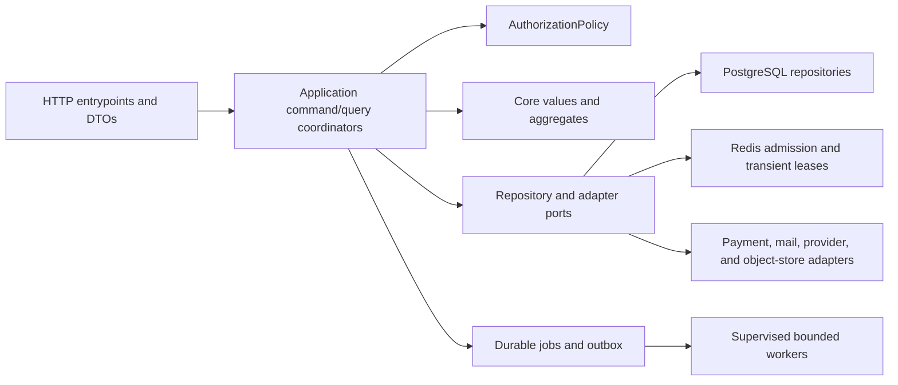
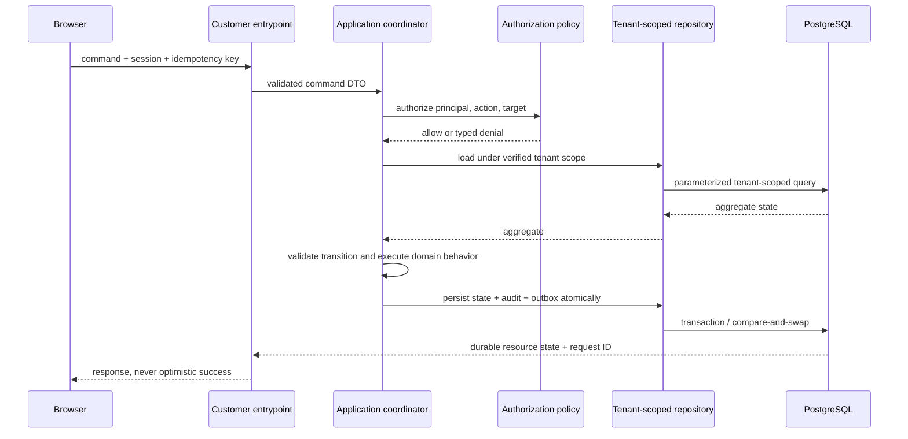
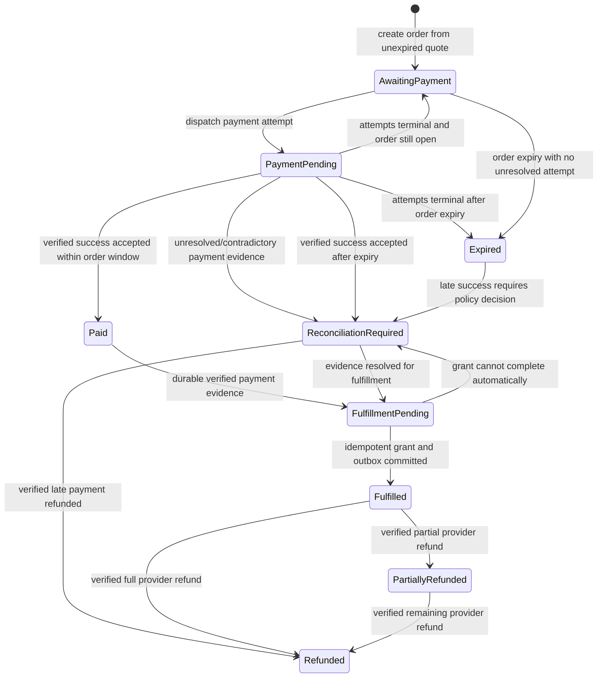
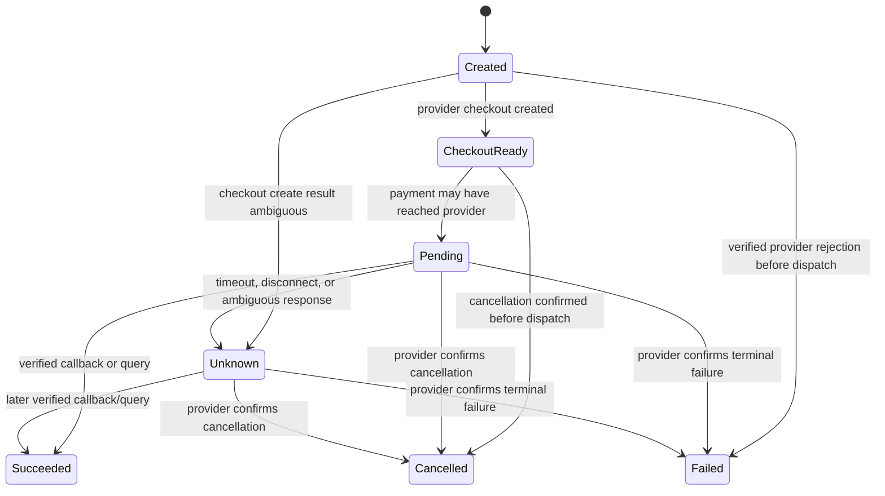

# Product Domain and API Design

Status: normative target product contract. The customer ownership, commerce,
wallet/subscription and retail billing workflows described here are not
implemented on the imported backend. Its existing provider execution, management
APIs and per-key USD provider-cost budgets do not imply these customer contracts.
This document turns the current administrator and user page inventory into
domain ownership, command/read boundaries, lifecycle rules, and API resources.
It complements [Gateway Framework](GATEWAY_FRAMEWORK.md),
[Multi-user Identity and Request Admission](ADMISSION_AND_TENANCY.md), and the
[implemented HTTP surface](API.md).
The exact tariff, precharge, charge, wallet, and usage read contract is in
[Billing and Pricing Design](BILLING_AND_PRICING_DESIGN.md).
The imported implementation baseline and accepted currency/updater choices are
recorded in [ADR 0015](adr/0015-imported-backend-baseline.md).

## 1. Contract rules

- `/api/v1` is the customer workspace API. Authenticated requests use a
  customer session whose tenant and user are resolved server-side. Registration,
  sign-in, verification, and recovery endpoints are unauthenticated and
  independently rate-limited. Model traffic uses native protocol routes and
  derives its scope from the verified model API key; a model key is never a
  browser session.
- `/api/admin/v1` is the management API. Every command requires a named
  permission from a separate management session. Tenant-owned commands require
  an explicit target tenant when run cross-tenant; platform-wide queries and
  actions use separately named permissions and audit actor, target, action, and
  reason. A customer session or model API key cannot authenticate here.
- Retail prices, wallet balances, subscription allowances, usage charges and
  rewards are USD decimal strings using the existing checked `Decimal` scale of
  10 and PostgreSQL `numeric(20,10)`. There is no internal credit currency or
  USD-to-credit conversion. Ledger entries carry credit/debit direction and a
  nonnegative amount. Provider USD cost remains a separate internal fact.
  CNY payments use integer fen with a frozen CNY-per-USD order quote; refunds
  retain the original order's rate and payment terms. Time is RFC 3339 UTC.
  Durations and token counts have explicit units. A
  missing amount or usage dimension is `unknown`, never an implicit zero.
- List endpoints use bounded cursor pagination with stable sort keys. User
  queries are tenant-scoped in the repository, not filtered after retrieval.
- Create/payment/refund/redeem/withdraw/draw/restore and financial-adjustment
  commands accept an idempotency key.
  Repeating the same key and payload returns the original result; reusing it
  with a different payload is a conflict. Configuration writes use a revision
  precondition (`If-Match`) and publish a complete validated revision.
- Errors use a stable machine code, safe message, optional field errors, and
  request ID. Do not expose another tenant's records, upstream credentials,
  callback signatures, provider raw errors, or diagnostic payloads in ordinary
  API responses.
- Commands return their durable state and resource ID. Long-running work returns
  a job ID and a status resource. A browser redirect, queued notification, or
  optimistic UI update is not proof of payment, fulfillment, delivery, or restore.
- Cookie-authenticated browser writes require CSRF protection. Session cookies
  are Secure, HttpOnly, SameSite, rotated after authentication, and revoked on
  logout or account/security policy events. Verification/reset endpoints return
  non-enumerating responses and enforce per-account, per-IP, and global send
  budgets.

### Management authorization

Authorization is permission-based and default-deny. Roles are named bundles of
permissions, not special code paths; every grant has a scope and can expire.
Initial role bundles are `platform_owner`, `routing_operator`,
`billing_operator`, `support_readonly`, and `security_auditor`. Their grants are
deployment policy, while these permission families define the boundary:

| Permission family | Scope and boundary |
| --- | --- |
| `identity.users.read`, `identity.users.manage` | User directory reads and lifecycle actions. Cross-tenant access names the target tenant. |
| `routing.configuration.read`, `routing.configuration.write`, `routing.configuration.publish` | Provider secrets are excluded from ordinary reads; publish is separate from draft editing. |
| `billing.records.read`, `billing.adjustment.request`, `billing.adjustment.approve`, `billing.refund.request`, `billing.refund.approve`, `billing.payout.confirm` | Financial commands produce linked ledger/audit entries. Requester and approver must differ for grants, adjustments, refunds, manual payout confirmation, and restore. |
| `operations.monitoring.read`, `operations.diagnostics.metadata`, `operations.diagnostics.payload`, `operations.diagnostics.export` | Payload access and export are narrower than support metadata and individually audited. |
| `security.audit.read`, `security.settings.manage`, `backup.manage`, `backup.restore` | Audit, security policy, backup configuration, and restore have separate privileges. Restore requires second-person approval and preflight evidence. |

A permission grant carries `principal_id`, `permission`, `scope_kind`,
`scope_id`, `granted_by`, `created_at`, and optional `expires_at`. The policy
checks actor, action, target, tenant, and resource state on every request;
hiding a page or button is not enforcement. Secret reads require reauthentication,
return only the requested secret through a non-cacheable response, and are audited
without logging the value.

Initial role bundles are explicit and additive. `platform_owner` receives all
listed permissions but still uses target scopes and dual control.
`routing_operator` gets identity read, routing read/write/publish, and monitoring
read. `billing_operator` gets identity read, billing read/request permissions,
and monitoring read, but no approval permission by default. `support_readonly`
gets identity read, billing record read, monitoring read, and diagnostics metadata
only. `security_auditor` gets security audit, monitoring, and diagnostics metadata
read, but no mutations or payload access. Approval grants are assigned to a
separate approver principal; no actor may approve their own request.

## 2. Object model and code boundaries

Rust models these concepts as structs/enums and composed role traits; do not build
a base-class hierarchy or generic `Manager`/`Service` layer. Immutable values
carry identity, units, and revisions. Aggregates own state transitions and
invariants. Application coordinators load aggregates, authorize commands, invoke
domain behavior, and persist results. Entrypoints translate HTTP DTOs;
infrastructure adapters implement storage, payment/network, mail, and object-store
ports. HTTP/SQL/Redis types never enter core.

| Core concept | Kind and invariant | Application owner / persistence boundary |
| --- | --- | --- |
| `TenantId`, `UserId`, `ManagementPrincipal`, `CustomerPrincipal` | Value objects. Customer and management principals are distinct; tenant scope is explicit. | `IdentityCoordinator`; identity/session repositories. |
| `Permission`, `PermissionGrant`, `AuthorizationPolicy` | Permission value, scoped grant record, and pure decision contract. Default deny; no implicit platform-wide scope. | Every protected application command/query checks policy before loading protected data. |
| `ApiKey` | Aggregate. Secret is returned once; verifier, owner, tenant, group, billing source, and lifecycle are immutable bindings. | `ApiKeyCoordinator`; API-key repository and verifier lookup. |
| `ProviderAccount`, `Group`, `ChannelBinding`, `ConfigurationRevision` | Aggregates/value objects. Published revisions are immutable; credential revocation and account suspension remain immediate dispatch checks. | `RoutingCoordinator`; configuration repository and publication outbox. |
| `Quote`, `Order`, `PaymentAttempt`, `PaymentEvidence`, `Refund` | Separate aggregates/immutable evidence. Unknown attempts block duplicates; verified payment and fulfillment are idempotent. | `CommerceCoordinator`; commerce repository, payment-provider port, and reconciliation job. |
| `Wallet`, `LedgerEntry`, `UsageReceipt`, `BillingReservation` | Wallet is a balance projection; ledger and usage receipts are append-only; reservations use `max(2 * latest settled charge, current request quote)` and settle once by operation ID. | `BillingCoordinator`; PostgreSQL reservation/ledger repository. See [Billing and Pricing Design](BILLING_AND_PRICING_DESIGN.md). |
| `SubscriptionPlanRevision`, `EntitlementSnapshot`, `QuotaWindow` | Purchased plan terms are immutable snapshots; quota windows reserve and settle atomically. | `SubscriptionCoordinator`; entitlement and quota repositories. |
| `RedemptionBatch`, `RedemptionClaim`, `ReferralCampaign`, `Commission`, `Withdrawal`, `LotteryCampaign`, `Draw` | Each owns its lifecycle; rewards never mutate a ledger directly. Claims/draws/payouts create linked idempotent billing commands. | `RewardsCoordinator`; rewards repository and billing command port. |
| `AnnouncementRevision`, `EmailTemplateRevision`, `BackupJob`, `DiagnosticManifest`, `AuditEvent` | Versioned publication, durable job, protected evidence, and append-only security facts. | Content, backup, diagnostics, and audit application workflows; separate repositories/workers. |

Use application names that describe workflows, such as `PaymentCoordinator`,
`OrderQuery`, `ConfigurationPublisher`, or `BackupRestoreCoordinator`. Define a
trait at an actual variation boundary or where a core contract must stay
independent of infrastructure; concrete PostgreSQL/Redis/provider adapters remain
named implementations. Transaction boundaries stay inside repository/application
commands and never span network calls. This follows
[backend boundaries](BACKEND_STRUCTURE.md) and
[naming rules](adr/0008-naming-and-abstractions.md).

### Request sequence

Management commands use the same sequence with a separate principal, explicit
target scope, and mandatory audit reason. External calls happen after the intent
transaction commits; verified response evidence is then persisted in a second
transaction. Unknown network outcomes enter reconciliation.

## 3. Domain ownership and page mapping

| Domain | Frontend areas | Write model owner | Read models |
| --- | --- | --- | --- |
| Identity and access | Sign-in, registration, profile, users, API keys, security authentication | Identity application: user status, sessions, role/permission grants, API-key verifier and lifecycle | Current principal, user directory, key metadata without secret material, security events |
| Provider inventory and routing | Accounts, groups, channels, gateway settings, proxies | Routing application: provider contracts, accounts, group membership, channel bindings, model mappings, and immutable route/capability revisions. It references a published billing price-book revision but does not own prices. | Account eligibility, group catalog, route preview, model capability catalog |
| Request execution | Native model routes, monitoring, request diagnostics | Gateway executor and provider adapters; each attempt belongs to one operation | Active operations, operation/attempt summaries, health and throughput projections |
| Usage and billing | Admin usage, user usage, dashboard, wallet and recharge history, global and group pricing controls | Billing application: immutable retail price-book revisions, usage receipt, reservation, ledger, balance and quota windows. Group price overrides and multipliers are billing records keyed by group ID. | Tenant-scoped user usage/balance; price preview; permissioned admin operation, retail-charge and procurement-cost views |
| Subscription and commerce | Plan catalog, assignments, orders, payment history, recharge | Commerce application owns quote/order/payment attempt; billing owns monetary grants; subscription owns entitlement snapshot | Published offers, personal entitlements, customer order history, admin reconciliation queues |
| Rewards | Redemption codes, referrals, lottery | Rewards application owns claims, attribution, commission and draw records; billing owns resulting grants/transfers | Personal claim/referral/winnings views and permissioned admin campaign views |
| Content and communication | Announcements, mail settings/templates, website/login settings | Content/configuration application owns published revisions; notification worker owns delivery attempts | Public published content, personal readership, admin delivery state |
| Operations and compliance | Dashboard, channel status, monitoring, audit, backup | Operations application owns policy/config revisions, audit records and bounded jobs | Aggregated health, alerts, audit search, backup job and restore status |

Page visibility switches are navigation only. Authorization is enforced by
permissions and domain state. Preview fixtures never become defaults, published
configuration, or successful API responses.

## 4. Target API surface

These are normative resource contracts, not live routes.

| Capability | Customer `/api/v1` | Administrator `/api/admin/v1` |
| --- | --- | --- |
| Authentication and profile | `POST /auth/registrations`, `POST /auth/sessions`, `DELETE /auth/session`, `POST /auth/email-verification-requests`, `POST /auth/email-verifications`, `POST /auth/password-reset-requests`, `POST /auth/password-resets`, `GET /session`, `GET /sessions`, `GET/DELETE /sessions/{session_id}`, `GET/PATCH /profile`, `POST /profile/avatar`, `POST /profile/password-change` | `POST /auth/sessions`, `DELETE /auth/session`, `GET /session`, `GET /sessions`, `GET/DELETE /sessions/{session_id}`, `GET/POST /users`, `GET/PATCH /users/{user_id}`, `POST /users/{user_id}/suspend`, `POST /users/{user_id}/activate`, `POST /users/{user_id}/role-assignments`, `DELETE /users/{user_id}/role-assignments/{assignment_id}`, `POST /users/{user_id}/permission-grants`, `GET/POST /roles`, `GET/PATCH /roles/{role_id}`, `POST /roles/{role_id}/permission-grants`, `POST /users/{user_id}/balance-adjustments`, `POST /balance-adjustments/{id}/approve`, `POST /balance-adjustments/{id}/reject`, `GET /security/auth-events` |
| Model keys | `GET/POST /api-keys`, `GET/PATCH /api-keys/{key_id}`, `POST /api-keys/{key_id}/rotate`, `POST /api-keys/{key_id}/revoke` | `GET/POST /api-keys`, `GET/PATCH /api-keys/{key_id}`, `POST /api-keys/{key_id}/revoke` |
| Catalog and dashboard | `GET /dashboard/summary`, `GET /models`, `GET /channel-status`, `GET /catalog/subscription-plans`, `GET /catalog/recharge-offers`, `GET /payment-methods` | `GET /dashboard/summary`, `GET/POST /providers`, `GET/PATCH /providers/{provider_id}`, `GET/POST /accounts`, `GET/PATCH /accounts/{account_id}`, `GET/POST /groups`, `GET/PATCH /groups/{group_id}`, `GET/POST /channels`, `GET/PATCH /channels/{channel_id}`, `POST /accounts/{account_id}/suspend`, `POST /accounts/{account_id}/resume`, `POST /routes/preview`, `POST /configuration-revisions`, `POST /configuration-revisions/{revision_id}/publish` |
| User limits and usage | `GET /usage`, `GET /usage/{operation_id}`, `GET /billing/balance`, `GET /subscriptions`, `GET /subscriptions/allowances` | `GET /usage`, `GET /operations`, `GET /operations/{operation_id}`, `GET /operations/{operation_id}/attempts`, `GET /operations/{operation_id}/diagnostics`, `POST /operations/{operation_id}/diagnostic-exports`, `GET /diagnostic-export-jobs/{job_id}`, `POST /operations/{operation_id}/reconcile` |
| Retail pricing | -- | `POST /pricing/revisions`, `POST /pricing/revisions/{revision_id}/validate`, `POST /pricing/revisions/{revision_id}/preview`, `POST /pricing/revisions/{revision_id}/publish` |
| Plans, recharge, and orders | `GET /orders`, `GET /orders/{order_id}`, `POST /quotes`, `POST /orders`, `POST /orders/{order_id}/payment-attempts` | `GET/POST /subscription-plans`, `GET/PATCH /subscription-plans/{plan_id}`, `GET/POST /recharge-offers`, `GET/PATCH /recharge-offers/{offer_id}`, `POST /users/{user_id}/subscriptions`, `GET /orders`, `POST /orders/{order_id}/refunds`, `GET /payment-reconciliation` |
| Redemption, referral, and lottery | `POST /redemption-claims`, `GET /redemptions`, `GET /referral`, `GET /referral/commissions`, `POST /referral/withdrawals`, `GET /lottery/campaigns`, `POST /lottery/campaigns/{campaign_id}/enrollments`, `GET /lottery/enrollments/{enrollment_id}` | `GET/POST /redemption-batches`, `GET /redemption-batches/{batch_id}`, `POST /redemption-batches/{batch_id}/code-issuances`, `POST /redemption-batches/{batch_id}/revoke`, `GET/POST /referral-campaigns`, `GET/PATCH /referral-campaigns/{campaign_id}`, `GET /referrals`, `POST /referrals/{commission_id}/adjustments`, `GET /withdrawals`, `POST /withdrawals/{id}/approve`, `POST /withdrawals/{id}/reject`, `POST /withdrawals/{id}/payout-attempts`, `POST /withdrawals/{id}/confirm-payout` |
| Content and communication | `GET /announcements`, `POST /announcements/{id}/read` | `GET/POST /announcements`, `GET/PATCH /announcements/{id}`, `POST /announcements/{id}/publish`, `POST /announcements/{id}/archive`, `GET/POST /email-templates`, `POST /email-settings/test` |
| Settings and operations | `GET /profile/preferences` where user-owned settings are enabled | `GET/PATCH /settings/{domain}`, `GET/POST /payment-providers`, `GET/PATCH /payment-providers/{provider_id}`, `POST /payment-providers/{provider_id}/test`, `GET/POST /lottery-campaigns`, `POST /lottery-campaigns/{id}/open`, `POST /lottery-campaigns/{id}/close`, `POST /lottery-campaigns/{id}/draw`, `GET /monitoring/summary`, `GET /monitoring/alerts`, `GET /audit-events`, `GET/POST /backup-configurations`, `POST /backup-configurations/{id}/probe`, `POST /backups`, `GET /backup-jobs/{id}`, `POST /backup-jobs/{id}/restore`, `GET/POST /proxies`, `POST /proxies/{id}/probe` |

The page-to-domain crosswalk covers all current product areas:

| Frontend pages | Owning contract |
| --- | --- |
| User dashboard, usage, API keys, recharge, order history, redemption, referral, subscriptions, lottery, channel status, profile/settings | Customer session APIs and customer resources above; every read/write is tenant-scoped. |
| Admin users, accounts, groups, channels, pricing, gateway/general/page settings, payment settings, plans, orders, redemption codes, referrals, lottery, announcements, email settings/templates | Permissioned management resources and versioned configuration; draft, validate, and publish are separate operations. |
| Admin dashboard, usage, monitoring, active requests, channel status, diagnostics, security audit/authentication | Bounded query/read models with explicit time range, cursor/limit, tenant scope, projection freshness, and narrow diagnostic payload/export permissions. |
| Proxies, data backup, restore, notification/test email | Permissioned commands return bounded durable job resources; external results and credentials are not inferred from local form state. |

Every list query has a maximum page size, stable sort tuple, and documented
filter set. Dashboard endpoints accept a bounded time range and return an
`as_of` timestamp plus projection freshness. They are read models, never the
source of a balance, order, route, or account eligibility decision.

Payment provider callbacks are a separate integration boundary:
`POST /webhooks/payments/{provider_id}`. It uses provider signature verification,
replay-window checks, immutable event-ID deduplication, and order/payment
cross-checks; it accepts neither customer sessions nor management permissions.
The provider adapter validates and maps its native callback to a typed payment
event before the commerce coordinator sees it. Invalid signatures are rejected
without disclosing whether an order exists. Persist event identity and verified
facts before acknowledging a valid callback; downstream fulfillment is an
idempotent outbox workflow. Payout callbacks use
`POST /webhooks/payouts/{provider_id}` with separate signature rules and event
identity, never the payment callback handler.

The management API should be split into bounded feature contracts/OpenAPI tags;
the table does not authorize one generic CRUD handler. `GET/POST` and
`GET/PATCH` shorthands apply only to the named collection/item where meaningful.
Commands such as `confirm-payout`, `draw`, `publish`, `restore`, and `reconcile`
are explicit domain operations with dedicated permissions and audit records.
Manual payout confirmation must attach independently verified payout evidence
and cannot bypass a configured payout provider. Avatar, backup, diagnostic, and
export content uses separately bounded upload/download flows, not arbitrary JSON.

Registration and recovery requests return the same public response regardless
of account existence. Verification tokens are single-use, short-lived, stored
hashed, and invalidated when consumed or superseded. Session creation requires
verified email when policy requires it; repeated failures invoke progressive
per-account and per-IP throttling without revealing account state.

### Payload and response contracts

Successful single-resource reads return the resource directly. Lists return
`{ "items": [...], "next_cursor": "..." }`; `next_cursor` is null at the end.
All responses include an opaque `X-Request-Id`. Errors use
`{ "error": { "code", "message", "field_errors" }, "request_id" }` with a
stable HTTP status. Validation errors use 422, stale `If-Match` uses 412,
idempotency-key payload mismatch and illegal state transitions use 409,
authentication uses 401, authorization uses 403 (or 404 where existence is
sensitive), rate limits use 429 with `Retry-After`, and unavailable dependencies
use 503. Expected conflicts never require parsing message text.

| Command or resource | Required fields and returned facts |
| --- | --- |
| Registration/session | Registration accepts normalized email, password, and optional display name; verification token is submitted separately and is never returned by reads. Session creation accepts email/password and optional second factor, sets the session cookie, and returns a principal summary and CSRF token. |
| Model API key | Create accepts name, group ID, billing source, optional fixed-point spend cap, RPM/concurrency limits, and expiry. Response includes key ID and raw secret exactly once plus masked prefix; subsequent responses omit secret material. |
| Redemption code issuance | `POST /redemption-batches/{batch_id}/code-issuances` accepts count, per-user claim limit, value, expiry, and idempotency key. It returns a bounded durable export job; raw codes are available once through a short-lived encrypted download and are never stored in plaintext. |
| Configuration revision | Draft writes include expected revision and changed domain objects. Publish returns immutable revision ID, validation results, publication time, and audit ID; validation errors identify the conflicting object/field without returning credentials. |
| Quote | `POST /quotes` accepts purchase kind, offer/plan revision, payment method, and optional quantity. The response freezes item terms, principal amount, currency, fee, payable amount, bonus/entitlement terms, and expiry. All money is a decimal string plus currency and scale. |
| Order | `POST /orders` accepts quote ID and idempotency key. The response returns order ID, frozen quote facts, `AwaitingPayment`, and expiry. The client cannot choose price, fee, bonus, tenant, or fulfillment value. |
| Payment attempt | `POST /orders/{order_id}/payment-attempts` uses the payment method frozen by the quote/order and an `Idempotency-Key` header. It returns attempt ID/state and a provider-approved checkout URL or bounded QR payload when applicable. Poll through the order/attempt resource; redirects never mark payment successful. |
| Usage | A receipt identifies operation, tenant-scoped key, requested/resolved model, status/dispatch certainty, authoritative usage dimensions (nullable when unknown), frozen tariff revision, reserved/settled/released amounts, canonical customer charge, and timestamps. Customer reads omit provider account identity, procurement cost, and private diagnostics. |
| Rewards and entitlements | A claim/withdraw/enrollment command returns its own resource ID/state and immutable campaign revision. Ledger/entitlement grant IDs are linked only after the owner workflow commits them. |
| Durable job | Long-running commands return job ID, state, creation time, and a status URL. Job reads expose progress and a safe terminal error code; they never expose storage URLs, credentials, or raw provider payloads. |

Commands accept `Idempotency-Key` as a header. The key is unique within the
authenticated principal and command family for the retention window, and the
stored result is tenant-bound. Configuration writes require `If-Match` with the
current revision. Upload/download commands use scoped short-lived object
references and maximum byte counts defined by domain policy; clients never
choose arbitrary object-store keys.

### API-key management contract

An API key belongs to exactly one tenant and user and one authorized group. Its
published fields are name, masked prefix, group, billing source, optional USD
spend cap, optional RPM/concurrency caps, expiry, status, and timestamps. Creation
returns raw key material once; list/read never does. Rotation creates a new key
and revokes the old key in one transaction with an explicit overlap policy
(default: no overlap). Revocation is immediate at the next authentication and
dispatch authorization check. User concurrency must be editable in the key
editor if this limit is exposed in the API. Zero is never an unlimited sentinel.

### Configuration publication contract

Provider/account/group/channel routing and gateway policies are drafted against
a routing revision. Routing publication validates references, provider
capabilities, protocol/conversion pairs, account pools, model mapping ambiguity,
egress policy, and coverage by the referenced published billing price-book
revision. Retail price books have their own draft, validate, preview, and publish
lifecycle in [Billing and Pricing Design](BILLING_AND_PRICING_DESIGN.md); that
domain validates rate completeness and time-window overlap and atomically writes
its immutable revision, audit event, and outbox invalidation. A routing revision
stores the selected price-book revision ID and cannot edit or publish tariff
rows. Each domain publishes in one PostgreSQL transaction, with no cross-domain
transaction. In-flight operations keep both revisions in their frozen snapshot;
account disable and credential revocation remain live dispatch checks. A failed
publish changes no active policy or price book.

## 5. Durable state machines

### User, session, API key, and account

- User lifecycle: `Invited -> Active -> Suspended`; `Invited` may expire and
  `Suspended` may return to `Active`. Deletion is a privacy/retention workflow,
  not a status toggle: financial and audit facts remain while identity data is
  minimized under the retention policy.
- Customer and management sessions use separate principals, cookie/token
  audiences, and authentication policies. Each lifecycle is
  `Active -> Revoked | Expired`; rotation invalidates the prior token family.
  Password/recovery changes revoke customer sessions; role or security-policy
  changes revoke management sessions according to policy. Each user can inspect
  and revoke only their own customer sessions; authorized security operators can
  inspect/revoke sessions with a target principal and audit reason.
- API key lifecycle: `Active -> Revoked | Expired`. Key rotation records
  `supersedes_key_id`; activation/revocation is audited. One key never changes
  tenant, owner, group or billing source after creation; issue a replacement to
  change those bindings.
- Account administrative status and observed health are separate. An account
  can be `Enabled | Suspended | Revoked` while health is independently
  `Unknown | Healthy | Degraded | CoolingDown`. Eligibility is derived from
  both plus quota, credentials, egress and capability; a probe cannot reactivate
  a manually suspended account.

### Orders, payments, refunds, and fulfillment

Each payment attempt has an independent state machine:

The order freezes offer/plan revision, integer CNY-fen principal and payable
amount, fee policy, positive CNY-per-USD decimal rate and its revision/expiry,
USD grant or entitlement terms, bonus terms, and fulfillment type. USD grants
round down to `0.0000000001 USD`; CNY fees round up to a whole fen. Each provider
attempt has its own merchant order/reference and callback event. The webhook
verifies signature, merchant, currency, amount, provider transaction ID, order
binding, and legal transition before recording immutable evidence. Duplicate
callbacks are acknowledged idempotently; conflicting callbacks enter
reconciliation and never grant twice. Fulfillment inserts the wallet ledger
grant or subscription entitlement snapshot and outbox event in one transaction.
Payment credentials and callbacks are not read from browser configuration.
Quotes have their own lifecycle `Active -> Consumed | Expired | Revoked`; they
are immutable and single-use for order creation.
If a verified provider event contradicts an already terminal attempt, preserve
both immutable pieces of evidence, keep the original attempt outcome, and open a
reconciliation case; never overwrite the earlier provider fact.

A timeout, connection loss, or process crash after possible provider dispatch
makes the attempt `Unknown`, not `Failed`. The order remains `PaymentPending` or
enters `ReconciliationRequired`; the customer cannot start another attempt until
the provider confirms the prior attempt terminal, unless that provider offers a
documented idempotent retry using the same merchant reference. Expiry prevents
new attempts but does not erase an in-flight payment. A verified late success
whose provider acceptance time is within the frozen order window may fulfill;
one accepted after expiry goes to reconciliation and is refunded or handled by
the explicit late-payment policy. Browser return URLs never establish payment.
If the last attempt becomes terminal after order expiry, the order expires rather
than returning to `AwaitingPayment`. Refund attempts follow the same uncertainty
rule: an ambiguous provider result remains pending reconciliation and cannot be
blindly duplicated with a new provider reference.

Refund request and provider refund evidence are distinct. A refund record has its
own `Requested -> Pending -> Succeeded | Failed | Unknown` attempt state;
`Unknown` requires provider query/reconciliation and cannot be blindly retried
with a new provider reference. An order's `PartiallyRefunded` or `Refunded`
state advances only from verified evidence. Refunds bind the original order and
payment attempt, use CNY fen and the original frozen CNY-per-USD rate/terms, and
never reprice the granted USD at a current exchange rate. A provider refund does
not directly rewrite the original ledger; post a linked compensating debit or
adjustment once verified. Cumulative partial refund reversals derive from the
original grant and refunded principal, with floor rounding at the ten-place USD
unit and only the difference from prior reversals posted; a full principal refund
reverses the full applicable grant. Fees and bonuses follow the original frozen
refund policy. If granted funds have already been spent, open collection
reconciliation rather than making the wallet negative or deleting usage.

### Subscription entitlement

An entitlement snapshot is `Scheduled | Active | Expired | Cancelled | Exhausted`.
It freezes plan revision, included amount/model/group, start/end, billing windows,
reset timezone and reset rule. Effective availability is derived from status,
time boundaries, remaining fixed-point quota, and allowed group/model. The user
may request cancellation; whether it ends now or at period end is part of the
purchase contract. Renewal is a new order and a new entitlement snapshot, never
an in-place mutation of purchased terms. Window consumption uses atomic
reservation/settlement and is idempotent by operation ID.

### Redemption and referral rewards

- A redemption batch is `Draft -> Published -> Exhausted | Expired | Revoked`.
  A claim transaction validates code verifier, batch status/window, per-user
  limits and eligibility; it creates one unique claim and one linked ledger or
  entitlement grant. Store only code verifiers; raw codes are never included in
  ordinary API responses and are delivered once through the audited issuance
  export. Revocation blocks unclaimed codes;
  already granted value uses an audited compensating action.
- A referral campaign moves `Draft -> Scheduled -> Active -> Closed | Revoked`.
  Attribution freezes the campaign revision, referrer, referred principal,
  attribution time, and eligibility snapshot. Referral attribution is immutable after the referred user completes the
  configured qualifying event. A commission moves `Pending -> Qualified ->
  Available -> Paid`, with `Reversed` for fraud, refund, or correction. The
  qualifying event, attribution window, rate/base, cap, currency, and reversal
  policy are frozen by campaign revision. A withdrawal moves `Requested ->
  Approved -> Processing -> Paid` or `Rejected | Failed`; approval does not mean
  money was sent. Payout evidence and the corresponding ledger transfer are
  idempotent and audited.
- A lottery campaign moves `Draft -> Scheduled -> Open -> Drawing -> Completed`
  or `Cancelled`. Enrollment is unique by campaign/user and validates eligibility
  at the defined snapshot time. Draw command freezes participant set and rules,
  records algorithm/version, seed commitment/reveal or auditable randomness
  evidence, winners, and idempotency key before crediting. An interrupted draw
  resumes the same recorded draw; it cannot produce a second winner set. CAPTCHA
  and fraud controls are required before public enrollment is enabled.

### Content, mail, backup, and diagnostics

- Announcements use `Draft -> Published -> Archived`; edits after publication
  create a new revision. Readership is a per-user immutable read marker. Delivery
  channels have separate at-least-once notification attempts and do not alter
  publication state.
- Email templates are versioned by locale and event with an allowlisted variable
  schema. Test delivery is a permissioned job with rate limits and redacted
  destination metadata. SMTP credentials are encrypted, never returned, and
  tested by server-side transport. Template rendering sanitizes unsafe active
  content and records the template revision used.
- Backup configuration is versioned separately from backup jobs. A job moves
  `Queued -> Running -> Succeeded | Failed | Cancelled`; restore is a separate
  privileged job with preflight, confirmation, integrity verification and a
  recorded target. The gateway never deletes persistent volumes or auto-rolls
  back schema. Backup object credentials are encrypted and URLs are short-lived.
- Diagnostics separate operation outcome from capture state. Metadata, payload
  read, and export are distinct permissions. Capture manifests record encrypted
  object references, completeness, retention, and access audit. An export is a
  bounded job with an expiry; reading diagnostics never changes billing or
  execution state.

## 6. Persistence invariants

PostgreSQL is authoritative for identity ownership, published configuration,
orders, payment evidence, grants, ledger, usage receipts, audit, and job state.
Redis is disposable and contains only leases/counters/caches whose loss is
recoverable. Key constraints include:

- Composite tenant ownership on tenant-owned foreign keys and unique indexes.
- Unique API-key verifier hash, payment provider event ID, provider transaction
  ID, order fulfillment key, operation settlement key, redemption claim key,
  referral attribution, campaign enrollment, draw idempotency key, and outbox
  consumer event.
- Append-only financial and security audit facts; corrections are linked new
  rows. Mutable projections can be rebuilt from durable facts.
- No network call inside a database transaction. Persist intent, release the
  transaction, call the provider, then persist verified evidence and advance
  state with compare-and-swap. Unknown results enter reconciliation, not blind
  replay.
- Every background workflow has bounded attempts, deadlines, cancellation,
  owner fencing, observable terminal state, and an explicit operator recovery
  action.

The complete billing logical records, required fields, unique constraints,
ownership, API resources, and settlement states are specified in
[Billing and Pricing Design](BILLING_AND_PRICING_DESIGN.md). Physical SQL types,
indexes, retention partitions, and generated OpenAPI schemas are delivery
artifacts for the implementation slice and must follow
[database recovery rules](DATABASE.md). No SQL migration, generated schema, or
product endpoint is implied to exist yet.

## 7. Implementation order

1. Establish the imported backend baseline and preserve its provider/protocol,
   credential, transport, lease, recovery and restart-based updater flow. Add verified
   tenant/customer ownership and separate customer/management authorization to
   the existing policy, snapshot and repository boundaries.
2. Reuse fixed-point USD `Decimal`; implement immutable retail tariffs, enforced
   quote bounds, PostgreSQL reservations/ledger and reconciliation, then wire
   them into existing execution start, the cold-stream dispatch barrier and
   terminal settlement. Preserve `max(2 * A, Q)` and its exact history scope.
3. Verify existing provider/protocol coverage and adapt each billable capability
   to authoritative usage and bounded quotes, preserving its native handling.
   Unknown usage retains its hold. Do not advertise a customer-billable capability
   before its pricing, isolation and failure fixtures pass.
4. Customer usage/balance/subscription read APIs and API-key management UI,
   generated from OpenAPI; remove preview data only when the workflow is real.
5. Subscription catalog, quotes, orders, payment callbacks, fulfillment,
   reconciliation, refunds, redemption and referral payout with real provider
   sandbox and crash/duplicate-event tests.
6. Content/settings, mail delivery, monitoring, diagnostics export, proxy
   management, backup/restore jobs, and lottery/rewards after their permission,
   audit, and recovery contracts pass.

No frontend feature should claim success before its command has a durable owner,
authorization rule, idempotency strategy, observable failure state, and relevant
integration test. See [API.md](API.md) for the actual imported HTTP surface and
the remaining customer API boundary.
