# Protocol Conversion and Provider Adapter Design

Status: normative target architecture adapted to the imported modular monolith.
The removed unary backend is not the implementation baseline. Existing native
Responses execution and the current HTTP surface are defined by [API](API.md).
[ADR 0027](adr/0027-standard-api-and-chat-conversion.md) records the next standard
API and directional Chat implementation. The matrices and abstract type names
below express target responsibilities; they do not establish working support.

The actual source owners are `src/crates/{core,api,protocol,store}` and
`src/crates/providers`. Reuse their registry, execution sessions and account-bound
networking. Credential encryption belongs to Store; provider-specific rewrite
and normalized native usage belong to concrete providers. Automatic customer
precharge and settlement remain disconnected from model execution.

This document specifies how a client protocol can be served by a provider with a
different boundary protocol, and how each provider maps that boundary request to
its own endpoint. It complements [Architecture](ARCHITECTURE.md),
[Multi-provider Support](MULTI_PROVIDER_SUPPORT.md),
[Multi-user Identity and Request Admission](ADMISSION_AND_TENANCY.md),
[Request Diagnostics](REQUEST_DIAGNOSTICS.md), and
[ADR 0011](adr/0011-protocol-conversion-and-provider-rewriting.md).
Pricing and settlement belong to [Billing and Pricing Design](BILLING_AND_PRICING_DESIGN.md);
provider-native usage evidence does not become a second provider-selected retail
price path.

## 1. Design goals

- Preserve native client and provider semantics whenever a provider supports the
  client's protocol directly.
- Permit independently implemented, directional conversions between
  Responses, Chat Completions, Messages, and Generate Content.
- Keep protocol conversion, provider-specific wire rewriting, account choice,
  transport, retry, and billing under separate owners.
- Reject unsupported or unsafe combinations before dispatch. Never imply that
  an enum value, model name, or OpenAI-compatible URL proves compatibility.
- Make unary, SSE, and WebSocket behavior explicit, bounded, cancellable, and
  testable in both response directions.

This is not a canonical Chat DTO design, a promise that all protocol pairs can be
converted, or a user-configurable scripting system.

## 2. Terms and representations

| Representation | Meaning | Owner |
| --- | --- | --- |
| Client protocol | The exact boundary protocol declared by the inbound route and received from the client. | Entrypoint and inbound protocol adapter |
| Client request | Bounded original protocol bytes plus validated routing/capability fields; the bytes are not a universal mutable DTO. | Inbound adapter and operation snapshot |
| Provider boundary protocol | The public/native protocol shape accepted by the selected provider endpoint, when it has one of the four shared shapes. | Provider capability contract |
| Converted provider request | Request expressed in the provider boundary protocol after an exact directional converter runs. | Protocol converter, coordinated by application |
| Provider wire request | Method, configured authority/path, sanitized query/headers, encoded body and content coding required by one concrete provider endpoint. It may be private. | Provider adapter and transport |
| Provider response | Native provider status, headers, body/events, usage and provider identifiers, observed before response conversion. | Provider adapter |
| Client response | Response expressed in the client's original protocol and negotiated stream shape. | Response converter and outbound protocol adapter |

`Protocol` names only a boundary wire shape. A private cloud protocol, SDK
serialization, signing envelope, or endpoint-specific variation is not another
`Protocol` value. Provider product, model family, account, deployment, and
protocol remain independent identities.

There is no universal intermediate conversation model. Inbound protocol code
validates the fields needed for routing and retains the bounded original body as
evidence. A pair-specific converter parses the source schema, maps to the target
schema, and serializes it; implementations do not round-trip every request
through a Chat-shaped DTO. Native passthrough can preserve the original body
exactly. During conversion, unknown extensions are preserved only when the
converter explicitly understands their meaning and the target supports them.
Unknown required semantics fail before dispatch. Unknown optional fields may be
dropped only when the exact field is declared loss-tolerant by the converter
and the frozen route policy permits that loss.

## 3. Ownership and dependency flow

| Layer | Owns | Does not own |
| --- | --- | --- |
| Entrypoints | Bind route to client protocol; validate HTTP/WS framing; decode and encode protocol envelopes; map errors to client protocol. | Provider/account selection, conversion policy, retries, provider wire rules. |
| Core | Portable protocol/converter contracts, capability and conversion metadata, typed transformation outcomes and errors. | Tokio, HTTP, credentials, databases, concrete provider endpoints. |
| Application | Resolve ordered route candidates; intersect provider and converter capabilities; freeze operation and candidate revisions; schedule eligible accounts per attempt; coordinate conversion, attempts, replay decisions and settlement. | Provider serialization, network I/O, secret storage, runtime scheduling primitives. |
| Runtime | Bounded admission and child-task execution, deadlines, cancellation and task supervision used by application workflows. | Route policy, provider account selection, protocol semantics, business retry decisions. |
| Provider infrastructure | Concrete endpoint contract, provider-specific request rewrite and encoding, send-time auth binding, native response/event and usage parsing. | Client protocol identity, generic conversion, account selection, retries, settlement. |
| Transport infrastructure | Account-bound egress, connection pools, HTTP/SSE/WS framing, compression, bounded IO and backpressure. | Model alias resolution, semantic conversion, provider billing policy. |
| Billing | Settle from normalized provider-native usage and frozen prices. | Treating converted client usage or estimated text as authoritative provider usage. |
| Diagnostics | Record each permitted leg, transformations, revisions, gaps and redacted evidence. | Logging secrets or claiming unavailable wire details were captured. |

Core defines the portable `ProtocolConverter` behavior. The application selects
and invokes it. Provider-specific rewrite code belongs to the concrete
infrastructure provider adapter. Entrypoints only translate the client
boundary; they do not contain per-provider branches.

### Runtime objects and composition

Rust uses role traits and composition rather than a class hierarchy. Keep
polymorphism at the two application boundaries that have multiple real
implementations: `ProtocolConverter`, keyed by one ordered protocol pair, and
`ProviderAdapter`, keyed by concrete provider product/endpoint contract. The
application `RequestExecutor` coordinates one immutable operation-level
`ExecutionPlan` and creates a fresh `AttemptContext` for each upstream dispatch.
Bootstrap builds both registries from compiled adapters; duplicate keys are
startup errors. This is not a runtime plugin system.

```text
HTTP/WS entrypoint
  -> RequestExecutor
       -> frozen ExecutionPlan (ordered, compatible provider candidates)
       -> ProtocolConverter (or explicit native passthrough)
       -> AccountScheduler (eligible account + concurrency lease)
       -> immutable AttemptContext (one mandatory account binding)
       -> ProviderAdapter (one dispatch)
            -> provider-local rewrite_request (pure, typed)
            -> credential binding at dispatch
            -> shared account-bound transport
            -> provider-native response/event and usage parsing
       -> response/event conversion (or native passthrough)
       -> retry decision or terminal operation result
  -> client protocol writer/session
```

`ProviderAdapter` remains the application-facing port. A concrete adapter is a
small infrastructure facade that composes provider-specific pure rewrite and
parse functions with shared credential and transport components. Do not add a
core `ProviderWireRequest` or make `ProviderAdapter::rewrite_request` a public
trait method: private endpoint formats belong to infrastructure, and a second
public rewrite trait is unnecessary until a real caller needs independent
implementations. Mutable stream/session state is created per operation; shared
adapter and converter instances remain stateless and safe for concurrent calls.

The executor asks the scheduler for an eligible account and concurrency lease
for the selected frozen candidate. The scheduler returns a `ScheduledAccount`
with its mandatory `AccountId`, credential-principal reference/revision, quota
owner, and lease fence. `RequestExecutor` combines those values with the frozen
operation and candidate to construct the mandatory-account `AttemptContext`.
The provider adapter may resolve only that account's credential and egress
binding. It never chooses an account or fills in a missing account. An unbound
attempt is rejected before network dispatch.

### Operation plan, candidate plan, and attempt context

The operation is the client's logical request. An attempt is one scheduled
provider invocation that can perform at most one upstream dispatch. It has a
distinct ID even when rewrite or credential binding fails before network I/O.
The operation and its attempts have different lifetimes and must not share one
mutable context.

| Object | Lifetime and contents | Must not contain or decide |
| --- | --- | --- |
| `ExecutionPlan` | Immutable for the operation. Pins tenant/user/API-key/authorized-group identity, operation identity, original client protocol and shape, requested public model, bounded request snapshot reference, ordered candidate plans, route/policy revision, deadline, finite attempt/replay policy, client settlement basis and pricing revision. | A selected account, secret bytes, mutable health/quota state, or a provider retry loop. |
| `ProviderCandidatePlan` | Immutable entry in the ordered route. Pins provider product/endpoint contract and revisions, resolved provider model/deployment, target protocol and shape, exact converter ID/revision or native passthrough, capability/profile/rewrite/parser/usage revisions, and account-pool/eligibility-policy references. | An implicit cross-provider fallback, unverified capability, mutable account choice, or unbounded converter chain. |
| `ScheduledAccount` | One scheduling result for a candidate: mandatory `AccountId`, principal reference/revision, quota owner, provider-quota reservation reference when locally enforced, and acquired concurrency-lease fence. It exists only for the attempt being constructed. | Credentials, route changes, retry decisions, or operation billing. |
| `AttemptContext` | Immutable for one scheduled provider invocation (at most one dispatch). Binds operation/attempt IDs and number to exactly one candidate and mandatory `AccountId`; records credential-principal reference/revision, quota owner, provider-quota reservation/policy revision when present, endpoint and profile revisions, egress/profile generations, and concurrency-lease fence. | Optional account identity, credential material, mutable retry counters, a different provider/model, or a billing decision. |
| `AttemptOutcome` | One attempt's failure classification, dispatch certainty, provider/native result, downstream response-head commitment, semantic-output/session-state acceptance, completion and usage evidence. | Operation-level settlement or the decision to dispatch another attempt. |

The plan stores stable keys and revisions, not trait-object instances or
credentials. The process registry resolves those keys to compiled
implementations; configuration reloads cannot silently change a running
operation's selected contract. Account health, revocation, and available quota
remain live eligibility checks when a lease is acquired. Recheck revocation and
the pinned principal before credential attachment; if binding is no longer
valid, do not dispatch.

The application `RequestExecutor` owns the state machine. It resolves and
freezes candidates once, chooses a candidate allowed by the frozen route policy,
and applies that candidate's pinned request converter or native passthrough
before acquiring an account lease. Every candidate conversion starts from the
original bounded client request stored for the operation; a provider-bound
payload from one candidate is never converted again for another protocol. On a
retry, the executor selects the next frozen candidate and repeats that
candidate-specific conversion before acquiring only the new attempt lease. It
does not reacquire operation capacity or customer RPM. It then constructs one
`AttemptContext` and invokes exactly one provider adapter. The scheduler
exhausts accounts that fail eligibility or atomic acquisition of attempt
capacity and locally enforced provider quota before it reports that a candidate
has no available account; it does not dispatch or
retry an upstream request. Every upstream retry creates a new attempt ID and
context, and excludes accounts already attempted when policy requires it. A
credential binding that becomes invalid after scheduling yields a
`NotDispatched` outcome, reconciles any committed provider quota to zero, and
releases the lease; another account may be tried only under the frozen
account-switch policy and finite attempt budget. This is
not an upstream replay because dispatch certainty proves that no request was
sent.

When provider quota is locally enforced, the scheduler reserves it atomically
with attempt capacity against the shared provider-principal quota owner. The
reservation reference and policy revision travel in `ScheduledAccount` and
`AttemptContext`; the adapter cannot acquire another quota owner or hide a
second dispatch. The executor commits the reservation idempotently immediately
before invoking the one-attempt adapter; the adapter reports failure before
network handoff as `NotDispatched`. A pre-dispatch failure releases a held reservation;
`NotDispatched` reconciles a committed reservation to zero; a known dispatch
reconciles to provider request/usage evidence. Unknown execution conservatively
retains the reserved amount until evidence arrives. Token reservations use a
defensible upper bound and return only the unused portion after authoritative
usage is available. Every retry gets a distinct reservation and attempt ID,
while customer RPM remains charged once per logical operation.

Retry eligibility is evaluated from the failure classification, attempt
outcome, remaining attempt and deadline budgets, explicit replay policy,
account-switch policy, candidate policy, live operation/cancellation state,
and downstream commitment state. The replay barrier is reached as soon as the
client response head is committed, semantic output is accepted, or a
bidirectional provider/client session has accepted state, whichever occurs
first. After that point the same operation cannot transparently replay on a
different account. A deterministic conversion/rewrite failure is terminal; it
must not be hidden by changing providers. A post-dispatch outcome that may have
executed upstream requires the explicit replay policy even if no response bytes
reached the client. Cross-provider fallback additionally requires a published
route policy that authorizes the semantic/model substitution and its price;
each provider procurement attempt remains separately recorded, while customer
settlement occurs once for the operation under its frozen billing rule.

The adapter boundary must accept an account-bound attempt context whose
`account_id` is required. The current core `ProviderAdapter::execute` instead
accepts `OperationContext`, whose `account_id` is optional. That contract is
not sufficient for the target dispatch invariant and must be replaced or
strengthened before any model route is enabled; adapters may not paper over the
gap by looking up an account themselves.

### Provider adapter composition contract

Use one public behavior contract per independently selected strategy and keep
implementation steps private to the owning adapter. A concrete adapter is
identified by provider product and endpoint contract, not by model family or
URL alone. It can serve several models only when authentication, endpoint wire
rules, error parsing, and usage semantics are genuinely the same contract.

| Component | Contract |
| --- | --- |
| `ProviderAdapter` | One application-facing call receives one `AttemptContext` with a required account binding and one provider-boundary `ProviderRequest`; it performs no account selection and no hidden retry. |
| Provider endpoint implementation | Owns its immutable contract/profile and private `rewrite_request`, response/event parsing, error classification, and usage normalization functions. Rewrite is deterministic and returns a private prepared request plus redacted mutation evidence. |
| Credential resolver | Resolves only the principal already named by the attempt, rechecks revocation, and returns short-lived secret material only to the dispatch path. Refresh coordination is separate from replaying the model request. |
| Account-bound transport | Receives the prepared request, credential binding and pinned egress generation; validates destination policy, applies framing/content coding and performs one network exchange with bounded IO. |
| `ProtocolConverter` | Converts provider-independent protocol semantics before and after the adapter. It never sees credentials, account selection, private endpoint wire types, or settlement policy. |

Adapter implementations are facades composed from these dependencies. Keep
provider rewrite/parser code as private functions or private modules until a
second real implementation needs an independent contract. Do not add public
`RewriteAdapter`, `ProviderRequestBuilder`, or generic hook traits merely to
mirror each internal step. Conversely, do not create one giant provider switch:
bootstrap resolves a typed adapter key once, and each adapter owns exactly one
provider endpoint contract. Shared compatible-wire code is allowed only when
typed immutable profiles retain each product's identity, capabilities, parser
revisions, and acceptance evidence.

### End-to-end model forwarding flow

This diagram shows the ownership and the two lifetimes. The application creates
one frozen operation plan, then may create zero or more distinct attempts only
while the replay gate permits them.

```mermaid
flowchart TD
    client[Client request] --> auth[Authenticate API key and resolve tenant principal]
    auth --> inbound[Bound decode and preserve native client protocol]
    inbound --> route[Resolve public model alias and route policy]
    route --> compatibility[Filter operation, protocol, shape, features and exact converter]
    compatibility -->|No compatible candidate| preflightError[Return structured client-protocol error]
    compatibility -->|Candidates available| plan[Freeze ExecutionPlan and ordered ProviderCandidatePlans]
    plan --> candidate[RequestExecutor selects next policy-allowed candidate]
    candidate --> requestConversion[Convert exact pair or use native passthrough]
    requestConversion -->|Unsupported required semantics| preflightError
     requestConversion -->|Request ready| admission[Try initial operation RPM provider quota and candidate attempt bundle]
     admission -->|Candidate capacity or provider quota unavailable; no holds| nextCandidate{Another route candidate allowed?}
    nextCandidate -->|Yes; bounded fail-fast| candidate
    nextCandidate -->|No| noAccount[Return terminal routing or capacity error]
    admission -->|Tenant user key operation or RPM limit full| admissionError
    admission -->|Cluster capacity exhausted| capacityError[Return bounded 503]
    admission -->|Initial bundle acquired| attempt[Create AttemptContext with mandatory AccountId and lease fence]
    attempt --> reserve[Reserve customer billing and entitlement]
    reserve -->|Rejected| reserveFailure[Release attempt and operation holds]
    reserve -->|Reserved| intent[Persist first dispatch intent and commit customer RPM once]
     intent --> quotaCommit[Commit enforced provider quota before one adapter invocation]
     quotaCommit -->|Confirmed| adapter[Invoke concrete ProviderAdapter once]
     quotaCommit -->|Authority unavailable; fail closed| noDispatch
    adapter --> rewrite[Provider-local typed rewrite and endpoint validation]
    rewrite -->|Invalid deterministic rewrite| deterministicFailure[Record terminal pre-dispatch failure]
    rewrite -->|Prepared request| credential[Resolve pinned credential and bind account egress]
    credential -->|Binding invalid; no dispatch| noDispatch[Record NotDispatched before provider handoff]
    credential --> dispatch[Dispatch one upstream exchange]
    dispatch --> native[Parse native head, events, errors, completion and usage]
    native --> responseConversion[Convert response/events or preserve native protocol]
    responseConversion --> writer[Write client protocol response/session]
    writer --> commitment[Record downstream commitment state]
    native --> outcome[Record AttemptOutcome, native usage and client disposition]
    commitment --> outcome
    responseConversion -->|Deterministic conversion failure| clientFailure[Record client-path failure and cancel peer]
    writer -->|Write failure or disconnect| clientFailure
    clientFailure --> outcome
    deterministicFailure --> outcome
    noDispatch --> outcome
    outcome --> quotaReconcile[Reconcile provider quota from certainty and usage]
    quotaReconcile --> releaseLease[Release attempt lease]
    releaseLease --> success{Provider and client response path succeeded?}
    success -->|Yes| finalize[Finalize operation]
    success -->|No| barrier{Replay barrier reached?}
    barrier -->|Yes| terminalError[Return protocol error or terminal frame and close; no replay]
    barrier -->|No| retry{Retryable failure class, certainty, policy, budget, deadline and operation active?}
    retry -->|No| terminalError
    retry -->|Yes| newAttempt[Select next candidate from frozen route]
    newAttempt --> retryConversion[Rebuild request from original input with pinned converter]
    retryConversion -->|Ready| attemptOnlyLease[Acquire attempt-only account and provider quota]
    attemptOnlyLease -->|Acquired| retryIntent[Persist retry intent without another customer RPM charge]
     attemptOnlyLease -->|No account capacity or provider quota| nextRetry{Another candidate allowed?}
    nextRetry -->|Yes; bounded| newAttempt
    nextRetry -->|No| terminalError
    retryConversion -->|Deterministic failure| terminalError
     retryIntent --> quotaCommit
    preflightError --> finalize
    noAccount --> finalize
    terminalError --> finalize
    finalize --> billing[Finalize billing once by operation ID; settle or release by policy]
    admissionError --> finalize
    capacityError --> finalize
    reserveFailure --> finalize
```



The client writer and attempt-outcome observer are concurrent views of one
exchange: the writer streams bounded converted events and reports when the
response head, semantic event, or session state is accepted; the provider
exchange independently reports completion and native usage. The outcome join
waits for both views or for bounded cancellation/termination, then records the
attempt result and releases its lease exactly once. Each dispatched attempt
records provider procurement evidence when available; a pre-dispatch failure
has no provider charge. Only the terminal operation path performs the
idempotent customer settlement, once by operation ID. A retry edge is reachable
only before the downstream replay barrier. In unary mode the head and body are
usually committed together; in SSE the response headers commonly commit before
the first semantic event.

## 4. Directional protocol-pair matrix

The matrix describes architecture eligibility, not implemented support. Rows are
client protocols; columns are provider boundary protocols.

| Client → Provider | Responses | Chat Completions | Messages | Generate Content |
| --- | --- | --- | --- | --- |
| Responses | Native passthrough | Direct Responses → Chat converter required | Direct Responses → Messages converter required | Direct Responses → Generate Content converter required |
| Chat Completions | Direct Chat → Responses converter required | Native passthrough | Direct Chat → Messages converter required | Direct Chat → Generate Content converter required |
| Messages | Direct Messages → Responses converter required | Direct Messages → Chat converter required | Native passthrough | Direct Messages → Generate Content converter required |
| Generate Content | Direct Generate Content → Responses converter required | Direct Generate Content → Chat converter required | Direct Generate Content → Messages converter required | Native passthrough |

Every off-diagonal cell is **disabled until that exact direction is implemented
and accepted**. The table does not claim that each direction is semantically
possible for every model or operation. A forward converter does not imply the
reverse converter. Do not infer transitivity and do not build automatic
multi-hop chains. If no direct accepted pair exists, reject the route before
dispatch.

The route keeps the original client protocol for the full operation. The
selected provider's boundary protocol is separately recorded. A same-protocol
provider path skips conversion and records native passthrough; it does not
construct a fake identity conversion.

## 5. Capability resolution

The selectable unit is one complete provider contract, not a provider name or a
base URL. Key each immutable provider contract revision by:

| Identity dimension | Required value |
| --- | --- |
| Product | Concrete service/product and endpoint contract, not only the model vendor. |
| Endpoint | Authority policy, path family, API/version contract and deployment mode. |
| Account | Credential principal reference, auth mechanism, project/workspace and region scope where applicable. |
| Model | Exact provider model/deployment identifier, accepted aliases, context/output limits and enabled operations. |
| Boundary | Native request and response protocol(s), including separately verified compatible interfaces. |
| Exchange | Provider-side HTTP/WS connection, unary/SSE/bidirectional shape, frame format, keepalive and content coding. |
| Features | Tools, content modalities, reasoning controls, search/media operations, continuation and usage dimensions. |
| Parsers | Provider request rewrite, response/event parser, error classifier and usage normalizer revisions. |

Resolve candidates in this order:

1. Authorize the caller and map the public model alias to ordered concrete
   provider/model/deployment candidates.
2. Reject candidates that lack the operation, model limits, native protocol or
   exact converter pair, required tools/content features, or a compatible
   exchange plan.
3. Bind each compatible candidate to its exact converter implementation and
   revision, or to native passthrough. Reject duplicate/missing registry keys
   during bootstrap and reject a candidate if its exact strategy is unavailable.
4. Apply customer-authorized model substitution, price and route-order rules.
   Reject a cross-provider candidate unless the published route policy allows
   its semantics and retail-price treatment.
5. Freeze one `ProviderCandidatePlan` per compatible ordered candidate, including
   endpoint/model/profile/capability, converter-or-native strategy, parser and
   price revisions, plus the account-pool and eligibility policy references.
   Build the immutable operation `ExecutionPlan`; do not select or pin an
   account in it.
6. For each permitted attempt, `RequestExecutor` chooses a candidate from the
   frozen order and applies its pinned request converter or native passthrough.
   Validate the bounded provider-boundary request before acquiring an account
   lease; deterministic conversion failure is terminal and cannot be hidden by
   selecting another provider.
7. `AccountScheduler` checks entitlement, revocation, quota owner,
   health/cooldown, concurrency, region and egress policy, then atomically
   acquires attempt capacity and any locally enforced provider quota reservation.
   It returns a `ScheduledAccount`; `RequestExecutor` combines
   that result with the operation and candidate to construct a new
   mandatory-account `AttemptContext`. If no eligible account remains, another
   candidate is considered only when the frozen route policy permits it.

A provider candidate is compatible only when either:

1. The provider contract natively accepts the client protocol and the complete
   requested capability tuple; or
2. An exact accepted client-to-provider converter exists, its request and
   response profiles cover every required semantic, and the provider contract
   accepts the converted protocol and complete requested tuple.

Transport and stream compatibility are checked independently from protocol
conversion. A Messages-to-Responses converter does not establish SSE, WS, or
HTTP unary support. Conversion cannot make a provider support an operation,
tool, model, content modality, or transport it otherwise lacks.

The client shape and provider shape are separate inputs. Store them in an
`ExchangePlan { client_shape, provider_shape }`; do not reuse
`InboundRequest.shape` as the upstream capability declaration. The initial
forwarding slice accepts only a plan whose shapes match. A unary/SSE/WS shape
mismatch remains unsupported until an explicit, bounded bridge has a real
caller, its own capability declaration, and failure tests. Protocol conversion
does not provide such a bridge.

## 6. ProtocolConverter contract

A converter is registered for one exact ordered pair `(source, target)`. Its
descriptor includes a stable converter ID/revision and independent request and
response support for:

- operations and model-specific parameter profiles;
- ordered text/content blocks, images and other multimodal parts;
- tool definitions, call IDs, arguments, results and tool choice;
- reasoning controls, reasoning output, signatures and refusal representation;
- system/developer roles, stop conditions, finish reasons and response IDs;
- cache metadata, service tier and other provider extensions;
- unary response bodies, incremental stream events, errors and terminal usage;
- cancellation, partial output and bounded converter state.

The converter performs two related mappings for its declared pair:

- Request: source client protocol → target provider boundary protocol.
- Response: target provider boundary protocol → source client protocol.

These are separate behaviors and acceptance tests. A converter descriptor may
support request conversion while response or a stream mode remains unavailable;
such a descriptor is not selectable for a complete generation route. A future
API may model independent capabilities, but application admission must require
the full request/response pair for the selected exchange.

The converter is a compiled strategy selected from the application registry;
it is not selected by request data or provider code. Its pair-specific parser
uses source and target protocol schemas locally. The original request bytes are
kept for permitted diagnostic capture, not passed off as a typed semantic model.
The converter returns a target-protocol request and explicit transformation
evidence. Response conversion uses the same frozen converter revision. Streaming
conversions create a fresh bounded event-translator state object per operation;
they never store session state on the shared converter instance.

Classify every known field or semantic as:

| Classification | Behavior |
| --- | --- |
| Exact | Meaning and ordering are preserved. |
| Normalized | Target representation differs but has verified equivalent meaning; record the rule. |
| Optional loss | Only a documented optional field can be omitted, and only when the operation's explicit loss policy permits it. Record the field and policy revision. |
| Unsupported | Required, unknown-required, signed, opaque-continuation, or otherwise non-representable semantics fail before dispatch. |

Default policy rejects optional loss as well as unsupported semantics. A route
may permit only named, converter-declared optional fields in its immutable
loss-policy revision; there is no global or per-request "best effort" switch.
It cannot allow loss of tools/results, authorization, tenant/account binding,
signatures, continuation ownership, usage needed for billing, or content that
changes user meaning. Never silently coerce reasoning budgets, tool schemas,
roles, stop reasons, or cache counters.

Converters do not select providers, accounts, endpoints, credentials, routes,
models, retries or prices. The application resolves the destination model first
and supplies the immutable target model to conversion. Converters do not execute
tools or fetch URLs referenced by content.

## 7. Unary and streaming behavior

### Unary

For unary exchanges, convert and validate the complete bounded request before
dispatch. Parse the provider response in its native boundary protocol, capture
provider-native usage, then convert the response body and supported headers to
the client protocol. Keep provider status/error evidence separately from the
client-facing status and error body. Enforce body and decompression limits on
both sides of every transform.

### Server-sent events

Streaming conversion is an event translator, not a final JSON reconstruction.
It consumes one complete protocol event at a time and emits zero or more
client-protocol events while preserving semantic order. Its state is scoped to
one operation and has explicit byte/event bounds. It must define event start,
content/tool/reasoning deltas, error events, terminal events, usage, and
truncation behavior. TCP read chunk boundaries are never treated as protocol
events. Keepalives remain transport events and are not converted into semantic
output or billable usage.

The HTTP SSE reader must assemble bounded blank-line-delimited SSE frames and
retain `event`, `id`, `retry`, and ordered `data` lines where present. Comments
are transport keepalives. A provider response envelope establishes status,
headers, provider protocol and provider shape before the first semantic frame;
the frame stream then preserves ordering and terminal/close classification.
Native provider usage is surfaced as separate accounting evidence, not inferred
by the protocol converter. A client writer can commit its HTTP status only once;
that response-head commitment closes transparent replay even before the first
semantic frame. After that point failures use the client protocol's terminal
error/incomplete frame or close behavior.

The response path validates protocol terminal state separately from provider
usage evidence. A missing terminal event, malformed frame, or upstream close
after headers produces an incomplete/uncertain outcome, never fabricated
completion. Native usage is parsed and normalized by provider infrastructure;
the response converter may map a client-visible usage projection, but does not
own billing evidence. A committed response head, accepted semantic output, or
accepted session state prevents transparent replay on another account. Before
any of those barriers, retry remains an executor decision governed by failure
classification, dispatch certainty, and explicit replay policy, not a converter
or provider decision. A deterministic response-conversion failure is terminal
even when no client bytes have been committed.

### WebSocket

WebSocket conversion is a bidirectional session translator with bounded queues
in both directions. Client messages and provider messages have independent
directional rules, correlation/response identity, ordering, cancellation and
close semantics. Ping/pong and other keepalives remain distinct from semantic
messages. A protocol converter cannot turn SSE capability into WebSocket
capability or infer that one side's message types exist on the other. Reuse and
continuation are allowed only while tenant, credential principal, session,
account, endpoint, and profile/egress generations remain compatible.

The inbound WebSocket endpoint also needs a client-session contract with
bounded `receive`, `send`, and `close` operations. `InboundRequest` is a finite
HTTP request body and cannot represent a live client session by itself. The
operation owner supervises both client and provider session directions, applies
backpressure, and closes/cancels the peer when either side terminates. Do not
expose a WebSocket model route until that inbound contract and its disconnect,
half-close, and cancellation behavior exist.

## 8. Provider request rewriting

Each concrete provider adapter has a code-owned contract implementation and a
versioned immutable endpoint/profile. Its infrastructure-local pure
`rewrite_request` function maps a provider-boundary `ProviderRequest` plus the
frozen endpoint/model binding to a private prepared request. It is not a core
method or a tenant-supplied script:

| Wire component | Rule |
| --- | --- |
| Method/authority/path | Selected by the frozen endpoint contract. Client input cannot redirect it. Authority must pass endpoint allowlists and SSRF policy. |
| Model/deployment | Comes from the already resolved route mapping. Provider formatting may encode it in a path or body but cannot select a different model implicitly. |
| Query/body | Serialize the selected provider boundary protocol and apply only code-owned, documented typed defaults/removals/renames. Unknown fields pass only under an explicit provider schema rule; otherwise reject unknown-required fields and preserve the original request only on native passthrough. |
| Headers | Use an explicit allowlist. Drop hop-by-hop and client-supplied credential headers. Provider and gateway-owned headers cannot be overwritten by client input. |
| Authentication | Resolve the selected account's credential immediately before send/dial. Keep secret bytes only in the bounded dispatch buffer; never clone into snapshots, debug output, or diagnostics. Capture mechanism/reference/revision and attachment result. |
| Content coding | Selected by the transport capability and bounded encoder, not by arbitrary body rewrite rules. |

The deterministic order is:

1. Freeze route, exact provider product/endpoint, mapped model, protocol pair,
   profile/config revisions and allowed feature set.
2. Convert the client request when and only when the exact pair is selected.
3. Serialize the provider boundary request according to its declared protocol.
4. Apply code-owned provider rules and typed endpoint/account options declared by
   that provider contract. Generic raw JSON/body/header patch rules do not exist;
   schema or option conflicts fail configuration validation.
5. Validate method, authority, path, query, headers, body shape, size and
   provider-required/forbidden fields. Produce an immutable rewrite result and
   ordered mutation evidence.
6. At dispatch, resolve the frozen account credential, attach auth, apply
   transport content coding and send one attempt.

Rewrite code cannot mutate tenant, API-key principal, selected provider/account,
destination authority, egress binding, client protocol, operation/retry policy,
or billing. It cannot inject prompt text, execute tools, remove required
semantics, or create compatibility fallbacks. Built-in mutations have stable
rule IDs and a contract revision for diagnostics. Redirects are disabled unless
the provider contract explicitly supports them; every permitted redirect target
is revalidated against the same authority/SSRF policy at connection time.

Provider adapters do not own retries. One call performs one dispatch attempt.
They return native status, headers, events/body, provider request IDs, parsed
usage evidence, and classified failure; the executor decides whether another
eligible account may be attempted.

## 9. Response, errors and accounting

The response path is the reverse in ownership, not a blind inverse serializer:

1. Transport captures the provider response exactly to the permitted level.
2. Provider adapter parses native status, headers, body/events, finish/error
   reason, identifiers, limits and native usage without erasing extensions.
3. Provider-native usage normalization creates the accounting evidence. It is
   independent of the client response converter and is never reconstructed from
   visible text or converted usage fields.
4. The selected directional response converter maps supported response
   semantics into the original client protocol.
5. Outbound adapter emits the negotiated HTTP/SSE/WS shape and records local
   downstream write acceptance separately from application-level delivery.

Every upstream exchange exposes one common immutable response head and one
shape-specific body. The head carries the provider boundary `Protocol`,
provider `ProtocolShape`, status, sanitized headers and provider request IDs.
The body is a bounded unary response, a pull-based SSE event stream, or a
bidirectional provider session. SSE events retain `event`, `id`, `retry`,
ordered `data` lines and sequence; WebSocket frames retain their message type
and close information. Unary completion is immediate; a stream or session
reports its terminal result only when it ends. The target core contract is:

```text
ProviderExchange
  head: ProviderResponseHead
  body: ProviderBody::{Unary, ServerSentEvents, WebSocket}

ProviderCompletion
  outcome: Completed | Incomplete(reason) | Failed(class) | Cancelled
  usage: ProviderUsageReport

ProviderUsageReport
  evidence: Observed | Missing | Incomplete(reason)
  source/parser revision + zero or more ProviderUsageCounter values

ProviderUsageCounter
  provider counter identity + normalized dimension + explicit unit/value
```

`ProviderCompletion` is immediate for unary responses and produced by the
stream/session lifecycle for incremental exchanges. It distinguishes normal
completion, incomplete/uncertain termination, classified failure and
cancellation; EOF by itself never means success. The usage report explicitly
distinguishes observed, missing and incomplete evidence, and each counter keeps
its provider identity, explicit unit/value and normalized dimension. These
values reach accounting separately from client conversion, so a client-visible
projection cannot become the ledger source.

The current core contract carries unary `ProtocolResponse`, typed completion,
and provider usage evidence together in `ProviderExchange::Unary`. It does not
yet expose the common response head or full SSE metadata described above. The
concrete adapter below is unary-only; streaming and WebSocket completion must
not be inferred from this exchange shape.

Failure stages remain distinct: inbound validation, route/capability rejection,
conversion/rewrite validation before dispatch, credential binding, transport
failure before send, uncertain dispatch, provider HTTP error, malformed native
response, deterministic conversion error, and conversion/transport error after
response commitment. Map each to the declared client protocol's error
form. After headers, use that protocol's supported terminal error/incomplete
event or close behavior; do not pretend a new HTTP status can replace the sent
status. Preserve sanitized native errors and cause classification in protected
diagnostics. The executor owns replay decisions; response-head commitment,
semantic output acceptance, or accepted session state is a replay barrier.

Billing uses the provider's native usage parser and versioned pricing semantics.
The response converter may map usage fields for client compatibility, but that
projection is not the ledger source. Missing or inconsistent provider usage
remains unavailable/reconciliation state according to the billing contract; it
does not become zero or an inferred token count.

The concrete `openai_api` adapter implements the fixed
`openai_public_api_v1` / `openai_responses_create_v1` authority and endpoint
contract for native Responses text-only unary generation. It preserves the
original provider response bytes and parses `input_tokens`,
`input_tokens_details.cached_tokens`, `output_tokens`,
`output_tokens_details.reasoning_tokens`, and `total_tokens`. It verifies the
input/output total and cached-input split, then reports disjoint cached input,
uncached input, and output token quantities. Total and reasoning counters stay
as non-billable provider evidence because reasoning is already included in
output. An absent `usage` object is `Missing`; absent required counters,
malformed values, overflow, duplicate counters, unsupported counters, and
inconsistent arithmetic are `Incomplete`. Billing may settle only an
`Observed` report. The adapter does not infer counts from response text and
does not advertise streaming, tools, continuation, or multimodal semantics.

## 10. Provider contract and conversion acceptance records

Enablement is recorded per exact tuple, not for a vendor family or base URL:

```text
provider product
+ endpoint/API contract revision
+ auth mode and account scope
+ region/project/workspace/deployment
+ exact model/deployment ID and operation
+ provider boundary protocol
+ connection + stream + frame shape
+ tools/content/reasoning/cache features
+ converter ID/revision or native passthrough
+ request rewrite, event/error parser, and usage normalizer revisions
```

Existing provider rows in [Multi-provider Support](MULTI_PROVIDER_SUPPORT.md)
are target candidates. A compatible OpenAI-shaped endpoint is still a separate
provider contract with its own identity, auth, error, usage and fixture set. Each
candidate record is `proposed`, `verified`, `enabled`, `disabled`, or `retired`;
only `enabled` records route traffic. `verified` requires all applicable gates:

- official endpoint/auth/version evidence and the exact tested scope;
- redacted request/response fixtures for required and optional fields, unknown
  extensions, tools, modalities, refusals, reasoning and signatures;
- byte/semantic assertions for rewrite output, endpoint allowlists, precedence,
  required/forbidden fields, secret redaction and mutation evidence;
- unary, SSE and WS behavior only for each shape explicitly claimed, including
  fragmented/multiline frames, terminal events, malformed streams and usage;
- provider-native success/error/status/rate-limit parsing and authoritative
  usage counter identities;
- every enabled conversion pair tested in request and response directions,
  including rejection of unsupported required fields and allowed-loss policy;
- cancellation, backpressure, slow consumer, disconnect, dispatch certainty,
  replay barriers, tenant/account isolation and bounded memory;
- billing reconciliation from provider-native usage with exact fixed-point
  arithmetic and duplicate-settlement tests.

Record source URL/version, observed date, fixture revision, implementation
revision, tested model/deployment and known limitations. Unknown behavior stays
unknown and disabled; do not infer it from a sibling product, SDK compatibility,
or a shared model name.

## 11. Diagnostics and data safety

For every operation/attempt, link these distinct legs when policy permits:

1. Original client protocol, bounded payload and declared route.
2. Converted provider-boundary protocol request, or an explicit native
   passthrough marker.
3. Provider rewrite output before credential attachment, including sanitized
   method/authority/path/query/headers/body and ordered mutation IDs/revisions.
4. Provider-native response/status/events and original usage evidence.
5. Converted client response/events and downstream status/write boundaries.

Mark each leg complete, partial, unavailable, or redacted with reasons and
sequence boundaries. Store payloads only through the protected bounded capture
path in [Request Diagnostics](REQUEST_DIAGNOSTICS.md). Ordinary logs contain
correlation IDs, classifications and safe references, not prompts, response
bodies, credentials or opaque continuation state. Diagnostic capture failure
does not trigger request replay.

## 12. Implementation gaps

Before model forwarding is enabled, the current scaffold needs all of the
following in one or more vertical slices:

- a behavioral directional converter contract; `ProtocolConversion` alone is
  only pair metadata;
- explicit source and target protocol identity on streaming exchanges;
- separate client/provider exchange shapes and an immutable `ExchangePlan`;
- an inbound client-session contract before any WebSocket model route;
- stream envelope metadata (status, headers, protocol and SSE event fields), a
  typed `ProviderCompletion`, and a provider-usage report handoff to billing;
- converter capability descriptors and deterministic resolution in application;
- application-owned converter/provider registries, an account-free immutable
  per-operation `ExecutionPlan` with ordered `ProviderCandidatePlan`s, and a
  fresh mandatory-account `AttemptContext` for every dispatch;
- provider contract/profile revisions and an immutable infrastructure-local
  wire rewrite result with no secret material;
- concrete adapter composition for rewrite, credential binding, transport, and
  native response parsing; the public core `ProviderAdapter` remains the
  one-attempt application port;
- native response/error/usage parsers and the client response conversion path;
- route enablement and fixture gates for every provider/endpoint/model/shape;
- redacted contract and failure tests for each enabled tuple.

Do not expose a forwarding route until that complete tuple passes its contract
and the account, cancellation, diagnostics, billing and recovery owners are
connected through the shared executor.
