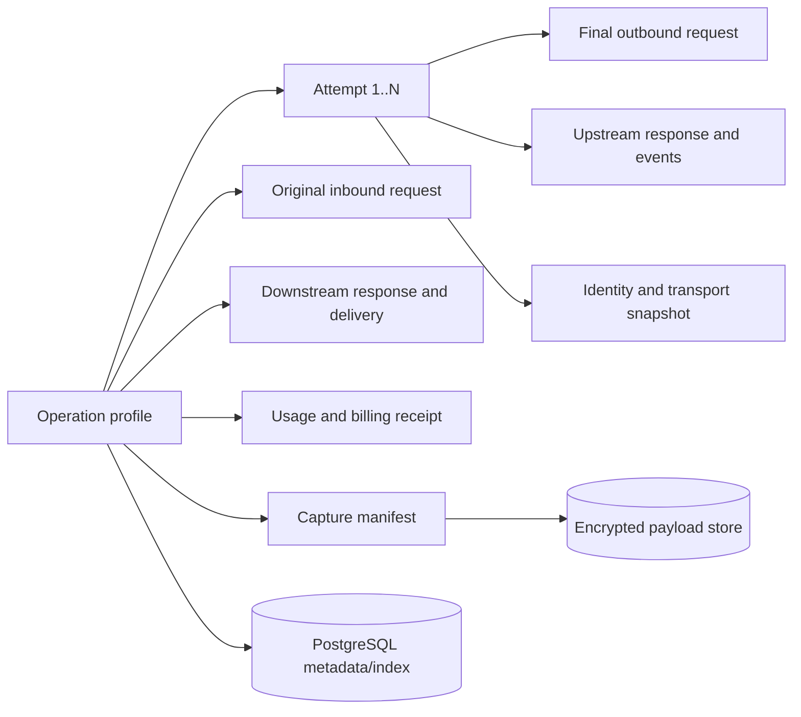

# Administrator Request Diagnostics Design

Status: normative target design. Existing imported execution observations and
diagnostic facilities are the adaptation base; they do not establish this
tenant-scoped encrypted full-capture, retail billing or query contract.
[ADR 0015](adr/0015-imported-backend-baseline.md) supersedes the removed baseline
and source layout. The actual HTTP surface is in [API Contracts](API.md).
See [Gateway Framework](GATEWAY_FRAMEWORK.md),
[Protocol and Identity](CODEX_PROTOCOL_AND_IDENTITY.md), and [API Contracts](API.md).

The same capture lifecycle applies to every service in
[Multi-provider Support](MULTI_PROVIDER_SUPPORT.md): OpenAI/Codex, Claude,
Gemini, Grok, and Chinese services. Common correlation and completeness fields
are shared; provider-specific wire evidence remains native and versioned.

## 1. Product contract

Administrators need a complete request profile to explain what a client sent,
what every upstream attempt sent and received, what the gateway changed, what
the client connection received, and how the final charge was calculated.
Successful requests, errors and cancellations all participate. Sampling only
errors or keeping only token summaries does not meet this requirement.

Default target policy for admitted model operations is `full_requested`: capture
every permitted exchange leg and every attempt, subject to declared byte/event,
time, tenant and storage budgets. Capture is not ordinary access logging.
Credentials are always removed. Request/response content, tool arguments/results
and attachments are protected diagnostic payloads, outside the repository and
ordinary logs. Routine process logs remain redacted and contain references only.

"Complete" means all gateway-observed application exchange data permitted by the
capture policy, with known omissions reported. It does not mean TLS private keys,
unobservable client internals, packet-level identity, hidden model reasoning,
decryption of opaque reasoning payloads, or proof of upstream execution beyond
the observed protocol. Known application credential values are removed before
persistence; arbitrary user content can still contain sensitive data and remains
encrypted and access controlled.

## 2. Record graph and ownership



Use gateway operation IDs, attempt IDs and capture IDs as correlation keys.
Client request IDs and upstream request/response IDs are separate observed fields.
A single operation can have multiple attempt costs but one user settlement.
Handshake/prewarm/provider discovery are explicit operation kinds and link to
their owning connection/turn where known; they must not appear as invented user
generation usage.

Metadata and payload references carry tenant ownership. Admission rejections
before verified authentication have a gateway ID and unverified authentication
state, never a tenant asserted by an invalid token. Keep their content capture
disabled by default and their metadata bounded by edge/admission limits; do not
allow anonymous traffic to fill the payload store. Such records explicitly show
that full authenticated capture did not apply.

## 3. Complete profile fields

| Area | Required observations |
| --- | --- |
| Ownership | Tenant/user references, downstream credential principal, group/channel, operation/attempt IDs, trace linkage, authentication result and scope. |
| Inbound request | Receive time UTC, method, authority/path, sanitized query, multi-value headers, observed HTTP version, content type/coding, encoded/decoded byte counts, original permitted body/attachments, client UA and transport. |
| Client network | Peer address, derived client IP, trusted-proxy decision and configured source, validated forwarding chain; connection accept/upgrade timings where measured. |
| Requested behavior | Requested model, operation kind, HTTP/WS, unary/SSE/frame stream, reasoning effort, requested tier, tools/search/compaction flags and supported extension metadata. |
| Resolution | Mapped model, billing model, provider, eligible/excluded account reasons, selected real account principal, route/price/config/entitlement revisions and frozen limits. |
| Transformation | Ordered rule IDs, affected paths/headers, before/after protected references, model mapping, explicit protocol conversion, identity projection and content coding. |
| Outbound attempt | Final endpoint, method, sanitized query and headers after auth binding, permitted body before content coding, encoded size/coding, dispatch/write boundary and attempt ordinal. |
| Upstream response | Status, sanitized multi-value headers/trailers, provider request ID, response IDs, rate-limit/retry metadata, raw permitted body or ordered events/frames, close code/reason and terminal usage. |
| Downstream response | Status/headers, permitted body or ordered event output, local write acceptance, semantic-output commitment, disconnect/cancellation and final delivery outcome. |
| Identity | Installation/profile reference and generation, actual outbound UA/originator, supported version fields, original/projected session/thread/turn/window relationships, opaque-state presence and protected reference. |
| Transport | Connection ID/generation, new/reused state, actual credential owner, selected egress/proxy reference, target authority, resolved/connected address, TLS backend/version/cipher, ALPN, HTTP version, compression, pool/build/contract revisions. |
| Execution | Admission/queue/dispatch timeline, deadlines, retry decision and budget, send certainty, first semantic output, cancellation origin, provider errors and redacted cause chain. |
| Accounting | Authoritative provider usage, normalized disjoint quantities, frozen retail USD unit prices and multiplier, exact customer charge calculation, reservation/ledger references, separate procurement cost/currency and reconciliation state. |
| Capture | Policy/schema/redaction revisions, requested/captured byte/event counts, leg completeness, gaps, truncation/error reasons, retention deadlines and payload integrity state. |

Customer money evidence uses canonical USD decimal strings at scale 10,
matching existing checked `Decimal` and PostgreSQL `numeric(20,10)`. Ledger
references identify credit/debit direction and a nonnegative amount. Show the
one final retail charge rounded half-even after exact component/multiplier
calculation, and quotes/holds rounded upward, at `0.0000000001 USD`. Never
recompute financial authority from rounded display components or captured text.
Provider USD cost stays a distinct procurement fact; native non-USD evidence
retains its currency. Unknown usage is not zero. The financial authority and
arithmetic rules are in [Billing and Pricing Design](BILLING_AND_PRICING_DESIGN.md).

Full headers means all permitted values, retaining duplicates where the
application stack exposes them. It does not imply original HTTP/2 wire ordering
or capitalization. Redact Authorization, Proxy-Authorization, API keys, cookies,
Set-Cookie, signed query credentials and configured secret-bearing headers.
Record presence, mechanism and credential revision instead of their values.
Perform filtering on request, response, error and export paths alike.

For identity debugging, non-secret session/turn values can be inspected with
payload permission; ordinary list records show safe references. Opaque upstream
state belongs in encrypted storage and remains scoped to its execution owner.
Never export an access-token digest as a public principal identifier.

Original payload, final provider payload and final client output must be
distinguishable. For streaming, preserve event payload boundaries and sequence;
TCP chunk boundaries are not protocol events. Record WS text/binary/control
message metadata as exposed by the instrumented transport, and mark lower-level
fragmentation unavailable if the library has already assembled it. Do not claim
a sanitized payload is a byte-identical raw network capture.

Remote URLs referenced by a request are recorded after secret filtering, not
automatically fetched for diagnostics. Record gateway-observed uploaded bytes;
do not claim to archive data that only the provider fetched.

## 4. Timing and metric definitions

Use UTC for absolute timestamps and monotonic elapsed durations within a process.
Store clock/process identity so a restart or clock adjustment cannot make a fake
negative duration. Record distinct phases when instrumented:

```text
receive -> authenticate -> admission wait -> route -> funds/capacity reserve
        -> pool wait -> DNS -> proxy/TCP -> TLS -> HTTP/WS handshake
        -> request write -> upstream headers -> first semantic output
        -> terminal usage observed -> settlement -> downstream terminal write
        -> capture finalization
```

Pool reuse commonly skips DNS/TCP/TLS. Those phases are `not_applicable` or
`unavailable`, not zero milliseconds. Proxy connection and origin connection are
different measurements. Record endpoint and scope for every reported delay.

- User TTFT: receive to the first model semantic output; preserve the separate
  upstream first-output delay measured from dispatch/write.
- Total time: receive to the defined terminal delivery boundary, with a separate
  upstream completion and settlement time. Partial/cancelled durations are marked.
- Output rate: authoritative output-token count divided by observed generation
  interval; return unavailable when count or interval cannot support the metric.
  SSE event count is not a token count, and final reasoning tokens can make this
  an effective rate rather than visible text speed.
- Cache rate: provider cached-input tokens / provider total-input tokens for a
  contract that defines that subset. Zero denominator is unavailable.

Caddy terminates inbound TLS, so the gateway normally cannot directly observe
the original client handshake. Any edge TLS metadata requires a deliberately
trusted, sanitized integration and explicit provenance. Do not copy arbitrary
forwarded headers and label them measured facts. A local socket address is not
necessarily the public egress IP; a configured proxy address is not proof of the
provider-observed address. JA3/JA4 are optional measured evidence with a named
capture point, never derived from a UA or crate version.

## 5. Structured metadata and protected payloads

Suggested persistence groups, added only with real query/capture callers:

| Record | Content and access pattern |
| --- | --- |
| Operation profile | Tenant-scoped indexed summary, independent execution/delivery/settlement/capture states, route and revision references. |
| Attempt profile | Account/egress/profile snapshot, timestamps, send certainty, errors, upstream IDs and usage evidence. |
| Exchange index | Leg, attempt, ordered sequence, direction, event kind, response/lane boundary, monotonic offset, protected payload locator. |
| Capture manifest | Schema/policy revisions, object/chunk counts, checksums, coverage/gaps, retention and finalization state. |
| Capture access audit | Actor, tenant scope, operation, metadata/payload/export action, result and time; no content. |

Keep these metadata/index records in PostgreSQL. Do not put full prompts or
stream event bodies in ordinary usage rows, outbox events, metric labels or
process tracing spans. Index only bounded, useful query fields; never index all
prompt text. Dashboard queries must not load payloads.

Initial payload storage is a dedicated private persistent filesystem mount,
separate from application source, public static files, access logs and temporary
build output. Application releases preserve it. Multi-replica support must first
provide a shared/durable payload backend or explicit owner-aware retrieval and
recovery; replica-local ephemeral files do not satisfy retention. Add an object
store adapter only when the deployment requires it.

Write bounded chunks: optional compression, then authenticated encryption with
fresh nonces and per-capture data keys wrapped by an external key source. Bind
tenant, capture, attempt, leg and sequence in authenticated associated data.
Plaintext exists only in bounded processing buffers, never disk spool or crash
dumps. The manifest records chunk sizes, ordering and integrity verification.
Use atomic object finalization and idempotent index publication. A crash leaves
explicit pending/orphaned chunks for recovery, not a false complete manifest.

Payload checksums must not become a cross-tenant plaintext-content oracle. Keep
integrity metadata protected and use keyed content fingerprints if equality
indexing is needed. Never deduplicate customer payloads across tenant boundaries.

Default retention target: seven days for protected payloads and thirty days
for diagnostic metadata/event indexes. Financial ledgers have a separate
retention contract and do not expire with debug content. Policy is tenant-aware
and versioned; quotas and permitted capture size are mandatory deployment
configuration. Retention workers delete payloads and transition manifests to
`expired`; retrieval returns that state. Backups, wrapped keys and restored
indexes participate in expiry, so restoration cannot silently resurrect access.

## 6. Bounded collection and failure behavior

Reserve tenant/global capture quota before dispatch. Bound encoded and decoded
request/frame/event sizes, total captured bytes, event count, spool capacity,
per-operation memory, queue depth, enqueue wait, writer concurrency and shutdown.
Decompression limits apply before allocating expanded payloads. Include all
attempts in the operation budget; retries do not reset storage limits.

Use a bounded tee at actual IO boundaries, with off-worker blocking filesystem
work supervised by runtime limits. Record source and destination sequences so
upstream-observed data can differ from downstream-written data after cancellation
or conversion. Financial receipts use their durable settlement path independently
of the potentially much larger capture writer.

| Failure point | Required behavior |
| --- | --- |
| Capture quota/key/store unavailable before dispatch | Reject admission for the full-capture policy, record the reason where available, release reservations/leases; send nothing upstream. |
| Input rejected above an admission body limit | Reject with the declared protocol error; retain only permitted bounded metadata/partial capture and mark the limit. |
| Capture limit, writer deadline or disk failure after dispatch | Mark the affected leg partial/failed with its last durable sequence and reason; emit a bounded operational alert; continue the existing model exchange within its execution limits. Never silently label it complete. |
| Metadata/index failure after dispatch | Preserve a bounded encrypted spool/manifest for recovery when possible; report capture degradation. Do not retry generation to reconstruct diagnostics. |
| Client disconnect | Stop downstream writes, signal cancellation through the executor, preserve observed upstream/cancel/usage evidence and uncertain state. |
| Shutdown/crash | Drain only within the shutdown budget; recovery finalizes durable chunks or marks gaps/aborted capture. It never guesses missing usage from payload text. |
| Corrupt/expired payload on query | Return a typed unavailable/integrity result, audit it, and keep the surviving summary visible. |

Continuing an already dispatched request after a capture failure is an explicit
availability policy, not a claim of complete capture. It avoids turning a debug
disk failure into an ambiguous provider execution plus a speculative retry. An
environment requiring termination on capture loss needs a separate explicit
policy and must still account for upstream execution uncertainty.

Capture state is independent of forwarding success:

```text
requested -> collecting -> complete
                       -> partial(reason, last_durable_sequence)
                       -> failed(reason)
complete/partial/failed -> expired
```

`complete` requires every required leg/attempt closed and durably indexed, no
missing permitted payload chunks, and a terminal manifest integrity check.
Expected credential removal is listed as policy redaction, not hidden data loss.
Incomplete client input, unknown late frames and unobserved delivery are explicitly
identified; the UI never converts absence into an empty successful exchange.

## 7. Administrator investigation flow

### Provider-specific evidence

Every attempt pins the concrete provider product, region/project or deployment,
model mapping, endpoint/auth contract revision, and usage-normalizer revision.
A shared protocol name is insufficient to identify its behavior. Preserve native
stop/error reasons, tools, cache counters, and signature-bearing content in the
protected exchange; never manufacture missing fields to fit a Codex profile.

| Provider contract | Additional investigation evidence |
| --- | --- |
| OpenAI API / Codex OAuth | Responses item/event IDs, supported continuation and compaction boundaries; Codex turn/connection identity only where its endpoint contract requires it. |
| Anthropic Messages | Content-block indices/types, incremental tool JSON, thinking/signature blocks when returned, stop reasons, input/cache-write/cache-read quantities and TTL class. |
| Gemini API / Vertex AI | Candidate/part ordering, function calls/results, thought signatures when returned, grounding/citations, safety/finish reasons, usage metadata, project/location and cache references. |
| xAI API | Native response/tool events, citations/search/tool usage, continuation references where supported, and actual terminal usage. |
| Chinese services | Original reasoning/tool fields, cache hit/miss/write quantities, endpoint/workspace/deployment IDs, safety/provider error codes, rate-limit dimensions and original cost currency. |

Opaque or signed blocks are not credentials merely because they are opaque, but
may contain sensitive content. Preserve them unchanged for authorized forwarding
and protected diagnostics, apply their specific retention policy, and exclude
them from ordinary logs and public/user usage summaries. Capture only what the
upstream actually returns; this design cannot reveal hidden model reasoning.

### Investigation views

Use the existing administrator request/usage feature for the eventual entrypoint;
this design does not add a new route or implement a screen.

The selected record should provide these cohesive views:

| View | Questions answered |
| --- | --- |
| Overview | Who called what, when, through which route/account; what succeeded, failed or remains unknown? |
| Inbound | Exact permitted client headers/body, IP provenance, request kind, model, reasoning and tools. |
| Outbound | Every attempt's actual endpoint/headers/body, transformation diff, selected identity and egress. |
| Response/events | Original upstream and final downstream content with sequence/time/response boundary; terminal and close events. |
| Timeline/attempts | Queue/pool/network/generation/settlement timing; retries, budgets, certainty and cancellation. |
| Identity/transport | Build/contract/profile revisions, thread-turn-window graph, auth attachment, socket reuse, TLS/ALPN/compression facts and unavailable observations. |
| Billing | Token/cache/tool quantities, frozen USD unit prices, tier/multiplier, canonical customer charge/debit, separate procurement cost, source, reservation, ledger and reconciliation. |

Raw protected content is lazy loaded with bounded pagination/streaming. Escape
all user/provider text. Do not execute tool calls, render active HTML, or follow
payload URLs automatically. Show visible capture gaps and expiry near the data.
Do not make a giant JSON blob the only investigation interface.

Separate permissions for metadata read, protected payload read, and export.
Every operation enforces the administrator's tenant/data scope. Audit payload
views/downloads and exports. Exports retain secret filtering, are size/time
bounded, require scoped retrieval and expire; file contents never enter analytics
or public URLs. No diagnostic read grants access to upstream credentials.

User APIs expose only their approved successful usage summaries and billing
facts. They have no administrator request-details action, internal failure
history, account identity, raw payload, or upstream credentials. Financial query
contracts must still disclose their authoritative debits and pending disposition.
Debug archives are not a replay queue and never trigger automatic model calls.

## 8. Acceptance criteria

Implement collection alongside the first real model flow. Verify:

- Original and transformed requests, multiple attempts, upstream and downstream
  streams, successful/failed/incomplete/cancelled exchanges and pre-dispatch errors.
- Correlation across session/turn, connection/lane and response boundaries without
  cross-tenant or stale-response attribution.
- Secret removal in headers, URLs, provider error strings, payload views and
  exports; bounded handling of binary, malformed and oversized content.
- No raw prompts/response bodies in tracing, access logs, metrics or outbox data.
- Exact billing evidence with overlapping cache/reasoning counters normalized once.
- Capture admission failure, queue pressure, disk full, encryption/key failure,
  index failure, process crash, missing chunks, retention and backup recovery.
- Large streams retain bounded memory/backpressure; slow diagnostic readers cannot
  block unrelated model operations or create unbounded export buffers.
- Independent execution/delivery/settlement/capture states and truthful UI gaps.

These are required implementation checks, not tests completed by this design.
