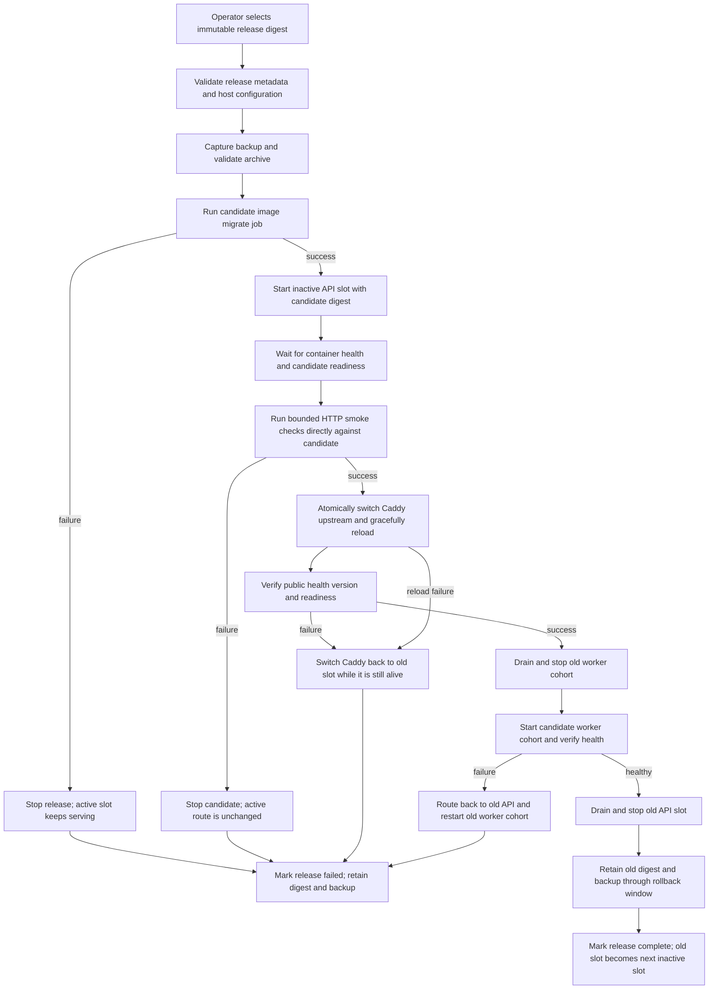

# ADR 0012: Zero-downtime Docker releases

Status: superseded by [ADR 0015](0015-imported-backend-baseline.md).
Date: 2026-10-27.

The following records the previous backend's release design and scaffold only.
Its CLI, health endpoints, and process roles do not apply to the imported backend.
The accepted update mechanism now uses the imported replacement/restart/rollback
flow; zero downtime is no longer required. Packaging adaptation remains pending.

Implementation status: the double API-slot Compose topology, loopback-only Caddy
reload path, host coordinator, coordinator failure tests, and tag-only workflow
signing/attestation steps are implemented. A static workflow contract checks image
signature and SLSA v1 provenance identity against the coordinator's exact trust rule.
No signed release has yet been observed, and the real Docker release acceptance
gate has not passed; the zero-downtime production guarantee remains unsupported.

## Context

At decision time, Compose had one `gateway` container behind Caddy. Replacing that
container interrupted new requests during startup. The API, worker, and migration
process roles are now explicit in the CLI and Compose topology.

Sub2API is a useful reference for a simple Compose installation, release discovery,
and a convenient update flow. Its Docker instructions update with `docker compose
pull` and `docker compose up -d`; its Web UI update flow atomically replaces the
application executable and restarts the process. Those approaches are operationally
simple, but they do not keep an old and new API instance serving across a route
switch. Ovload needs an explicit proxy cutover to meet the zero-downtime requirement.

## Decision

Keep one immutable Ovload image and use Docker Compose blue/green application slots
on a single host. Caddy remains the stable ingress. PostgreSQL and Redis remain
independent stateful services with persistent volumes. A host-side release command
owns image verification, migrations, candidate startup, proxy switching, draining,
and cleanup. It takes a host-level exclusive release lock so two operators cannot
switch slots concurrently. The application container never receives the Docker
socket and never replaces its own executable.

The deployment roles are:

| Role | Runtime | Ownership |
| --- | --- | --- |
| Ingress | One stable Caddy container | Public listener, HTTP policy, and routing to exactly one active API slot |
| API slots | `api-blue` and `api-green` containers from the same immutable image | One active slot serves requests; the inactive slot is started with the candidate image before cutover |
| Worker | One active release cohort of `worker` command containers from one image digest | Durable jobs, bounded concurrency, shared PostgreSQL queue and Redis leases; replicas in a cohort use the same digest and settings |
| Migration | One-shot `migrate` command from the candidate image | Applies reviewed schema changes before the candidate is admitted |
| State | Independent PostgreSQL and Redis containers | Durable records and shared coordination; never recreated as part of an app release |

The API role must not start background workers. The worker role is independently
started and drained so a blue/green API overlap cannot accidentally multiply
worker capacity or run jobs using two application versions. After API cutover,
the coordinator drains and stops the old worker cohort, then starts and checks the
candidate cohort. The durable queue remains available during that bounded pause;
queued jobs are not lost, though background completion can be delayed. The API
slot switch does not claim zero downtime for background job completion. The same
binary and domain modules serve all roles; role selection belongs to the CLI and
bootstrap composition root, not to domain or provider code.
The CLI contract keeps `serve` as the HTTP-only command, `worker` as the durable
worker command, and `migrate` as the one-shot schema command. The worker's
`worker-ready` check verifies storage and required schema without applying
migrations. No second API alias is introduced. Deployment role selection is
explicit in Compose and no role starts the other role implicitly.

The release coordinator accepts only a version-tagged immutable image digest and
requires a signed SLSA provenance attestation bound to that digest. It updates only
the inactive slot, never mutable `latest` tags. The active route is stored in a
host-owned Caddy include directory mounted read-only into
Caddy; mount the directory rather than the file so an atomic rename is visible
inside the container. Caddy's admin API listens on `localhost:2019` inside the
container and is never published. The host coordinator holds an exclusive file lock,
atomically writes and syncs the include, then runs
`caddy reload --config /etc/caddy/Caddyfile --adapter caddyfile`
inside the Caddy container so the reload uses container loopback. The include
contains only the allowlisted blue/green service name and port. The coordinator
probes the candidate `/readyz` and `/healthz` directly;
after cutover, it probes those routes through Caddy and compares the public
`/healthz` version with the selected release version. No proxy retry is added for
model requests because replaying a dispatched request can duplicate provider work
or customer charges.

## Release protocol

The active API slot continues receiving traffic during backup, migration, candidate
startup, and smoke checks. The coordinator changes the route only after the
candidate is ready. Caddy applies the new route while existing connections drain
under the old configuration. If reload fails, Caddy retains its old configuration;
the coordinator restores the old include and accepts the existing configuration
only if public health and readiness still prove the old release is serving.

The coordinator persists a pending release record before starting side effects. If
the host process exits at any phase, `recover` always rolls back to the recorded old
slot and worker image; it does not infer that a partially switched release should
commit. Recovery validates the recorded slot names and digest references, restores
the old image pins and route, restarts the old worker, and verifies public version
and readiness before removing the pending record. If the old public state cannot be
proven, both API slots and the pending record remain for operator investigation.
Application recovery never reverses database migrations. The old API remains
available until the candidate worker passes health checks; it then
receives SIGTERM and uses bounded graceful shutdown. Model streams have a
server-owned maximum operation lifetime; the drain period must exceed that bound.
An interrupted upstream operation is classified by dispatch certainty and billing
settles idempotently. A disconnect or timeout never authorizes an automatic replay.

If candidate worker startup fails, the coordinator restores the old Caddy route
and restarts the old worker cohort before stopping the candidate API. This recovery
depends on the persisted job envelope and handler semantics remaining unchanged
across the rollback window. Job kinds have immutable typed payload and handler
semantics; do not change their meaning in place or add version-sniffing fallbacks.
To introduce a new kind, first release a worker that handles it while the API still
emits only existing kinds. In a later release, allow the API to emit the new kind.
Retire an old kind only after its rows are drained and no rollback target needs it.
Job age and queue capacity are release health signals; queue processing may pause
during the bounded worker switch, while queued rows remain durable.

“Zero downtime” means the public HTTP listener remains available for new requests
through an application release while the host, ingress, and state services remain
healthy. It does not promise continuity through host/Caddy/PostgreSQL/Redis failure,
or that an unbounded client stream can be migrated between processes. WebSocket or
other long-lived sessions must have an explicit maximum lifetime and close policy
before those routes are covered by this guarantee.

## Schema and rollback contract

The release coordinator captures a PostgreSQL backup while the old API continues
serving and validates the archive before proceeding. Archive inspection is not a
restore test; a scheduled isolated restore drill must verify recoverability.
Candidate migrations run as a one-shot job before candidate startup. Migrations in
a blue/green release may add tables, nullable columns, indexes, or other structures
that every currently active API and worker image can safely ignore. They must not
drop or reinterpret fields used by an active image. Each migration must set bounded
lock and statement timeouts and document its lock impact. Large indexes use a
reviewed concurrent-build procedure with explicit partial-failure recovery; a
migration requiring a long exclusive lock is not eligible for a zero-downtime
release. Destructive cleanup is a later release after the old image is no longer
a rollback target.

This is migration ordering, not application compatibility code. Do not add dual
read/write paths, legacy aliases, fallback parsers, or version branches to keep old
application behavior alive. Every migration remains append-only and checksum
verified. Readiness requires every migration embedded in that image to be present,
successful, and checksum-matching. It tolerates newer successful revisions created
by an additive candidate migration, so the old slot remains ready during rollback.
Startup of API and worker roles does not run migrations;
the one-shot migration role is the only schema writer during deployment.

Before cutover, any failure stops the candidate and leaves the active slot untouched.
After cutover, a failed public check switches Caddy back to the still-running old
slot. A candidate worker startup failure also returns API traffic to the old slot,
restarts the old worker cohort, and marks the release failed. Image rollback does
not reverse a migration. Automatic schema downgrade is forbidden; destructive
recovery uses a reviewed migration or restores a tested backup after stopping
writers. Retain the previous image digest and backup until the release has passed
its observation window.

## Security and operations

The release command runs on the Docker host with operator authorization. It accepts
only `ghcr.io/jhupo/ovload-gateway@sha256:<digest>` and an explicit semantic
version, then verifies both a keyless image signature and a GitHub Actions SLSA v1
attestation whose certificate identity is the version-tagged `release.yml` workflow
before pulling or starting a container. It never accepts arbitrary image names,
shell fragments, or migration SQL. The tag-only `.github/workflows/release.yml`
signs the pushed digest and emits an OCI-backed SLSA v1 attestation. The coordinator
requires exact identity
`https://github.com/jhupo/ovload-gateway/.github/workflows/release.yml@refs/tags/v<VERSION>`
and issuer `https://token.actions.githubusercontent.com`. A static workflow
contract checks that the trust rule and digest subject stay aligned; actual registry
output remains unverified until a normal authorized tag run succeeds.
The gateway API cannot invoke the release command and has no Docker socket, host
mount, or deployment credentials. An in-product update trigger is not part of this
decision; adding one would require a separately authenticated host agent that
accepts a narrow signed release request and records an audit event.

Compose remains the supported single-host deployment. Blue/green cutover requires
temporary capacity for both API slots. PostgreSQL and Redis are not part of the
slot switch. Multi-host failover and orchestrator-managed rolling updates are outside
this ADR; they require an orchestrator and service discovery with their own failure
and migration tests.

## Consequences

The release process is more involved than `docker compose pull` followed by
`docker compose up -d`, but it provides an explicit health gate, atomic ingress
switch, drain, and route rollback. The coordinator and Compose roles are present;
production support is gated on signed release provenance and a real Docker
acceptance workflow. The included Docker fixture tests Caddy routing with real
PostgreSQL and Redis containers, but its API slots are HTTP fixtures and it does not
prove application migration, worker, or durable job rollback behavior.

References: [Sub2API deployment guide](https://github.com/Wei-Shaw/sub2api/blob/main/deploy/README.md),
[Sub2API Apple container update behavior](https://github.com/Wei-Shaw/sub2api/blob/main/deploy/APPLE_CONTAINER.md).

Caddy's graceful reload behavior is defined by its [official configuration reload
documentation](https://caddyserver.com/docs/getting-started#reloading-config).

## Release acceptance

Before zero-downtime support is claimed, the Docker integration gate must exercise an old active image and a candidate image
against real PostgreSQL and Redis. It must keep bounded requests flowing through
Caddy during migration, candidate startup, route switch, and old-slot drain; verify
that a successful response is served by the candidate after cutover; and prove that
the old slot serves again after injected post-switch failure. It must also inject
migration failure, candidate readiness failure, Caddy reload failure, and candidate
worker failure, confirming that the API route returns to the old slot, the old
worker cohort can be restarted, and durable jobs remain. PostgreSQL and Redis
container identities and persistent volumes must remain unchanged throughout the
release. The test must verify the old API and worker can run against the additive
candidate schema before cutover and that candidate-enqueued jobs under the unchanged
contract remain processable by the old worker on rollback. A staged new job kind
must be tested with the worker release first and the API producer in a later release.
It must also kill the coordinator between route
file replacement and Caddy reload, and between worker replacement and release
completion, then verify deterministic recovery from the public version and container
digests.

The current `tests/deploy/test_caddy_release_switch.py` test exercises the Caddy
include switch path with continuous HTTP fixtures and verifies PostgreSQL/Redis
container identity stability. CI runs it with Docker when the daemon is available.
It does not satisfy the complete acceptance gate above.
Long-lived stream drain, client cancellation, dispatch uncertainty, and idempotent
billing require protocol-level tests once model forwarding exists. The current
infrastructure probe tests do not establish those guarantees.
