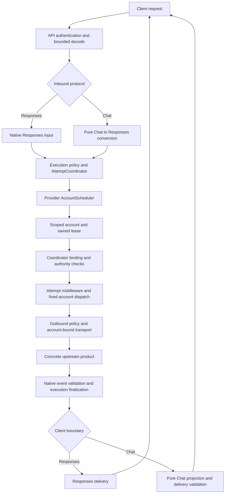

# ADR 0027: Standard API execution and directional Chat conversion

Status: accepted and implemented; validation limits are recorded separately.

Follow-up [ADR 0028](0028-managed-http-outbound-policy.md) completes managed HTTP
policy support and strict standard-API usage evidence. It supersedes the blanket
HTTP adapter/policy rejection below; the WebSocket restriction remains explicit.

## Decision

Reuse the imported provider registry, execution sessions and AttemptCoordinator.
The coordinator continues to own request deadlines, cancellation, retry budgets,
attempt evidence and downstream commit. Account scheduling is an execution
boundary; provider-specific credential/quota/affinity adapters supply facts and
leases, while a provider dispatches only the account selected for that attempt.
Do not create another execution framework or hide retries inside providers.

The public Responses API product is registered separately from Codex OAuth and
Grok Build. Its API-key credentials, configured endpoint, model catalog and
declared capabilities are independent product facts. Existing stored products
are not silently reassigned. Reuse proven account-bound networking, SSRF checks,
credential encryption and native Responses codecs without injecting Codex
identity, instructions, OAuth continuation or private endpoint fields into public
API requests. Management supports explicit public-API account creation and safe
connection editing through the existing account workspace.

Add POST /v1/chat/completions as an explicit Chat Completions-to-Responses
direction. Its request and response conversion are pure protocol code, separated
from provider wire rewriting and transport. Preserve the client protocol and
endpoint in execution metadata and customer usage. Authentication, group/model
policy, admission, retries, cancellation and finalization use the existing
execution path exactly once; conversion must not call another local HTTP route.

Support bounded text conversations, function tool definitions/calls/results,
one completion, ordinary JSON responses and incremental SSE. Strictly validate
and reject unsupported required fields, modalities, continuation and unknown
semantics before dispatch. Do not infer reverse conversion or chain converters.
Stream conversion keeps bounded per-output state and backpressure, emits one
terminal result, preserves errors and authoritative usage, and never fabricates
successful completion on truncation or upstream failure. A client disconnect is
not evidence of nonexecution.

Public API connection settings do not imply arbitrary-provider compatibility.
Expose only the concrete implemented product and supported protocol/transport
combinations. Credentials remain write-only and provider destinations remain
account bound. Existing native Responses payloads retain their protocol shape.

## Financial and validation boundaries

The execution roles fit within the existing process:

Automatic customer reservation and settlement remain disabled. Preserve native
usage evidence and explicit unknown usage; token estimates do not authorize
customer charging. Existing USD price publication and internal funds operations
continue independently.

Procurement cost is separate from customer charging. The standard API product
uses exact, explicitly configured USD token rates and authoritative usage only;
it does not inherit Codex model prices, aliases or long-context thresholds.
Missing rates, unsupported conditional bands and incomplete usage remain unknown.

Managed adapters retain the existing runtime destination authorization. Their
combination with frozen native privacy or outbound middleware is rejected before
adapter execution because that runtime does not apply these native policies.
Selecting an adapter must never silently bypass a configured policy.

Public API credential feedback is revision-fenced. Ordinary successful requests
may promote an unknown credential but cannot recover an invalid, expired or
banned credential. State promotion additionally compares the expected current
credential state atomically in PostgreSQL, so a concurrent 401 cannot be erased
by a delayed success. Explicit diagnostic recovery and credential rotation have
their own authority. PostgreSQL is the credential-state authority used by the
scheduler; this flow does not write a second credential-state cache. Redis owns
the separate, expiring 429 cooldown and shared concurrency leases.

Add redacted contract fixtures and focused failure/boundary coverage. The user's
current instruction skips test execution and real upstream/database operations;
static checks cannot establish migration, external-provider or race acceptance.
No release or deployment is authorized by this change.
