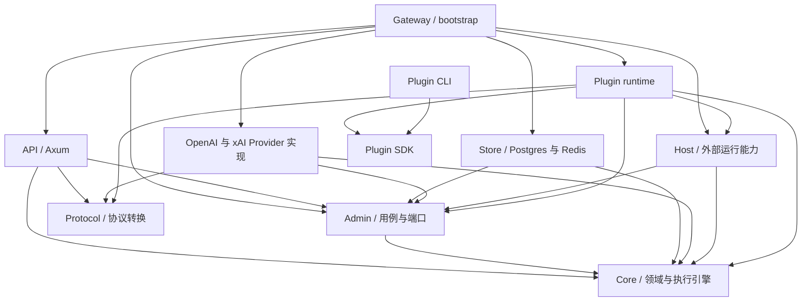
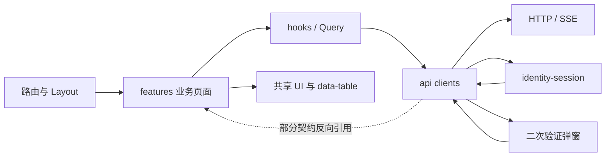

# 前后端架构审查与渐进重构设计

审查日期：2026-11-19。对象：`C:/Users/jhupo-pc/Desktop/ovload-gateway` 当前工作区，包括已有未提交和未跟踪源码。HEAD 为 `0dd21490b03d034e6a29cb8053a7e4474df912b8`，审查结果不等同于只审查这个提交。

结论：保留 Rust 模块化单体和 React 功能目录。需要收敛的是职责归属、接口契约、缓存规则和公共布局。Rust 用结构体封装状态、枚举表达有效状态、小 trait 表达变化点；React 用组件、hooks 和普通对象组合。没有必要引入另一套框架或建立通用继承体系。

本轮只新增审查材料和本地分析配置，没有修改产品行为、数据库或运行中的服务。

## 1. 主要发现

以下 P2 表示已确认的行为缺陷或有具体代码依据的维护风险；不把图谱的风险评分当成漏洞等级。未确认 P0/P1 问题，也不代表已完成所有功能和安全验证。

### F1 [P2] 账号模型目录未纳入统一缓存失效

- 位置：`web/src/features/accounts/supported-models.tsx:66`、`web/src/features/accounts/query-cache.ts:4`。
- 模型策略使用 `['account-supported-models', owner, accountId]`，保鲜时间五分钟。统一失效列表包含 `upstream-account-models` 和 `account-test-models`，遗漏了这个键。
- 触发：打开已存在账号的模型策略，修改凭据、重新授权或改变模型来源后，再次打开模型策略。失效函数不会取消或失效这个查询，五分钟内可能继续使用旧目录。
- 该组件的同步只写组件局部 `result`，没有更新 QueryClient 中的目录，其他弹窗也无法共享这次同步结果。
- `query-cache.test.ts:38` 的“every account projection”测试只列举部分查询，没有覆盖 `account-supported-models`，因此测试名比实际覆盖范围更大。
- 建议：统一账号 query key 工厂、query options 和 mutation 后的失效策略。保留现有 owner 隔离、取消旧查询后再次检查会话的保护。凭据原文不得进入 query key。
- 验收：编辑凭据、重新授权、手动同步后，模型策略和连接测试均读取新目录；旧响应不能回填；切换管理员不会污染另一会话。

### F2 [P2] HTTP 客户端依赖界面和会话 store，形成运行时循环

- 位置：`web/src/api/client.ts:1`、`web/src/stores/identity-session.ts:2`、`web/src/components/security-step-up.tsx:4`。
- 已确认循环：`client → identity-session → client`，以及 `client → security-step-up → client`。二次验证组件还使用模块全局 Promise 和 `createRoot` 管理界面。
- JSON 请求另有 `platform-client.ts`，连接测试 SSE 在 `account-connection-test.ts` 手动 fetch，诊断文件导出也有独立 fetch。它们分别维护认证、超时、会话变化和错误解释规则。
- 影响：修改认证或错误策略需要同步多处；基础网络层加载 React 弹窗，使单元测试和独立复用困难。循环本身不构成已证实的启动崩溃。
- GitNexus 的上游三层分析得到 73 个直接关联、156 个受影响符号，说明应保留旧入口逐步迁移。
- 建议：抽出叶子模块 `ApiError`、纯 HTTP transport、注入的 SessionPort 和二次验证协调器；弹窗由应用层 Provider 渲染。统一政策，保留不同解码器。
- 兼容约束：`apiRequest` 使用 identity 版本化地址和原始响应，`platformRequest` 使用 `/api/admin` 的 `{code,message,data}`。两种契约不能直接互换；SSE 和文件响应也不是普通 JSON。

### F3 [P2] 商业业务经过网站设置，主要规则落在 PostgreSQL 实现中

- 位置：`src/crates/api/src/identity/engagement.rs:30`、`src/crates/admin/src/use_case/site_settings.rs:25`、`src/crates/store/src/postgres/engagement/commerce.rs:128`。
- 订单、套餐、订阅、兑换码通过 `SiteSettingsService.engagement_*` 转发到 Store。该服务原本负责站点元数据和图片处理，现在直接转发商业指令。
- 分页查询在 HTTP 层转换成 `commerce-page|{JSON}` 字符串，随后在 Store 再解释；返回类型为 `serde_json::Value`，跨层无法检查查询和结果契约。
- `commerce::command` 同时负责权限、幂等、套餐与兑换规则、订阅操作、SQL、钱包账本和结果投影。调整业务规则必须阅读数据库实现，也难以使用内存假实现测试业务决策。
- 建议：先在现有 admin crate 建立 CommerceService 的明确用例入口和类型化查询；逐步按 Subscription、Redemption、Order 分工。Store 保留 SQL、并发锁和原子提交。
- 必须保留：实时权限校验、幂等键和原请求比对、revision/CAS、账本与审计同事务、兑换限额的并发保护。不能把一个事务拆成多个独立仓储调用。
- 本轮没有证据认定扣款遗漏或重复扣款。钱包投影包含数据库触发器，不能只根据 Rust 中是否出现余额 UPDATE 判断。

### F4 [P2] 厂商变化集中在 OpenAI 模块和大管理接口中

- 位置：`src/crates/providers/openai/src/public_api.rs:76`、`src/crates/providers/openai/src/public_api/native/oauth.rs:290`、`src/crates/admin/src/ports/provider.rs:143`。
- `initialize_http_provider` 在 OpenAI crate 内注册 `openai_api`、`claude`、`gemini`、`xai_api`。共享运行时中再通过 kind 字符串分支解释 OAuth、模型目录和上游请求。
- `ProviderAdmin` 聚合隐私、价格、身份、OAuth、凭据刷新、额度、模型、测试和导出等能力，很多能力通过默认 Unsupported 表示缺失。
- 前端已有 capabilities，但 `accounts/panels.ts:13` 仍需额外判断 Gemini 不使用周/月预测、OpenAI OAuth 不展示模型面板，能力语义尚未完整表达。
- 影响：增加厂商时，需要同时修改共享类的分支、能力默认值和前端例外；容易把某厂商的窗口、模型或测试模式错误套用到另一厂商。
- 建议：先在现有 crate 内按 Codex、OpenAI API、Claude、Gemini CLI、xAI API 分模块，分别拥有协议和凭据语义。抽出共享 HTTP 运行时；以 OAuthAuthorization、ModelCatalog、QuotaReader、ConnectionProbe 等窄能力组合，通过现有 registry/facade 接入。
- 不改变数据库中的 adapter ID。用户看到的四个平台与内部 adapter/auth 类型是两个维度；Gemini 的模型桶不能伪装成 OpenAI 的五小时/周窗口。

### F5 [P2] 表格公共布局存在多份实现，已产生布局策略差异

- 位置：`web/src/components/data-table/record-table.tsx:109`、`web/src/components/data-table/collection-table.tsx:76`、`web/src/features/accounts/index.tsx:484`、`web/src/features/groups/components/groups-table.tsx:94`。
- 发现 20 处 `useReactTable` 使用者，其中 18 处属于功能模块，另两处为通用包装。使用多个表格实例合理，问题是表头、行、空状态、滚动容器和分页布局也重复实现。
- `RecordTable` 的最外层是普通 `space-y-4` block；内部 TableViewport 虽声明 `flex-1`，但直接父元素并不是 flex。与依赖页面 flex 布局的 CollectionTable 不同，同一个底部分页规则无法由公共组件保证。
- 账号、分组等又维护自己的渲染和固定列逻辑，修改滚动、对齐和密度容易只覆盖一个页面。这解释了反复修某页而其他页仍不一致的代码原因，不等于本轮已完成逐页视觉验收。
- 建议：一个 DataTableFrame 负责 toolbar、可伸缩 viewport、footer、loading/error/empty；一个表头/表体 renderer；一个受控的服务端表格状态适配器。业务仅提供 columns、过滤器、行操作、固定列和展开区。
- 保留：账号左右固定列、横向滚动、服务端分页、行选择、移动端适配。客户端分页和服务端分页应是明确的两种模式。
- 已有 TableViewport、ToolbarLayout、PaginationControls 可继续演进。ServerPagination 包装公共分页属于合理适配，不应仅因名称相似删除。

### F6 [P2] 数据契约由界面类型反向提供，缺少依赖边界约束

- 位置：`web/src/api/workspace-settings.ts:1`、`web/src/api/gateway-settings.ts:2`、`web/src/hooks/use-commerce.ts:2`、`web/src/api/client.ts:153`。
- API 模块导入 features 的表单 draft，通用 hook 导入页面里的订单、兑换码和套餐类型；gateway-settings API 还运行时导入 feature 中的 codex-api。
- 影响：调整页面表单会影响网络契约，业务类型没有稳定归属；通用客户端的 `payload as T` 并不能验证服务器实际返回值。
- 统计得到 19 条跨 feature 静态依赖和 80 条非 feature 指向 feature 的依赖。80 条中包含 64 条正常路由装配，不能都视为越层；其余 16 条也应区分应用装配、类型依赖和真正的底层反向引用。
- 建议：建立 `api/contracts` 作为公共请求/响应契约归属，表单 Draft 是由契约映射得到的本地模型。优先为账号、使用统计和商业响应建立 schema 校验，再评估从 Rust DTO 生成契约；不要同时维护两套人工字段表。
- `web/eslint.config.js` 已启用 TypeScript、React 和 Query 检查，但没有 api/shared 禁止依赖 feature 的规则，也没有循环依赖守卫。应明确路由/应用装配例外后加入 CI。

### F7 [P3] 架构文档的“当前实现”描述落后于代码

- 位置：`docs/ARCHITECTURE.md:22`、`:45`、`:86`。
- 仍描述 commerce/自动请求扣费为缺口、额外商业页面为 preview，但已有商业命令、真实查询及 0060–0065 商业和执行结算迁移。
- 建议：重构时同步维护“已经执行的链路”和“目标设计”，链接到入口、迁移及测试。迁移存在本身不能证明生产环境完成迁移或整条扣费链路已经通过验证。

## 2. 现有架构与应保留的基础

### 后端实际依赖

Cargo metadata 确认 12 个 workspace package，生产依赖方向如下。下图为压缩视图，完整边集合在 inventory.json 的 backendCrates 中。



已有的设计模式及价值：

| 现有实现 | 设计方式 | 保留原因 |
| --- | --- | --- |
| apps/bootstrap 组装 Arc 与实现 | Composition root / 依赖注入 | 用例不需要自己查数据库或创建厂商客户端 |
| admin/use_case + admin/ports + store | Ports and adapters | API 不依赖 SQL；业务层不依赖 Axum、SQLx、Redis、reqwest |
| ProviderRegistry + 调度端口 | Strategy / Registry | 厂商替换通过明确接口完成 |
| Core execution session / AttemptCoordinator | 状态机与协调器 | 账号选择、重试、取消、提交时点有单一所有者 |
| CredentialsService prepared → commit → publish | 显式阶段和事务边界 | 凭据提交成功后再更新运行时，避免部分状态可见 |
| 固定运行时 snapshot + 实时权限验证 | 不可变快照与权威检查 | 稳定执行配置，同时不把快照当权限来源 |
| 数据库 revision、幂等记录、账本与审计 | 乐观并发和原子操作 | 重试和并发修改具有可核对结果 |

Core 不依赖工作区其他 crate；Protocol 和 Plugin SDK 同样独立。API 的工作区依赖仅 admin/core/protocol。现有架构测试已经约束 crate 依赖和部分模块边界，应继续使用，并增加商业领域的语义边界检查。

### 前端实际结构

技术基础是 React、TanStack Router/Query/Table、Zustand、shadcn/Radix、Zod 和 i18n。静态扫描覆盖 456 个前端生产源码文件、35 个 feature；Rust 生产路径 919 个文件，计数包含文件内测试。



已存在的公共能力包括表格工具栏、分页、滚动容器、字段布局、设置页布局、错误 toast、金额和 Token 格式化。需要统一使用方式和职责，不应另造第二套 UI 组件目录。

大型文件提示可拆分的责任，但行数本身不是缺陷。例如 accounts/details.tsx 1318 行、accounts/index.tsx 947 行、usage/index.tsx 953 行；应按查询、表格列、动作和独立面板拆分。shadcn sidebar 等上游基础组件不因行数较多而拆分。

## 3. 当前业务链路

### 账号授权与管理

```text
账号表单 / onboarding
  → upstreamAccounts → platformRequest
  → API accounts/credentials
  → CredentialsService → ProviderAdmin（厂商准备凭据事实）
  → commit_authorization（加密存储、权限、版本、审计）
  → publish_authorization（运行时刷新及额度观察）
  → 前端失效账号查询
```

证据入口：`admin/use_case/credentials/flow.rs:204`。该流程已有 durable receipt 重试处理和明确提交后发布语义，应该作为其他控制面用例的参考。GitNexus 对 trait 分派的调用边不完整，以上链路经源码逐段核对。

### 模型请求

```text
HTTP / WebSocket 协议入口
  → 身份与请求准备
  → Core admission / execution session / pinned snapshot
  → 路由与 AttemptCoordinator
  → AccountScheduler 获取绑定账号的 lease
  → Provider 认证、协议及网络适配
  → 流式事件 / 协议投影 / 计量与持久化观察
```

保留 Coordinator 对重试和取消的所有权。Provider 拿到账号 lease 后不能私自换账号重试。客户协议转换和上游厂商差异也应继续分开。

本轮核对了商业结算表与业务命令，但未通过真实数据库并发和请求流量验证整条执行扣费链路，不将该图作为扣费正确性证明。

### 订单、订阅、兑换码

```text
订单 / 订阅 / 兑换码页面
  → useCommerce / useCommercePage / useEngagement
  → /engagement 或 /commerce/{scope}
  → SiteSettingsService → SiteSettingsStore
  → PgSiteSettings → postgres/engagement
  → commerce 命令、查询、账本与审计
```

这条链路是后端优先整理的业务边界。替换内部服务归属可以先保留现有 HTTP 路径和 DTO，再逐步迁移客户端，避免一次改变所有层。

## 4. 公共架构应如何抽象

### 前端依赖规则

```text
应用装配层：routes / layouts / providers
  ↓
业务层：features/accounts、groups、commerce、usage、settings
  ↓                       ↓
数据层：api/contracts、api resources、query options
  ↓                       共享界面：components/ui、data-table、field-layout
基础能力：transport、纯格式化与校验、SessionPort
```

应用装配层可组合业务组件。基础 UI 不导入具体业务；API 不导入表单或 React；查询层不把页面类型作为公共契约。已有 components/layout 中的业务装配，应标记为应用层，而不是机械套用“components 禁止导入 features”。

建议在原目录中逐步演进，以下名称表示职责，不要求一次建立所有空目录：

| 公共能力 | 负责 | 业务保留 |
| --- | --- | --- |
| HttpTransport + response codecs | headers、会话、超时、取消、错误、request ID | 资源路径与请求/响应 DTO |
| StepUpCoordinator + 应用弹窗 Provider | 单次验证、等待者、会话更换时终止 | 哪些命令需要验证 |
| AccountQueries / query key 工厂 | owner、资源身份、缓存时间、取消和失效 | 账号操作的具体业务 |
| DataTableFrame / renderer | 工具栏、滚动、固定列样式、空/错/加载态、分页槽 | 列定义、筛选项、行操作 |
| DialogFrame 与明确尺寸档位 | 标题、内容滚动、固定 footer、焦点恢复 | 授权步骤、测试结果和业务面板 |
| Money / Token / Calendar 显示函数 | `$`、K/M/B、locale、时区、未知值 | 金额业务单位、额度计算、计费规则 |
| API contracts 与 form mappers | 公开 DTO、schema、明确转换 | 表单未保存状态与字段交互 |

金额精度不能通过展示格式统一来改变。后端十位小数 USD、钱包值、套餐 cents 和倍率需明确区分，原始契约使用精确值；UI 展示再格式化。服务端分页、cursor 分页和客户端分页也不能隐式互相转换。

账号功能建议按责任拆为：directory 查询、column 定义、mutation/actions、onboarding、usage/profile/quota 面板。连接测试的 SSE 协议解析留在数据适配层，进度和文本/图片输出留在面板；额度窗口的语义由后端能力和窗口事实提供。

### 后端用小接口和组合表达领域

优先复用现有 admin/core/store/provider 边界，不增加一个“万能 CommonService”。

| 边界 | 拥有的状态和规则 | 端口/适配器 |
| --- | --- | --- |
| Account / Credentials | OAuth 流程、账号配置、提交与运行时通知 | 凭据提交端口、OAuth 和模型能力 |
| Group / Routing | 分组倍率、路由和账号约束 | 分组存储、runtime 发布 |
| Commerce | 套餐、订阅、兑换、订单、资金使用规则 | 类型化读模型、原子命令端口 |
| Pricing / Metering | 标准模型价格、计量口径、价格快照 | 价目来源、持久价格版本 |
| Provider adapters | 各厂商 OAuth、协议、额度语义 | 共享 HTTP/代理/超时运行能力 |
| Observability | 系统日志、请求、容量快照及保留策略 | 查询/清理/采集端口 |

面向对象在这里具体指：对象保持自己的有效状态，调用者通过业务接口使用它；不同实现遵守同一能力契约。Rust 的 struct + impl + enum + trait 已能满足，无需模拟 Java 式基类。

示例职责分配：

```text
CommerceService.redeem(actor, RedeemCommand)
  → 验证命令形状、用例权限和业务意图
  → CommerceCommitPort.commit_redeem(typed command)
      PostgreSQL 事务内：锁与实时权限复核、额度约束、订阅/账本写入、幂等回执、审计
  → 返回 RedeemResult

ProviderAdapter = 公共执行接口 + 可选的窄能力
  OAuthAuthorization / ModelCatalog / QuotaReader / ConnectionProbe
  各厂商持有自己的协议实现，共享 HttpRuntime
```

并发敏感规则必须在原子提交处再次成立。不能在服务层先读取“可用兑换次数”，随后无条件更新；也不能为抽象而暴露任意 SQL 事务给业务层。纯计算规则可以移出 Store，锁、约束和账本一致性留在 PostgreSQL 事务内。

能力描述应包括可执行操作、测试模式、额度窗口种类和读模型可用性。前端基于描述显示菜单，后端仍独立鉴权；隐藏菜单不是权限控制。敏感凭据只能出现在受控写入和内部授权读取路径，公共 schema 不得生成这些字段的读取入口。

## 5. 迁移顺序与验收

每个阶段单独提交并保留兼容适配器；先契约与特征测试，再实现和调用者。没有必要先搬完全部文件。

| 阶段 | 修改范围 | 完成标准 |
| --- | --- | --- |
| 0. 可重复基线 | 前端依赖、查询失效测试、当前 API 与事务特征测试 | TypeScript 可完整检查；覆盖 F1 触发；明确旧 HTTP/SSE 契约 |
| 1. 请求与契约 | ApiError、transport、SessionPort、step-up、api/contracts | 消除网络/store/UI 循环；401/403/超时/取消/换会话/双响应格式兼容；导出和 SSE 仍工作 |
| 2. 账号查询与表格 | 统一 query keys、DataTableFrame；先迁账号和代理，再迁其他页面 | 刷新目录跨弹窗一致；表格工具栏、底部分页、固定列、横向滚动一致；移动端不溢出 |
| 3. 商业用例 | CommerceService、类型化查询、窄事务端口 | 不再经过 SiteSettings；并发兑换、重复命令、过期订阅、额度用尽转钱包、回滚和审计保持正确 |
| 4. 厂商能力 | 现有 crate 内拆独立模块，组合窄能力 | OAuth/API Key 分离；不同厂商目录/测试模式/额度窗口正确；提交后刷新和网络失败行为不变 |
| 5. 持续约束 | ESLint 依赖规则、Rust 领域边界测试、文档更新 | 新代码不新增反向依赖；现有债务按清单减少；业务入口和契约有稳定文档 |

表格验收包含桌面和移动端、长账号名、固定列、隐藏列、空/错/加载态、少量和大量行、浏览器缩放。只有实际截图验证后才能声明视觉一致。

商业验收必须用 PostgreSQL 覆盖事务与触发器，内存 fake 只用于纯业务规则。厂商测试用 mock server 覆盖 OAuth 换码与刷新、模型缓存、上游失败、流式中断、图片响应；少量真实账号验证不能替代这些回归测试。

优先级建议：先处理 F1 和 F2，再统一表格与契约，随后拆商业用例。执行引擎已有边界和测试，应避免与控制面重构同时大改。

## 6. 分析证据与限制

### GitNexus

- 使用官方 [Exploring skill](https://github.com/abhigyanpatwari/GitNexus/blob/main/.claude/skills/gitnexus-exploring/SKILL.md) 和 [Refactoring skill](https://github.com/abhigyanpatwari/GitNexus/blob/main/.claude/skills/gitnexus-refactoring/SKILL.md) 的索引、符号上下文、影响分析流程。
- 机器未预装该技能或 MCP。本次读取官方技能，使用本地 GitNexus 1.6.12 CLI，安装与 registry 均位于忽略的 `.runtime` 中，未更改全局 Codex 配置。
- 注册名称 `ovload-gateway`，路径与上述工作区一致。索引于 2026-11-19 01:11:33（Asia/Shanghai）完成；status 确认当前提交和 2333 个覆盖文件内容匹配。
- 图谱：52,420 nodes、146,206 edges、1705 clusters、564 flows。这是工具的全部节点统计，不等同于函数数量或已测试流程数量。
- 已查询 apiRequest、SiteSettingsService、commerce::command、complete_authorization、invalidateAccountQueries，并保存 apiRequest 上游三层影响分析。
- FTS 扩展因默认全局目录写入权限不可用而未加载；概念 query 返回降级警告和空结果，不能解释为“没有商业代码”。本次依靠精确符号查询、AST、Cargo metadata 和人工链路核对。
- 一个超过 512 KiB 的 OpenAI provider 契约测试文件未索引；TypeScript `component` 属性分派存在 fanout 截断；Rust 名称回退与 trait 分派不能完整解析。发现 commerce::command 的 `days` 调用关联到不相干符号，已排除该推断。即使某查询标记 exact，也不把它当跨 trait 调用完整性的保证。
- context 查询的调用者/被调用者展示上限为 5；列表未展示不代表不存在。impact 的 156 为本次图谱三层范围结果，不是全仓影响上限或安全严重度。

### 静态扫描与验证

- [inventory.json](inventory.json)：前端静态 import/export 图、强连通分量、表格使用者、文件规模、12 个 crate 的生产依赖；包括 type-only import，不能把所有依赖都当运行时调用。
- [inventory.mjs](inventory.mjs)：使用 TypeScript AST 和 Cargo metadata 的可重复生成脚本，不扫描凭据、数据库数据或运行时日志。
- [gitnexus-evidence.json](gitnexus-evidence.json)：查询原始证据；[gitnexus-evidence.mjs](gitnexus-evidence.mjs) 可重新生成。
- `cargo metadata --offline --locked --no-deps --format-version 1` 成功。仅核验依赖，不代表 Rust 已编译或测试通过。
- `node node_modules/typescript/bin/tsc -b --pretty false` 在 web 工作目录执行时未通过：`user-recharge/balance-form.tsx:3` 找不到 `qrcode.react`。package.json 已声明 4.2.0，当前是本地依赖完整性阻塞，不能据此认定该业务代码缺少依赖声明。
- 未执行整仓 Rust/前端测试、真实上游请求、数据库回归或浏览器截图。本报告是架构及重点逻辑审查，不是全量功能验收。
- UI 公共组件审查参考本机 ai-design-check 的共享组件、格式化和一致性规则；本轮未更改 UI。

### 复现

从仓库根目录执行：

```powershell
node reports/architecture-review-2026-11-19/inventory.mjs
$env:GITNEXUS_HOME = Join-Path (Get-Location) '.runtime/gitnexus-state'
$env:GITNEXUS_STORAGE_PATH = Join-Path (Get-Location) '.runtime/gitnexus-index'
node .runtime/gitnexus-tools/node_modules/gitnexus/dist/cli/index.js analyze . --index-only --workers 4
node reports/architecture-review-2026-11-19/gitnexus-evidence.mjs
```

`.gitnexusignore` 排除了依赖、构建产物、本地参考副本和本报告，`--index-only` 避免写入项目 AGENTS/CLAUDE 或自动生成技能。索引不上传源码，也未启用外部 embedding。
